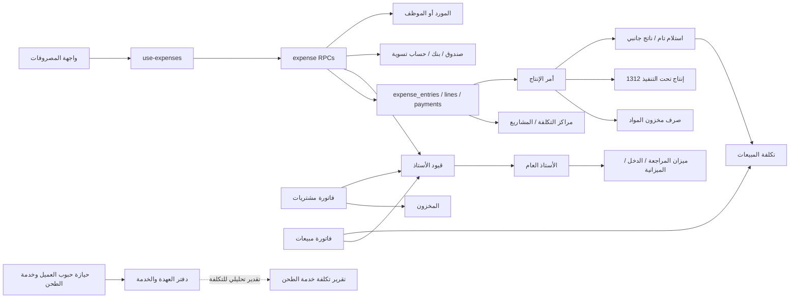

# تقرير التدقيق الشامل لمنظومة المصروفات وتكاليف الإنتاج

**النظام:** Market Hub / Vortex ERP  
**تاريخ المراجعة:** 4 نوفمبر 2026  
**نوع المراجعة:** قراءة ساكنة للكود ومخططات الترحيلات، وتتبع لمسارات الواجهة والخدمات وقاعدة البيانات  
**الحالة:** تقرير تدقيق؛ لا يتضمن إصلاحات أو تغييرات تشغيلية

> **خلاصة تنفيذية:** يحتوي المستودع على منظومة مصروفات فعلية بدورة اعتماد واستحقاق وسداد وعكس، وعلى مسار تصنيع مملوك للشركة يستهلك المخزون ويستفيد من حساب إنتاج تحت التنفيذ ويحمّل مصروفات مؤهلة ويستقبل منتجات تامة ونواتج جانبية. كما أن المشتريات والمبيعات وبعض تقارير القوائم المالية موصولة بدفتر الأستاذ. لكن توجد فجوات مؤثرة: إمكانية ترحيل مسودة بواسطة مستخدم ذي صلاحية اعتماد دون المرور بقرار الاعتماد، عدم ربط مصروف المورد بدفتر المورد الفرعي، عدم رسملة الضريبة غير القابلة للاسترداد عند تحميل المصروف على الإنتاج، ومسار تصنيع أقدم لا يطبع وحدات القياس في منطق الهدر. المرفقات ظاهرة كواجهة فقط، ولا يظهر دعم للمصروفات المتكررة.

## 1. الملخص التنفيذي

| المحور | النتيجة المختصرة |
|---|---|
| المصروفات | دورة مستندية حقيقية: إنشاء وتعديل وإرسال واعتماد ورفض وترحيل واستحقاق وسداد جزئي/كامل وإلغاء وعكس. ليست مجرد واجهة. |
| القيد المحاسبي للمصروف | الترحيل يثبت المصروف والضريبة المستردة والالتزام؛ الدفع ينشئ قيد تسوية منفصلاً. العكس يستخدم قيداً عكسياً. |
| التصنيع الحديث | أمر إنتاج مملوك للشركة، صرف مواد، WIP، رسملة مصروفات مختارة، مخرجات متعددة، توزيع تكلفة، فاقد طبيعي وغير طبيعي، واستلام مخزني؛ العملية الذرية موصوفة في دالة واحدة. |
| الطحن/القمح | يوجد مسار أقدم `smart_manufacture` مختلف عن أمر الإنتاج الحديث. الدالة موجودة لكن لم أعثر على مستدعٍ لها داخل الواجهة/المصدر الحالي؛ لذلك لا أعدّها دورة واجهة مثبتة. |
| التكامل المالي | فواتير الشراء والبيع، تكلفة المبيعات، بعض المرتجعات وتسويات المخزون، ودفتر الأستاذ والقوائم لها وظائف ترحيل فعلية. واجهات ميزان المراجعة وقائمة الدخل والميزانية تتصل الآن بمصادر الأستاذ، خلافاً لما قد توحي به بعض الملاحظات الأقدم في `docs`. |
| المخاطر الأعلى | تجاوز اعتماد المسودة، عدم اتساق دفتر المورد الفرعي مع مصروفات الموردين، استبعاد ضريبة غير مستردة من تكلفة الإنتاج، ومخاطر وحدات القياس في مسار الطحن الأقدم. |
| P0 مثبت | لم يثبت عيب P0 مؤكد من الكود الذي أمكن تتبعه. هذا لا يثبت سلامة بيئة الإنتاج أو الأرصدة الفعلية. |

### النسب المختصرة

الأرقام التالية **درجات تغطية ساكنة للكود** وليست شهادة تدقيق على قاعدة بيانات عاملة. قُسم كل محور إلى خمس حزم تحقق متساوية؛ الحزمة المثبتة بالكامل تساوي 20 نقطة، والنقص المؤكد لا يُحسب نجاحاً. أُخرج ما لا يمكن حسمه من مقام الدرجة ووُسم «غير قابل للتحقق» بدلاً من افتراض نجاحه أو فشله. تفاصيل الحزم في قسم التقييم.

| المؤشر | النتيجة | التفسير |
|---|---:|---|
| التوافق التقني والمحاسبي الإجمالي | **78.3%** | متوسط درجات المحاور الاثني عشر؛ قراءة للكود فقط. |
| اكتمال الوظائف | **76.0%** | متوسط محاور اكتمال المصروفات والاعتماد والإنتاج والتكلفة والنواتج والهدر. |
| صحة المعالجة المحاسبية | **76.7%** | متوسط محاور صحة القيود وتكلفة المنتجات والهدر ودفتر الأستاذ والتقارير. |
| التكامل بين الوحدات | **80.0%** | متوسط محاور التكامل مع المشتريات والمبيعات والأستاذ والصلاحيات وسلامة البيانات. |

لا تعني النسب أن الوظائف اختُبرت أثناء التشغيل، ولا أن كل القيود الموجودة في قاعدة بيانات فعلية صحيحة. لم يُتصل بقاعدة بيانات ولم تُنفذ اختبارات أو migrations.

## 2. النطاق والمنهجية والقيود

### النطاق

راجعت مسارات الواجهة والخطافات وخدمات البيانات وتعريفات الجداول والدوال في `src/` و`supabase/migrations/` ذات الصلة بالمصروفات والتصنيع والمشتريات والمبيعات والمخزون والقيود والتقارير، إضافة إلى سكربت اختبار دورة الإنتاج بغرض فهم نطاقه فقط.

### المنهج

1. تتبع نقطة دخول الواجهة إلى hook/service ثم RPC أو استعلام Supabase ثم تعريف الدالة/الجداول في SQL.
2. عند وجود عدة تعريفات للدالة، قرأت التعديلات اللاحقة ذات الصلة، ولم أتعامل مع أول migration كأنه التنفيذ النهائي.
3. ميزت بين: **حقيقة مصدرية** (تعريف واضح في الكود)، **تقييم محاسبي** (مقارنة ذلك التعريف بالمبدأ)، و**نقطة تحتاج اختباراً** (تعتمد على نشر migration أو بيانات/إعدادات فعلية).
4. لم أشغّل سكربت `test:company-production-cycle`: فهو يتصل بـ PostgreSQL على `localhost:5432` وينشئ مستخدمين وأصنافاً ومشتريات ومصروفات اختبارية داخل معاملة ثم يتراجع عنها. تشغيله يلمس قاعدة بيانات، وهو مستبعد حسب طلب المستخدم. لم تُشغّل اختبارات أخرى أو التطبيق.
5. لم أقرأ أو أعدّل قاعدة بيانات، ولم أنفذ migration أو استعلام كتابة. لا توجد بيانات أعمال أو بيئة تشغيلية متاحة لإثبات الأرصدة أو migrations المطبقة فعلياً.

### قيد مهم عن migrations

وجود ملف migration في المستودع لا يثبت تطبيقه على كل بيئة. التقرير يصف **الكود الحالي كما هو مخزن**. خصوصاً، لا يمكن التحقق من إعدادات الحسابات الفعلية، أو صلاحيات/RLS الفعلية، أو جودة الأرصدة التاريخية، أو اكتمال نشر آخر migrations.

## 3. خريطة معمارية للوحدات المرتبطة

**التمييز التشغيلي:** أمر الإنتاج الحديث يتعامل مع مخزون الشركة المملوك، بينما الطحن لحساب عميل له دفتر عهدة منفصل؛ تقدير تكلفة خدمة الطحن في `9914_expense_service_costing_and_milling_estimates.sql` تحليلي ولا يرحّل قيداً ولا يحول حبوب العميل إلى مخزون الشركة.

## 4. دورة المصروفات كما هي في الكود

### المستند والبيانات

- الجداول الأساسية هي `expense_entries`, `expense_lines`, `expense_payments`, `expense_approvals`, `expense_attachments`, والتصنيفات ومراكز التكلفة والمشاريع. رأس المصروف يتضمن المورد/الموظف/المستودع/مركز التكلفة/المشروع والتواريخ والحالة والإجمالي والمدفوع والمتبقي. راجع `supabase/migrations/09_expenses.sql:11-180`.
- `create_expense_v2` يتحقق من الدافع وتاريخ الاستحقاق ورقم فاتورة المورد، ويدعم مفتاح عدم التكرار، ثم يكتب البنود والإجمالي. تحديث المستند يمر عبر `update_expense_v2` مع نسخة متوقعة لتفادي الكتابة فوق تعديل متزامن. `supabase/migrations/9913_expense_accounting_lifecycle_integrity.sql:453-635`.
- البنود تسجل صافي/ضريبة/إجمالي وتدعم تصنيفاً ومركز تكلفة ومشروعاً لكل سطر. يحسب الخادم القيم الضريبية بدلاً من الوثوق بحساب العميل. `supabase/migrations/09_expenses.sql:104-122, 1060-1134`.
- أنواع `DIRECT` و`ADVANCE` معرفة، لكن ترحيل `ADVANCE` مرفوض صراحة ويطلب مستند سلفة وتسوية منفصلين. لا أعتبر وجود قيمة النوع دعماً لدورة سلفة مكتملة. `supabase/migrations/9913_expense_accounting_lifecycle_integrity.sql:750-758`.

### الاعتماد والصلاحيات

- حالات المسار تشمل المسودة، المرسلة، المعتمدة/المرفوضة، المرحلة، الجزئية، المدفوعة، المغلقة، الملغاة والمعكوسة. يوجد سجل إجراءات متسلسل، وقواعد رتبة اعتماد حسب مبلغ المصروف، وفحص صلاحية ونسخة المستند. `supabase/migrations/09_expenses.sql:141-151, 737-780`; `supabase/migrations/9913_expense_accounting_lifecycle_integrity.sql:11-90, 638-700`.
- تمنع `decide_expense` منشئ المصروف من اعتماد مصروفه، مع استثناء موثق للمالك. الرفض يتطلب سبباً.
- **استثناء اعتماد مؤكد:** `post_expense` يقبل حالتي `APPROVED` و`DRAFT`، ويشترط في المسودة أن يملك الفاعل صلاحية الاعتماد؛ لكنه لا يشترط أن تمر المسودة بحالة `SUBMITTED` وقرار `decide_expense` ولا يفحص منشئها كما يفعل قرار الاعتماد. بالتالي يستطيع صاحب الصلاحية العالية ترحيل مسودته مباشرة من دون سجل قرار اعتماد. الواجهة تستخدم ذلك عمداً لسند الصرف النقدي الفوري للمالك/المدير (`src/components/expenses/expense-form.tsx:399-499`)، لذلك فالمشكلة هي استثناء فصل مهام يجب أن توافق عليه سياسة الشركة، وليست ادعاءً بأن الواجهة تتجاوزه خفية. شرط الخادم قائم في `supabase/migrations/9913_expense_accounting_lifecycle_integrity.sql:738-755`.

### الاستحقاق والسداد والقيود

عند الترحيل ينشئ النظام قيداً للاستحقاق. مثال بنيوي لمصروف 100 (من دون ضريبة):

| المرحلة | مدين | دائن |
|---|---|---|
| إثبات المصروف | حساب المصروف المرتبط بالتصنيف 100 | التزام المورد/الموظف/غيره 100 |
| سداد 40 لاحقاً | حساب الالتزام 40 | حساب الصندوق/البنك المختار 40 |
| المتبقي | لا قيد إضافي | يبقى التزاماً بمبلغ 60 حتى السداد |

هذه أمثلة تفسيرية للمبالغ وليست قيوداً جرى تنفيذها. الكود يرفض ترحيل فئة بلا حساب مصروف صالح، ويربط دور حساب الالتزام بحساب فعال قابل للترحيل، ويفصل ضريبة المدخلات القابلة للاسترداد عن المصروف. `supabase/migrations/9913_expense_accounting_lifecycle_integrity.sql:758-828`.

- الدفع يستخدم حساب الصندوق أو البنك أو الحساب النشط المختار، ثم ينشئ `expense_payments` وقيداً من نوع `expense_payment`. المبلغ يجب أن يكون موجباً وألا يتجاوز المتبقي. مفتاح الدفع idempotent ويُرفض إعادة استخدامه لمصروف أو مبلغ مختلف. `supabase/migrations/9913_expense_accounting_lifecycle_integrity.sql:831-953`; فهرس فريد في `supabase/migrations/09_expenses.sql:240`.
- `p_pay_now=true` يثبت الاستحقاق ثم يدعو نفس RPC الخاص بالسداد داخل العملية؛ لذا الدفع عند التسجيل ليس قيداً نقدياً مكرراً بديلاً عن قيد المصروف، بل قيد استحقاق ثم قيد تسوية. `supabase/migrations/9913_expense_accounting_lifecycle_integrity.sql:815-828`.
- الحساب المقابل للالتزام يختار حسب نوع الدافع. لكن بنود القيد لا تحمل `partner_type`/`partner_id` في المسار الحالي للمصروفات. دفتر المورد الفرعي، بخلاف ذلك، يُغذّى من فواتير الشراء والمرتجعات فقط كما يظهر في `28_accounting_phase4_supplier_ledger.sql:312-402`. النتيجة أن مصروفاً مسجلاً على مورد قد يغيّر حساب الالتزامات العام دون حركة مقابلة في كشف المورد؛ انظر P1.

### الإلغاء والعكس والتكرار

- الإلغاء مخصص للمستندات غير المرحلة؛ المستند المرحلة يُعكس ولا يُحذف مادياً. `cancel_expense` في `09_expenses.sql:264-365`.
- `reverse_expense` يرفض العكس قبل عكس الدفعات، يعكس قيد المصروف الأصلي في دفتر الأستاذ، وينشئ مستنداً عكسياً مرتبطاً مع أسطر مرآة. `21_accounting_phase1b_returns_expenses_adjustments.sql:456-562`.
- عكس دفعة المصروف ينشئ صف عكس ويعكس قيد الدفعة. `78_expense_posting_payment_integrity.sql:189-220`.
- التكرار محمي في واجهة الإنشاء: النموذج يولد مفتاح طلب ويرسله، والخادم يقفل على المفتاح ويعيد المستند السابق عند تكرار الطلب؛ كما يوجد مفتاح فريد لفاتورة المورد ومفتاح فريد/idempotency للدفعات. `src/components/expenses/expense-form.tsx:97,150,209,465,499`; `supabase/migrations/9913_expense_accounting_lifecycle_integrity.sql:27-36, 471-559`. مع ذلك، `p_idempotency_key` اختياري على مستوى RPC؛ أي مستدعٍ آخر يحذفه لا يحصل على حماية الطلب نفسها. ولا يوجد فحص تشابه عام للمصروفات اليدوية التي لا تحمل فاتورة مورد.

### مرفقات وتقارير وتصنيفات

- جداول المرفقات ومسارات التخزين موجودة، لكن تبويب الملفات في لوحة التفاصيل يعلن صراحة أن تفعيل المرفقات مؤجل وأن مخزن الملفات الخاص غير موصول. إذن هذه واجهة غير مكتملة وليست وظيفة رفع/عرض مثبتة. `09_expenses.sql:153-162`; `src/components/expenses/expense-detail-drawer.tsx:438-453`.
- توجد لوحة ملخص، أرشيف، اعتماد، إعدادات، تقرير تصنيفات ومراكز تكلفة. الخطاف يستهلك RPCs `expense_summary`, `list_expenses`, `expense_detail`, `expense_report`; `src/hooks/use-expenses.ts:100-290`.
- لم أعثر على جدول أو RPC أو حقل جدولة للمصروفات المتكررة في المخطط المفحوص. لا يوجد سند لاعتبارها مدعومة.
- رأس المصروف لا يتضمن `branch_id` صريحاً؛ يرتبط بمستودع ومركز تكلفة ومشروع. لا يمكن استنتاج أن المستودع يمثل الفرع في جميع الشركات أو الفروع.

## 5. دورة الإنتاج والتصنيع الحالية

### المسار الحديث: أمر إنتاج مملوك للشركة

واجهة `/milling/manufacture` تستخدم `createAndPostProductionOrder` في `src/routes/_app.milling.manufacture.tsx:70-275` و`src/lib/production/production-orders.ts:82-244`. الخادم يستدعي `create_and_post_production_order`, والذي ينشئ الأمر ويكمله ضمن RPC واحد. الجداول هي `production_orders`, `production_order_materials`, `production_order_batch_allocations`, `production_order_cost_allocations`, `production_order_outputs`, `production_order_losses`. `9906_company_production_orders_and_costing.sql:13-119, 793-810`.

| خطوة | التنفيذ الفعلي | الأثر |
|---|---|---|
| الصرف | يتحقق الخادم من أن المادة مملوكة ومخزنية، يطبع وحدات المنتج إلى وحدة الأساس، يتحقق من الدفعات/الرصيد، ثم يسجل حركة صرف. | تخفيض مخزون المواد وإثبات تكلفتها إلى WIP `1312` مقابل حساب مخزون المادة. `supabase/migrations/9906_company_production_orders_and_costing.sql:358-555`. |
| تكاليف التحويل | يقبل أسطر مصروفات مرحلة، من تصنيف مؤهل، ومركز تكلفة مطابق وتاريخ لا يتجاوز تاريخ الإنتاج، ويمنع تحميل ما يتجاوز صافي السطر المتاح. | قيد Dr `1312` / Cr حساب المصروف، مع سجل تخصيص قابل للتتبع. `supabase/migrations/9906_company_production_orders_and_costing.sql:558-612`. |
| الأجور والطاقة والصيانة | لا توجد في مسار الأمر ساعات عمل أو معدلات أجور أو محركات توزيع آلية مستقلة. يمكن تحميل مصروفات مرحلة مؤهلة يدوياً وفق أساس توزيع يكتبه المستخدم. | موجود جزئياً كإعادة تصنيف للمصروف، وليس نظام أجور/تكاليف صناعية بمحددات قياس كاملة. |
| المخرجات | يسمح بمنتجات تامة ونواتج جانبية مخزنية قابلة للبيع؛ يدعم وحدات ودفعات وتواريخ صلاحية مناسبة. | استلام مخزني عبر محرك تقييم المخزون، ثم مدين حساب المخزون التام/الناتج الجانبي. `supabase/migrations/9906_company_production_orders_and_costing.sql:630-760`. |
| توزيع التكلفة | التكلفة المشتركة توزع حسب قيمة بيع تقديرية لوحدة الأساس عند تعدد المخرجات؛ يجب إدخال قيمة موجبة لكل منتج. | ينتج تكلفة وحدة لكل ناتج؛ طريقة مقبولة لتكاليف مشتركة عندما لا يمكن الفصل المباشر، بشرط اعتماد أساس القيمة وتحديثه. `supabase/migrations/9906_company_production_orders_and_costing.sql:696-717`. |
| الفاقد | يسجل الفاقد الطبيعي وغير الطبيعي بوحدات كتلة؛ عند توافر تحويلات الكتلة يفرض ميزان كتلة. الطبيعي يبقى ضمن تكلفة الناتج، وغير الطبيعي يحمّل على `5911`. | المعالجة من حيث المبدأ منسجمة مع IAS 2: الطبيعي تكلفة إنتاج، وغير الطبيعي مصروف خسارة. `supabase/migrations/9906_company_production_orders_and_costing.sql:619-690, 764-779`. |
| الإقفال | يرحّل استقبال الناتج ويقفل WIP مقابل المخزون وخسارة الفاقد غير الطبيعي وفروقات التقريب. | لا يبقى WIP مفتوحاً بعد RPC الناجح. `supabase/migrations/9906_company_production_orders_and_costing.sql:764-810`. |
| العكس | يسمح `reverse_production_order` بعكس أمر مرحلة عندما لا تكون الحركات المخزنية قد تأثرت لاحقاً، ويعكس القيود المرتبطة. | عكس مضبوط ومشروط؛ لا يوفر تحريراً مفتوحاً لأمر تم استهلاك ناتجه. `9908_reverse_untouched_production_order.sql:22-242`. |

**حكم WIP:** الحساب موجود وتظهر له قيود تحويل فعلية، لكن دورة الأمر ذرية وتكمل الإنتاج في معاملة واحدة؛ لم يثبت وجود مرحلة تشغيل WIP طويلة العمر، أو إدخال جزئي/متعدد الورديات، أو قياس ساعات ومراحل. إذن WIP مدعوم محاسبياً كمرحلة ترحيل وسيطة، وليس كنظام متابعة تشغيل مستقل.

**ملاحظة ضريبية مؤكدة:** ترحيل المصروف غير القابل للاسترداد يحمّل الضريبة ضمن مصروف الفئة، لكن تخصيص الإنتاج يحدد المتاح بـ `expense_line.net_amount - allocated_amount` ويعيد تصنيف صافي السطر فقط. لذلك لا تنتقل ضريبة غير قابلة للاسترداد على مصروف إنتاج مؤهل إلى تكلفة WIP/المنتج، وتظل مصروفاً في الفترة. إذا كانت الضريبة مرتبطة مباشرة بالإنتاج وغير قابلة للاسترداد، فهذا يخالف قياس تكلفة المخزون في IAS 2. `supabase/migrations/9906_company_production_orders_and_costing.sql:588-608`; طريقة ترحيل الضريبة في `supabase/migrations/9913_expense_accounting_lifecycle_integrity.sql:785-809`.

### مسار الطحن الأقدم

تعريف `smart_manufacture` في `33_milling_smart_manufacture_accounting.sql:26-233` يخص قمحاً خاماً ومخرجات `FINISHED_GOOD` و`BY_PRODUCT`، ويحسب تكلفة القمح من طبقات التكلفة/تكلفة الصنف، ثم يوزع تكلفة صافية على النواتج وفق قيمة البيع، ويحمّل فرق القمح والمخرجات على `5921` ويثبت المخزون في `1311/1313/1314`. لكنه مختلف عن أوامر الإنتاج الحديثة.

- يوازن كميات القمح والمخرجات بجمع قيم `qty` نفسها، ويحسب الفاقد من `grain_qty - total_output_qty` دون تحويل وحدة لكل صنف. لا توجد في توقيع RPC وحدات UOM للمدخل والمخرجات. إذا اختلفت وحدة القمح عن وحدة الدقيق/النخالة (مثلاً كيلو مقابل كيس)، فالمقارنة وتكلفة الفاقد غير صالحتين. هذه **مشكلة مؤكدة في منطق الدالة**، لكن الأثر التشغيلي الحالي غير قابل للتحقق.
- يسجل حركات المخزون والقيد تحت `source_id = _grain_item_id` (مع رقم تشغيل ضمن النص/سجل التدقيق)، لا معرّف تشغيل فريد موحد. هذا يضعف مطابقة التشغيلات ويجعل إعادة المحاولة الآمنة غير مثبتة.
- وجدت الدالة المغلفة `smartManufacture` في `src/lib/milling/custody.ts:1490-1515`، لكن لا يوجد استدعاء لها داخل `src/` وفق البحث. لذلك لم أعتبرها المسار النشط في الواجهة الحالية. المسار الظاهر للإنتاج هو أمر الإنتاج الحديث. لا يمكن استبعاد مستدعٍ خارجي للـ RPC.
- ناتج الطحن لحساب العميل له مسارات عهدة منفصلة؛ لا ينبغي إدخاله كمخزون مملوك للشركة. تقدير تكلفة الخدمة في `9914_expense_service_costing_and_milling_estimates.sql:1-220` تقديري وتقارير الخدمة لا ترحّل قيد إنتاج.

## 6. التكامل بين الوحدات

| الوحدة/التدفق | ما يثبته الكود | التقييم |
|---|---|---|
| المشتريات ← المخزون والأستاذ | `post_purchase_invoice` يرحل الأصول المخزنية حسب فئة الصنف، ضريبة المدخلات، المورد/النقد، مع فحص منع قيد فاتورة سبق ترحيلها. `65_split_purchases_and_milling.sql:128-292`. | ربط فعلي. يتطلب اختبار إعداد الحسابات وقيم الضرائب في البيئة. |
| فواتير الشراء ← دفتر المورد | مشغل `supplier_ledger` ينشئ استحقاقاً وسداداً أولياً للفاتورة، ومشغل مرتجع الشراء يسجل تخفيض الالتزام. `28_accounting_phase4_supplier_ledger.sql:312-402`. | تكامل فعلي لفواتير الشراء/مرتجعاتها. |
| مصروف المورد ← دفتر الأستاذ/المورد | مصروف المورد يرحل إلى حساب التزام عام، لكن قيد المصروف/السداد لا يحمل هوية شريك؛ لا يوجد مشغل `supplier_ledger` للمصروف. | فجوة مطابقة بين حساب الأستاذ وكشف المورد. |
| المخزون ← التصنيع | الصرف والاستلام يمران عبر `post_stock_delta` ومحرك تقييم المخزون، مع حفظ ربط حركة المواد والمخرجات بأمر الإنتاج. | ربط فعلي داخل التصنيع الحديث. |
| المبيعات ← الإيراد/التحصيل/الذمم | `post_sales_invoice` يرحل بنود الإيراد والضرائب والتحصيل المجزأ والمتبقي المستحق، ويمنع القيد المكرر للفاتورة. `64_split_sales_ledger_posting.sql:8-225`. | ربط فعلي. |
| المبيعات ← تكلفة البضاعة المباعة | تؤخذ التكلفة من حركات المخزون، ويُرحل Dr `5111` مقابل مخزون الفئة (تام/خام/ناتج جانبي/تعبئة) عبر `post_sales_invoice_cogs`. `supabase/migrations/9906_company_production_orders_and_costing.sql:839-877`. | منهجياً جيد لأن التكلفة من حركة الصرف، لا من سعر بيع مفترض. |
| المرتجعات والتسويات | دوال مرتجعات الشراء/المبيعات وتسويات المخزون موجودة ولها قيود عكسية/فروق حسب النوع. `21_accounting_phase1b_returns_expenses_adjustments.sql:19-197, 567-735`. | موجود؛ لم تُنفذ معاملات فعلية أو اختبار مطابقة أرصدة. |
| الصندوق والبنك وطرق الدفع | مصروف الدفع يختار حساباً فعلياً للصندوق/البنك أو حساب تسوية ويشترط أن يكون أصلاً فعالاً قابلاً للترحيل؛ الدفع المنفصل يخصم النقدية ويسوي الالتزام. | فعلي على مستوى RPC؛ صحة ارتباطات الحساب في البيئة غير متحققة. |
| الحسابات والقوائم المالية | دليل حسابات وقيود مزدوجة في `08_accounting_ledger.sql:27-60,127-240`. واجهة اليومية تقرأ القيود، ميزان المراجعة من العرض، وقائمة الدخل من سطور الأستاذ. `src/routes/_app.daily-journal.tsx:60-145`, `_app.trial-balance.tsx:55-80`, `_app.income-statement.tsx:65-132`, `_app.balance-sheet.tsx:75-100`. | الربط موجود حالياً، وليس واجهة شكلية أو حساباً من بيانات المبيعات فقط. |
| مراكز التكلفة/الفروع | المصروفات وأوامر الإنتاج تحمل مركز تكلفة، لكن `journal_lines` لا يحمل بعداً لمركز التكلفة أو الفرع، ورأس المصروف لا يحتوي `branch_id`. | تقارير تشغيلية حسب المركز موجودة، لكن تحليل الأستاذ المالي حسب الفرع/المركز غير مثبت من المخطط الحالي. |
| الأصول الثابتة IAS 16 | يوجد جدول أصول، تفعيل، سجل إهلاك ومنع تكرار حسب تاريخ الأصل، وقيد إهلاك `5611/1491` في `25_accounting_phase4_fixed_assets.sql:1-220`. | وظيفة منفصلة حقيقية؛ لم أجد في مسار المصروفات ربطاً مباشراً بتحويل بند إلى أصل ثابت. لا أستنتج من ذلك أن كل مسارات الشراء مستحيلة، بل يلزم توثيق/اختبار المسار. |
| الصلاحيات والتدقيق | دوال المصروفات تتحقق من صلاحيات الخادم وتكتب سجل الإجراءات؛ توجد سياسات/منح للـ RPCs وسجل تدقيق للإعدادات. | حماية فعلية في الكود، مع استثناء تجاوز الاعتماد المشار إليه. لا يمكن إثبات حالة سياسات قاعدة البيانات المنشورة. |

### أمثلة القيود المحاسبية

الأرقام أدناه أمثلة رمزية لشرح القواعد، وليست ناتجة عن تشغيل فعلي.

| العملية | القيد الذي يولده/يتطلبه التصميم |
|---|---|
| شراء خامات على الحساب | مدين مخزون خام `1311` (وقابل للاسترداد `1316` إن وجد)؛ دائن مورد `2111`. |
| صرف خام للتصنيع | مدين إنتاج تحت التنفيذ `1312`؛ دائن مخزون المادة وفق فئتها/تكلفتها الفعلية. |
| تحميل أجور/طاقة مؤهلة مسجلة كمصروف | مدين `1312`؛ دائن حساب المصروف؛ التحميل الحالي صافي البند فقط. |
| استلام دقيق/نخالة وإقفال WIP | مدين مخزون تام `1313` وناتج جانبي `1314`؛ مدين فاقد غير طبيعي `5911` عند ثبوته؛ دائن `1312`. |
| بيع منتج | مدين نقد/ذمم بحسب السداد؛ دائن الإيراد/الضريبة؛ ثم مدين تكلفة المبيعات `5111` ودائن حساب المخزون المناسب. |
| فاتورة صيانة مستحقة ثم سداد لاحق | عند الترحيل: مدين مصروف الصيانة، دائن التزام المورد؛ عند الدفع: مدين الالتزام، دائن الصندوق/البنك. |
| مصروف مدفوع جزئياً | القيد الأول بكامل المصروف مقابل الالتزام؛ قيد لكل دفعة من الالتزام إلى النقدية؛ يبقى الفرق دائن التزام. |
| عكس مصروف غير مدفوع | عكس قيد الأستاذ الأصلي ثم مستند عكسي مرتبط؛ إذا سبق دفعه يجب عكس الدفعة أولاً. |

## 7. تتبع السيناريوهات المطلوبة

| # | السيناريو ونقطة البدء | الجداول/الوظائف والأثر | النتيجة |
|---:|---|---|---|
| 1 | شراء مواد خام ودخولها المخزون: واجهة المشتريات → `post_purchase_invoice` | `purchase_invoices/items`, `inventory`, `stock_movements`, `journal_entries/lines`, `supplier_ledger`; أصل مخزون/ضريبة مقابل مورد ونقد بحسب السداد. | **مدعوم في الكود**؛ لم يختبر بقاعدة فعلية. |
| 2 | صرف خام لعملية إنتاج: `/milling/manufacture` → أمر الشركة | `production_orders/materials/batch_allocations`, `inventory`, `stock_movements`; دالة الإكمال ترحل مخزون المادة إلى `1312`. | **مدعوم في المسار الحديث**؛ يراعي UOM والدفعات. |
| 3 | أجور وتكاليف تشغيل الإنتاج | إنشاء مصروف اعتيادي، اعتماده وترحيله، ثم اختيار سطره المؤهل في الأمر؛ `expense_lines`, `production_order_cost_allocations`, قيد إعادة تصنيف. لا يوجد جدول ساعات/أجور/محدد حمل آلي. | **جزئي**؛ التكلفة ممكنة كتحميل يدوي لمصروف مسجل، لا كمسير أجور أو نظام تكاليف تشغيل كامل. |
| 4 | إنتاج دقيق ونخالة من الخام | الأمر يقبل مخرجات متعددة `FINISHED_GOOD` و`BY_PRODUCT` ويوزع التكلفة بوزن قيمة البيع لكل وحدة أساس. | **مدعوم في مسار أمر الإنتاج**. أما `smart_manufacture` الأقدم فموجود بلا استدعاء UI مثبت ومنطق وحداته أضعف. |
| 5 | إدخال المنتج النهائي للمخزون | استلام لكل output عبر محرك تقييم المخزون وإنشاء حركة وباتش عند الحاجة، ثم قيد المخزون مقابل إقفال WIP. | **مدعوم**؛ وحدات السيريال غير مدعومة في أمر الإنتاج صراحة. |
| 6 | بيع المنتج وCOGS | إنشاء فاتورة وترحيل إيراد/تحصيل/ذمم؛ استخراج التكلفة من حركات صرف البيع وتسجيل `5111` مقابل المخزون. | **مدعوم في الكود**؛ اختبار البيع بعد الإنتاج لم يُشغّل. |
| 7 | فاتورة صيانة مستحقة ثم سداد لاحقاً | مصروف بمورد وتاريخ استحقاق → اعتماد وترحيل → دفعة لاحقة؛ `expense_entries/payments` وقيدان منفصلان. | **مدعوم** في دفتر الأستاذ العام؛ **تكامل كشف المورد الفرعي غير مدعوم** للمصروف. |
| 8 | مصروف مباشر من الصندوق | `post_expense(p_pay_now=true)` يسجل الاستحقاق ثم يستدعي دفع المصروف مع حساب الصندوق المختار. | **مدعوم**؛ قيدان محاسبيان داخل المسار، لا قيد مصروف مكرر من الدفع وحده. |
| 9 | مصروف مدفوع جزئياً | تسجيل الترحيل بكامل الالتزام ثم `record_expense_payment` بمبلغ لا يتجاوز الباقي؛ حالة جزئية/رصيد متبقٍ. | **مدعوم**؛ منع تجاوز الباقي ومفتاح دفع idempotent موجودان. |
| 10 | مصروف إنتاج مربوط بأمر | لا ينشأ كنوع إنتاج منفصل: يسجل أولاً كمصروف، ثم يخصص بند مؤهل لمركز الإنتاج/الأمر مع مبلغ وأساس. | **مدعوم جزئياً وبطريقة إعادة تصنيف**؛ ضريبة غير مستردة لا تدخل التخصيص. |
| 11 | إلغاء أو عكس قيد سابق | المسودة/غير المرحلة تلغى؛ المصروف المرحلة يعكس قيده؛ دفعاته تعكس أولاً؛ أمر الإنتاج يعكس فقط إذا لم تتأثر حركاته لاحقاً. | **مدعوم بقيود تحفظية**؛ لا حذف فعلي للمستند المرحلة. |
| 12 | تلف/هدر الإنتاج | أمر الإنتاج يقبل خسارة طبيعية وغير طبيعية بوحدة كتلة وسبب؛ الطبيعي ضمن تكلفة المخرجات، وغير الطبيعي إلى `5911`. | **مدعوم في الإنتاج الحديث**. معالجة تلف منتج نهائي بعد الاستلام تتم كتسوية مخزون لا كتصحيح أمر تلقائي؛ أثرها المحاسبي يحتاج ربطاً وتحققاً. |

### ما لم يُختبر فعلياً

لم يتم شراء أو صرف أو إنتاج أو بيع أي شيء فعلياً في قاعدة البيانات. وجود سكربت قبول آلي محلي يغطي شراء خام، مصروفاً مؤهلاً، إنتاج مخرجين وفاقداً ثم البيع/القيود دليل على **نية اختبارية مكتوبة** فقط، لا على نجاح التنفيذ؛ `scripts/check-company-production-cycle.mjs:1-28, 163-250, 588-743`. لم يُشغّل احتراماً لمنع لمس قاعدة البيانات.

## 8. التقييم الرقمي للمحاور

كل محور مقسوم إلى خمس حزم أساسية متساوية الوزن (20 نقطة). الحزمة لا تحسب نجاحاً إلا إذا كان لها تنفيذ خلفي واضح في المسار الجاري. لا يساوي هذا تدقيقاً تشغيلياً؛ درجة المحور تقيس «نسبة الحزم المثبتة من الحزم القابلة للتقييم». بنود «غير قابل للتحقق» موضحة في الملاحظات ولم تُسجل كنجاح.

| # | المحور | الدرجة | الحزم التي تثبت الدرجة / أبرز ما لم يثبت |
|---:|---|---:|---|
| 1 | اكتمال منظومة المصروفات | **80/100** | الإنشاء/التعديل/الإلغاء/العكس؛ تصنيف وربط مركز/مشروع/مورد/موظف؛ اعتماد؛ الترحيل والسداد والتقارير موجودة. المرفقات غير مفعلة والمتكرر غير مثبت والفرع الصريح غير موجود. |
| 2 | صحة تسجيل المصروفات محاسبياً | **80/100** | إثبات الاستحقاق؛ حساب مصروف حسب التصنيف؛ ضريبة مستردة/غير مستردة في المصروف؛ تسوية مستقلة وعكس. لم يثبت ترابط حساب المورد الفرعي للمصروف. |
| 3 | دورة الاعتماد والسداد | **80/100** | رتبة اعتماد ومبرر رفض؛ فحص منشئ الاعتماد؛ فصل الدفع عن الإثبات؛ دفعات جزئية ومفتاح عدم تكرار؛ تسوية من حساب نقدي/بنكي. يوجد تجاوز لمسودة مباشرة لمن يملك الاعتماد، واستثناء مالك ذاتي. |
| 4 | إدارة تكاليف الإنتاج | **80/100** | أمر إنتاج؛ صرف مواد ودفعات؛ WIP؛ تحميل مصروفات مؤهلة؛ استلام وعكس مشروط. لا توجد ساعات عمل/معدلات أجور أو محركات تحميل صناعي مستقلة. |
| 5 | احتساب تكلفة المنتجات | **80/100** | تكاليف المواد من محرك المخزون؛ تكلفة تحويل؛ توزيع مخرجات مشتركة؛ تكلفة وحدة واستلام مخزني. ضريبة غير مستردة مرتبطة بالإنتاج لا ترسمل في مسار التحميل. |
| 6 | المنتجات الثانوية والهدر | **60/100** | النواتج الجانبية منفصلة ومخزنية؛ التوزيع على المخرجات؛ طبيعي/غير طبيعي وميزان كتلة في المسار الحديث. المسار الأقدم لا يطبع وحدات المدخل/المخرجات ولا يميز الطبيعي عن غير الطبيعي. |
| 7 | التكامل مع المخزون والمشتريات | **80/100** | شراء وترحيل واستلام ودفتر مورد للفواتير؛ صرف/استلام الإنتاج؛ المرتجعات والتسويات لها مسارات. ربط مصروف المورد بدفتره الفرعي ناقص. |
| 8 | التكامل مع المبيعات وCOGS | **80/100** | إيراد وضريبة وتحصيل وذمم؛ COGS من حركة المخزون؛ حسابات حسب فئة المخزون؛ حواجز تكرار ترحيل الفاتورة. لم يختبر فعلياً بعد إنتاج/مرتجع. |
| 9 | التكامل مع القيود المحاسبية | **80/100** | دفتر مزدوج؛ قيود مصدرية؛ عكس؛ ترحيلات مصروف/شراء/بيع/إنتاج/تسوية. الربط الفرعي للمورد وأبعاد التكلفة غير كامل. |
| 10 | التقارير المالية | **80/100** | يومية وميزان مراجعة وقائمة دخل وميزانية من الأستاذ/عرضه؛ تقارير مصروفات مستقلة. التحليل المالي حسب الفرع/مركز التكلفة ومطابقة subledger غير مثبتة. |
| 11 | الصلاحيات وسجل التدقيق | **80/100** | فحوص خادم وأدوار، قواعد اعتماد، optimistic concurrency، سجل إجراءات/تدقيق، قيود عكس. يتبقى تجاوز الاعتماد من مسودة بصلاحية مرتفعة، ونشر RLS الفعلي غير قابل للتحقق. |
| 12 | سلامة البيانات ومنع التكرار | **80/100** | واجهة المصروفات ترسل مفتاح إنشاء، والدفعات والفواتير لها حواجز تكرار. المتبقي: مفتاح الإنشاء اختياري للمستدعين الآخرين، ولا يملك مسار الطحن الأقدم هوية تشغيل متينة/حماية إعادة محاولة مثبتة أو كاشف تكرار عام للمصروف اليدوي. |

### اشتقاق النسب الإجمالية

- **التوافق الإجمالي 78.3%** = مجموع درجات المحاور 940 ÷ 12 محوراً. المحاور متساوية الوزن لتجنب إعطاء وزن غير مستند إلى بيانات استخدام غير متاحة.
- **اكتمال الوظائف 76.0%** = متوسط المحاور 1 و3 و4 و5 و6: (80+80+80+80+60) ÷ 5.
- **الصحة المحاسبية 76.7%** = متوسط المحاور 2 و5 و6 و8 و9 و10: (80+80+60+80+80+80) ÷ 6.
- **التكامل 80.0%** = متوسط المحاور 7 و8 و9 و10 و11 و12: (80+80+80+80+80+80) ÷ 6.

هذه النسب مؤشر **تغطية مصدرية** للأجزاء القابلة للتقييم، وليست احتمال صحة أرصدة أو درجة امتثال معتمدة. لا تتوفر أدلة لتقييم الحالة الفعلية للبيانات أو إعدادات الحسابات أو migration المنفذة على قاعدة الإنتاج.

## 9. العيوب والمخاطر مرتبة حسب الأولوية

### P0 — أخطاء مؤكدة شديدة

**لا يوجد عيب P0 مؤكد أمكن إثباته من الكود المتتبع.** لا تُفهم هذه النتيجة كضمان عدم وجود تضخيم أرصدة؛ لم تُراجع قاعدة فعلية ولا جميع البيانات والعمليات.

### P1 — وظائف أساسية/مخاطر محاسبية

| المشكلة والأدلة | السبب والأثر/السيناريو | التوصية والأنظمة المتأثرة |
|---|---|---|
| **ترحيل مسودة يتجاوز قرار الاعتماد.** `supabase/migrations/9913_expense_accounting_lifecycle_integrity.sql:738-755` يقبل `DRAFT` ويكتفي بأن يملك الفاعل `expense.approve`؛ ولا يفرض `SUBMITTED` أو يستدعي/يتطلب سجل `decide_expense`. | مستخدم صاحب صلاحية عالية يستطيع إنشاء مسودة وترحيلها مباشرة دون اعتماد موثق، رغم أن `decide_expense` يمنع عادة اعتماد المنشئ لنفسه. الواجهة تستخدم المسار صراحة للدفع النقدي الفوري؛ إذا كانت سياسة المنشأة تفرض maker-checker حتى على هذه الحالة فهذا استثناء غير مناسب. | قصر الترحيل العادي على `APPROVED`، أو تعريف تجاوز إداري صريح ومسبب يسجل في audit، ومنع المنشئ من ذلك وفق سياسة معتمدة. المتأثر: المصروفات، الصلاحيات، سجل التدقيق، التقارير. |
| **مصروف المورد لا يحدث دفتر المورد الفرعي.** قيد استحقاق المصروف والسداد في `supabase/migrations/9913_expense_accounting_lifecycle_integrity.sql:764-820, 914-940` ينشئ أسطر حسابية بلا هوية شريك؛ `supplier_ledger` يربط فواتير الشراء والمرتجعات في `supabase/migrations/28_accounting_phase4_supplier_ledger.sql:312-402` ولا يظهر فيه مسار مصروف. | فاتورة صيانة/خدمة مورّد مسجلة كمصروف تغير حساب الالتزامات في الأستاذ العام، بينما كشف المورد الفرعي لا يحمل الحركة. ينتج اختلافاً بين إجمالي الموردين وأستاذ AP عند استخدام المصروف بدلاً من فاتورة شراء. | إضافة مرجع مصدر idempotent إلى دفتر المورد عند ترحيل المصروف وعكسه عند السداد/العكس، أو منع استخدام مسار المصروف لمستندات يفترض أن تمر بالمشتريات. المتأثر: المصروفات، الموردون، AP، التسويات والقوائم. |
| **ضريبة غير قابلة للاسترداد مستبعدة من تكلفة الإنتاج.** تخصيص الإنتاج يحد المتاح إلى `net_amount` ويقيد مبلغ التخصيص من هذا الحد `supabase/migrations/9906_company_production_orders_and_costing.sql:588-608`؛ ترحيل المصروف يثبت الضريبة غير القابلة للاسترداد ضمن المصروف `supabase/migrations/9913_expense_accounting_lifecycle_integrity.sql:785-809`. | عند تحميل مصروف طاقة/صيانة مؤهل على الإنتاج وكانت ضريبته غير مستردة، يبقى جزء الضريبة مصروف فترة بدلاً من تكلفة المخزون. ينقص WIP/مخزون المنتج ويزيد مصروف الفترة، خلاف IAS 2 إذا كانت الضريبة غير المستردة تكاليف مباشرة/تحويل مؤهلة. | تحديد سياسة تصنيف ضريبة السطر القابلة/غير القابلة للاسترداد، والسماح بتحميل الجزء غير المسترد المؤهل إلى الإنتاج مع منع تحميل الضريبة المستردة. المتأثر: المصروفات والضرائب والإنتاج والمخزون وP&L. |
| **منطق وحدة القياس في مسار `smart_manufacture` الأقدم.** الدالة تقارن مجموع `qty` الخام بمقدار القمح وتحسب الفاقد بالطرح نفسه `33_milling_smart_manufacture_accounting.sql:84-123`؛ RPC لا يستقبل UOM. | عند اختلاف أساس الكمية (كيلوجرام مقابل أكياس مثلاً) يمكن أن يكون اختبار عدم تجاوز الناتج للمدخل والفاقد وتكلفته خاطئاً. هذا خلل مثبت في الدالة، لكن الاستعمال الحالي **غير قابل للتحقق**؛ لا يوجد مستدعٍ داخلي لها في المصدر الحالي. | عدم إتاحتها تشغيلياً إلى أن توحّد UOM والكتلة وتربط رقم تشغيل مستقل وتختبر؛ إبقاء المسار الحديث هو المدخل الوحيد إن كان هو المعتمد. المتأثر: الطحن والمخزون وCOGS ودفتر الأستاذ. |

### P2 — تكامل وتقارير واكتمال

| الملاحظة المثبتة | الأثر والتوصية |
|---|---|
| تبويب المرفقات يصرح بأن التخزين الخاص غير موصول، على الرغم من وجود جدول metadata. | لا يمكن اعتبار الفاتورة/المستند الداعم محفوظاً من واجهة المصروف. ربط bucket خاص وصلاحيات رفع/عرض/حذف منطقي وسجل تدقيق. |
| لا يوجد تنفيذ متكرر ظاهر في مخطط المصروفات/الدوال المراجعة. | الإيجارات والاشتراكات تحتاج إدخالاً يدوياً وقد يتكرر أو ينسى. أضف قالباً وجدولة وإنشاء مستند قابل للمراجعة، لا قيداً تلقائياً بلا اعتماد. |
| لا توجد `branch_id` على المصروف أو بُعد فرع على سطر الأستاذ، كما أن مراكز التكلفة لا تنتقل إلى `journal_lines`. | تقارير المصروفات قد تجمّع مركزياً، لكن لا يثبت تحليل P&L/GL حسب فرع/مركز. أضف بعداً موحداً في القيد عند الحاجة مع الحفاظ على التقارير الحالية. |
| حقل idempotency اختياري في RPC الإنشاء رغم أن واجهة المصروف الحالية تولده وترسله؛ كما لا يوجد كاشف لتشابه المصروفات اليدوية. | مسار الواجهة محمي بمفتاح الطلب، لكن مستدعياً آخر لا يرسله قد يكرر الإنشاء؛ تشابه المصروف ليس وحده دليلاً كافياً لمنع قيد صحيح. اجعل المفتاح إلزامياً للكتابات المدعومة وأبقِ كشف التشابه تنبيهياً للمراجعة. |
| `fetchUnifiedExpenseStats` يبتلع خطأ استدعاء RPC، ثم لا يفحص `error` لطلب fallback المباشر وقد يعيد أصفاراً عند عدم وجود بيانات. `src/lib/expenses/financial-bridge.ts:29-82`; يستدعى من `src/routes/_app.finance.tsx:40,94`. | قد تظهر إحصاءات المصروفات كصفر/قيم ناقصة عند فشل الاتصال بدلاً من رسالة خطأ؛ الواجهة الرئيسية تستخدم hooks أخرى ذات معالجة خطأ، لكن شاشة المالية تستعمل هذا الجسر. أظهر الخطأ ولا تعرض قيمة صفرية على أنها نجاح. |
| مسار الطحن القديم يخزن مرجع الحركة/القيد على معرّف صنف القمح لا على سجل تشغيل مستقل، ووجدت wrapper بلا مستدعٍ داخلي. | يصعب عزل تشغيل بعينه في سجل المخزون والأستاذ؛ لا تعاد إتاحته دون معرف تشغيل وتحقق من المستدعين الفعليين. |

### P3 — تحسينات تنظيمية

- أضف تقرير مصالحة دوري يطابق مجموع دفتر الموردين مع حساب AP، ومجموع حركات الدفعات مع حسابات النقد/البنك، وWIP مع أوامر الإنتاج.
- أظهر في شاشة الإنتاج التكلفة التي استبعدت (ضريبة مستردة/غير مستردة، مصروف غير مؤهل، فرق تقريب) وبيّن أساس التوزيع لكل ناتج.
- حسّن ربط مستندات الصيانة بالتمييز بين إصلاح مصروف وصيانة جوهرية تزيد منفعة/عمر الأصل، دون تحويل كل صيانة إلى أصل تلقائياً.
- وحّد توصيف أسباب الرفض والعكس وخيارات الطباعة والتقارير الثنائية اللغة بعد معالجة الضوابط المحاسبية.

## 10. مراجعة الوظائف الصحيحة التي يجب الحفاظ عليها

1. **الفصل بين إثبات المصروف وتسديده** صحيح من حيث المبدأ؛ الدفع الفوري يمر بمسار الاستحقاق ثم التسوية نفسها، فلا ينبغي استبدال ذلك بقيد نقدي وحيد يفقد الذمة.
2. **عدم حذف المستند المرحلة** واستخدام عكس صريح يحافظ على الأثر والمراجعة. عكس المصروف يفرض عكس الدفعات أولاً.
3. **ربط التصنيف بحساب مصروف قابل للترحيل** ورفض الترحيل عند غياب الإعداد أفضل من ترحيل صامت إلى حساب احتياطي.
4. **حماية الدفعات من التكرار** بمفتاح فريد وفحص المصروف والمبلغ، وفحص المتبقي، ومعالجة الدفع المجزأ، بنية سليمة يجب الحفاظ عليها.
5. **قيد شراء/بيع مصدري وتكلفة المبيعات من حركة المخزون** يوفر أثراً قابلاً للتتبع ويحد من اختلاف تكلفة المخزون عن COGS.
6. **أمر إنتاج الشركة** يميز الملكية عن العهدة، ويطبع UOM، ويفحص الدفعات والهدر، ويستخدم الحركة الفعلية في تقييم الناتج؛ لا حاجة لإعادة بناء هذا المحرك بسبب نقص نموذج أجور أو تقارير تحليلية.
7. **التمييز بين الهدر الطبيعي وغير الطبيعي** في الأمر الحديث ملائم محاسبياً: الطبيعي يبقى ضمن تكلفة المنتج، وغير الطبيعي مصروف مستقل.
8. **مسار عهدة العميل** بديل صحيح لا ينبغي دمجه قسراً مع مخزون الشركة: القمح المملوك للعميل ليس أصلاً للشركة. تقرير تكلفة خدمة الطحن تقديري/تحليلي ولا يحول بيانات العهدة إلى تكلفة مخزون مملوك.
9. **وحدة الأصول الثابتة والإهلاك** موجودة بشكل منفصل، لذلك لا يوصى ببنائها من جديد؛ المطلوب توثيق نقطة الربط بين شراء الأصل وتفعيله، إن كانت مطلوبة في سير العمل الحالي.
10. **تقارير الأستاذ** الحالية موصولة بمصادر قيود/عرض ميزان المراجعة؛ لا ينبغي إعادتها إلى جمع مبيعات ومصروفات تشغيلية في الواجهة.

## 11. الوظائف الناقصة أو غير المكتملة

| الحالة | الوظيفة |
|---|---|
| غير مكتملة | رفع المرفقات وتخزينها الخاص وربطها بالسطر/المستند. |
| غير مثبتة | قوالب/جدولة المصروفات المتكررة. |
| غير مكتملة محاسبياً | مزامنة مصروف المورد مع دفتر المورد الفرعي. |
| جزئية | أجور العمال والتكاليف الصناعية: تحميل يدوي لمصروف مرحلة بدلاً من ساعات/معدلات/أساس تحميل قابل للقياس. |
| فجوة | تحويل الضريبة غير المستردة المؤهلة إلى تكلفة إنتاج. |
| غير موجودة صراحة في المخطط | محور فرع موحد في المصروفات وقيود الأستاذ. |
| مسار قديم غير موثق التشغيل | `smart_manufacture` بوحدات غير مطبّعة وبدون مرجع تشغيل داخلي مثبت. |
| خارج نطاق الترحيل | تكلفة خدمة الطحن المسجلة كتقدير تحليلي؛ لا تُعد تكلفة مخزون أو مصروفاً مرحلاً. |
| غير قابل للتحقق | الدقة الفعلية للأرصدة التاريخية، الحسابات المهيأة في بيئة النشر، migrations المطبقة، ونتيجة المعاملة تحت بيانات حقيقية. |

## 12. خارطة طريق الإصلاح المستقبلية

لا يتضمن هذا التقرير تغييرات أو مهاماً برمجية؛ المراحل أدناه توصيات فقط.

| المرحلة | الهدف/المشكلات | الوحدات والمتطلبات السابقة | المخاطر | معايير قبول قابلة للاختبار |
|---|---|---|---|---|
| **0 — تثبيت خط الأساس** | التحقق من قائمة migrations الفعلية وإعدادات الحسابات والـ RLS ومصالحة الأرصدة. | نسخة بيئة اختبار معزولة ونسخة احتياطية وممثل محاسبي؛ لا تعديل مباشر للإنتاج. | فروق بين مخطط المستودع والمنشور؛ بيانات حساسة. | تقرير يحدد migration version، الحسابات المستخدمة، عينة أرصدة افتتاحية، وتطابق AP/المخزون/الأستاذ دون تغيير بيانات الإنتاج. |
| **1 — ضوابط المصروف والذمم (P1)** | إغلاق تجاوز اعتماد المسودة، وربط مصروف المورد بدفتره، ومعالجة الضريبة غير المستردة في تخصيص الإنتاج، وتوليد مفتاح إنشاء موثوق. | المرحلة 0؛ اعتماد سياسة موافقات وضريبة/تكلفة مكتوبة. | ترحيل مكرر في حال كتابة القيود والدفتر الفرعي دون idempotency؛ تغيير أرصدة تاريخية. | لا يترحل مصروف DRAFT قبل قرار معتمد (إلا استثناء owner موثق ومخصص)؛ مصروف مورد 100 ثم دفع 40 يظهر حركة واحدة في GL وsupplier ledger ويترك 60؛ مصروف إنتاج بضريبة غير مستردة يحول الجزء المؤهل إلى WIP مرة واحدة؛ إعادة طلب متطابقة لا تكرر مستنداً أو قيداً. |
| **2 — اعتماد نموذج تكلفة المطحنة** | توحيد أمر الإنتاج النشط وإيقاف/ترميم المسار القديم، ووضع سياسة توزيع منتجات مشتركة وأساس تكلفة التحويل. | المرحلة 0 وسياسة محاسبية لمخرجات الدقيق/النخالة والهدر الطبيعي. | اختلاف تعريفات الوحدات والأصناف القديمة؛ إعادة تقييم مخزون تاريخي. | إدخال كميات بوحدات مختلفة ثم التحقق من مكافئ الكتلة؛ مجموع كلفة المخرجات + الفاقد غير الطبيعي = WIP؛ الطبيعي يدخل تكلفة الناتج؛ لا يقبل abnormal loss بلا سبب/كتلة؛ لكل تشغيل رقم موحد يربط الحركات والقيود. |
| **3 — أبعاد وتكامل التقارير** | ربط الفرع/مركز التكلفة بالقيود، وإضافة تقارير مصالحة subledger/GL وتكلفة إنتاج حسب المركز. | المرحلة 1 و2؛ تحديد بنية الفروع والحسابات. | توسع schema والاستعلامات، وتقارير تاريخية بلا بُعد. | ميزان AP يساوي دفتر المورد؛ مصروف الإنتاج يظهر في المركز نفسه عبر expense → WIP → FG → COGS؛ القوائم لا تتغير إجمالياتها عند تفعيل الأبعاد. |
| **4 — اكتمال المستندات والعمليات المتكررة** | إتمام المرفقات الخاصة والمصروفات المجدولة دون تخطي الاعتماد. | صلاحيات التخزين والاحتفاظ وسياسة جدولة. | تسرب مستندات أو توليد مصروفات غير مراجعة. | مستخدم غير مصرح لا يقرأ/يرفع مرفقاً؛ لكل ملف checksum ومرجع مستند؛ التشغيل المجدول ينشئ مسودة/طلب اعتماد idempotent ولا يرحّل أو يدفع تلقائياً بلا سياسة مصادق عليها. |
| **5 — اختبارات قبول محاسبية** | تغطية الرحلات كاملة، العكس، التكرار، فشل منتصف المعاملة، والفروقات في المخزون. | جميع المراحل السابقة؛ قاعدة اختبار محلية معزولة وموافقات على بيانات اصطناعية. | سكربتات اختبار قد تكتب في قاعدة غير مقصودة إن لم تُحصر محلياً. | قيود متوازنة؛ استحقاق/دفعات لا تتكرر؛ عكس يعيد الحسابات والكمية الصحيحة؛ قياس تكلفة الوحدة ومطابقة كلفة الإنتاج/COGS؛ تنفيذ الاختبارات فقط بعد موافقة صريحة وضمن قاعدة اختبار. |

## 13. الملفات والجداول والوظائف التي تمت مراجعتها

### المصروفات

- `src/routes/_app.expenses.tsx`, `_app.expenses.new.tsx`, `_app.expenses.approvals.tsx`, `_app.expenses.archive.tsx`, `_app.expenses.setup.tsx`
- `src/components/expenses/expense-workspace-pages.tsx`, `expense-form.tsx`, `expense-detail-drawer.tsx`, `expense-register.tsx`
- `src/hooks/use-expenses.ts`, `src/lib/expenses/financial-bridge.ts`, `src/lib/expenses/types.ts`
- `supabase/migrations/09_expenses.sql`: `expense_entries`, `expense_lines`, `expense_payments`, `expense_approvals`, `expense_attachments`, `expense_categories`, `expense_cost_centers`, `expense_summary`, `expense_report`, `create_expense`, `update_expense`, `cancel_expense`, `submit_expense`, `decide_expense`, `post_expense`, `record_expense_payment`, `reverse_expense`
- `supabase/migrations/78_expense_posting_payment_integrity.sql`
- `supabase/migrations/9913_expense_accounting_lifecycle_integrity.sql`
- `supabase/migrations/9914_expense_service_costing_and_milling_estimates.sql`

### الإنتاج والطحن والمخزون

- `src/routes/_app.milling.manufacture.tsx`, `src/lib/production/production-orders.ts`, `src/lib/milling/custody.ts`
- `supabase/migrations/9906_company_production_orders_and_costing.sql`
- `supabase/migrations/9908_reverse_untouched_production_order.sql`
- `supabase/migrations/33_milling_smart_manufacture_accounting.sql`
- `supabase/migrations/9901_inventory_cost_ledger_and_method_guard.sql`, `supabase/migrations/05_products_and_inventory.sql`, `supabase/migrations/30_fix_stock_delta_adjustment_reason.sql`

### المحاسبة والتكاملات والتقارير

- `supabase/migrations/08_accounting_ledger.sql`, `19_accounting_phase0_controls.sql`, `21_accounting_phase1b_returns_expenses_adjustments.sql`, `23_accounting_phase3_fiscal_periods.sql`
- `supabase/migrations/25_accounting_phase4_fixed_assets.sql`, `28_accounting_phase4_supplier_ledger.sql`, `32_treasury_cashboxes_and_payment_hierarchy.sql`
- `supabase/migrations/64_split_sales_ledger_posting.sql`, `65_split_purchases_and_milling.sql`
- `src/routes/_app.daily-journal.tsx`, `_app.general-ledger.tsx`, `_app.trial-balance.tsx`, `_app.income-statement.tsx`, `_app.balance-sheet.tsx`
- `scripts/check-company-production-cycle.mjs` تمت قراءته فقط ولم يُشغّل.

لم أراجع كل ملف في المستودع حرفياً؛ النطاق كان دورة المصروفات/الإنتاج والوحدات المتصلة بها. لا أعتبر الملفات خارج القائمة قد خضعت لتدقيق شامل.

## 14. الخلاصة النهائية

النظام **ليس مجرد واجهات**: دورة المصروفات مفعلة على مستوى RPC والقيود، ومسار تصنيع الشركة الحديث متكامل إلى حد معتبر مع المخزون ودفتر الأستاذ، والمبيعات/المشتريات لها قيود مصدرية وCOGS. نقاط القوة في الاستحقاق المنفصل، العكس، ضبط الدفع، WIP، واستهلاك/استلام المخزون يجب الحفاظ عليها.

لكن قبل الاعتماد المالي ينبغي معالجة ضوابط P1 الأربعة، وأهمها عدم السماح بتجاوز الاعتماد، مطابقة مصروفات المورد مع دفتره، وإدخال الضريبة غير المستردة المؤهلة في تكلفة الإنتاج. كما ينبغي منع استعمال `smart_manufacture` الأقدم حتى توحيد وحداته وإثبات المستدعين. النسب أعلاه تلخص **الأدلة المصدرية** لا نتيجة تشغيل أو تدقيق أرصدة، ولم تُنفذ أي عملية على قاعدة البيانات.
