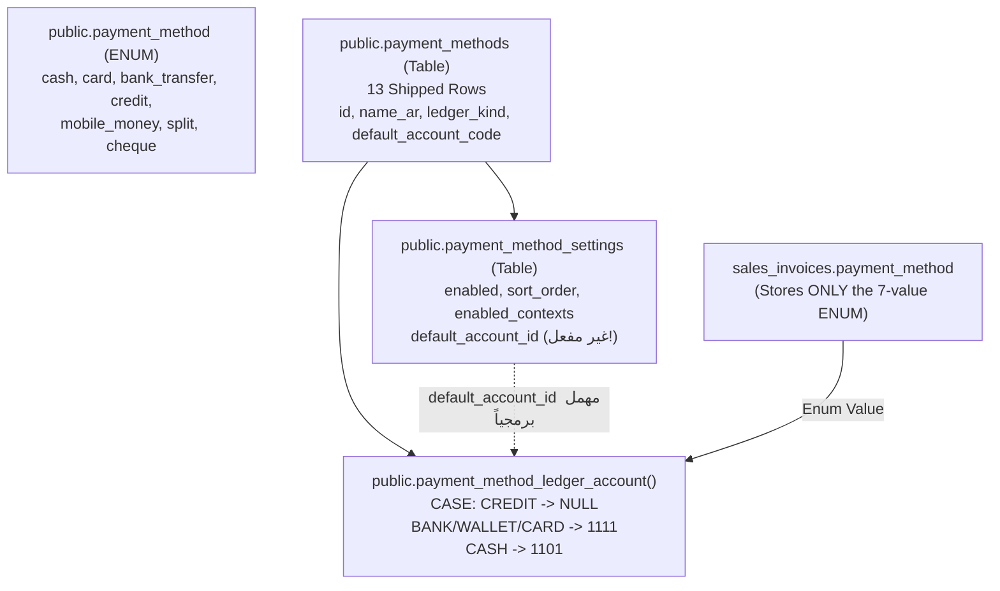
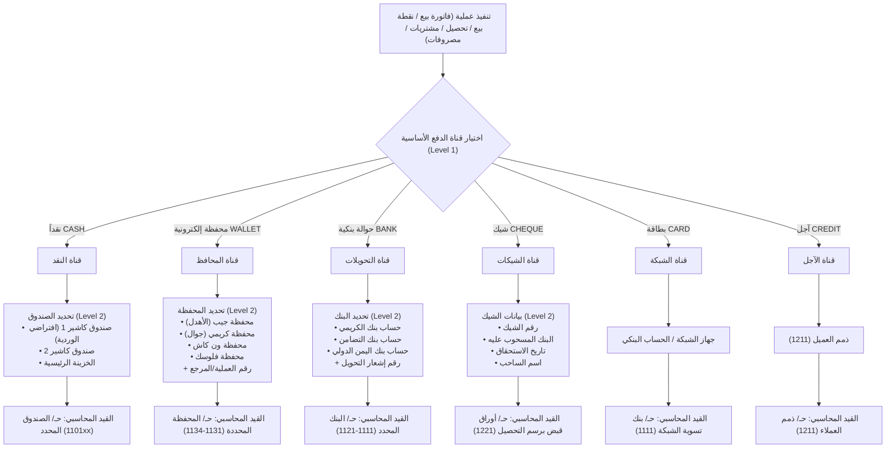
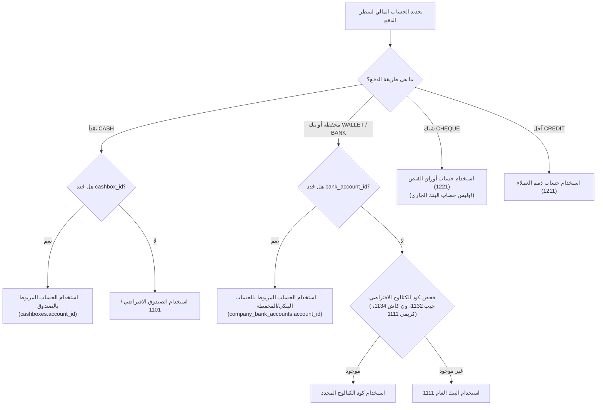
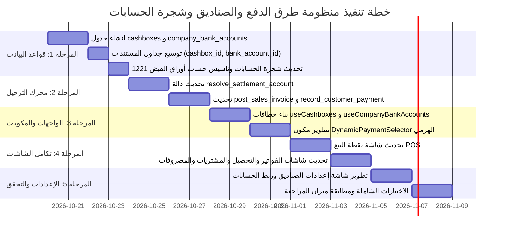

# تقرير وخطّة عمل هندسية: منظومة طرق الدفع، الصناديق، البنوك، المحافظ وشجرة الحسابات
## Market Hub ERP — Treasury, Payment Methods & Ledger Integration Architecture

> **تاريخ التقرير:** أكتوبر 2026  
> **الحالة:** خطة استراتيجية وتحليل فني وهندسي شامل (Architectural Audit & Implementation Plan)  
> **النطاق:** دورة الدفع، الصناديق (Cashboxes)، المحافظ الإلكترونية (Wallets)، الحوالات البنكية (Bank Transfers)، الشيكات (Cheques)، وربطها بشجرة الحسابات والقيود المحاسبية الآلية.

---

## الفهرس العام
1. [الملخص التنفيذي والإجابة المباشرة على تساؤلاتك](#1-الملخص-التنفيذي-والإجابة-المباشرة-على-تساؤلاتك)
2. [واقع النظام الحالي: ما هو الموجود فعلياً وما هي حدوده؟](#2-واقع-النظام-الحالي-ما-هو-الموجود-فعلياً-وما-هي-حدوده)
3. [التحليل التفصيلي للملاحظات ونقاط القصور](#3-التحليل-التفصيلي-للملاحظات-ونقاط-القصور)
   - 3.1 [تحديد الصندوق عند الدفع نقداً: لمن يذهب وكيف يحدد؟](#31-تحديد-الصندوق-عند-الدفع-نقداً-لمن-يذهب-وكيف-يحدد)
   - 3.2 [اختيار محفظة وتفرع المحافظ الموجودة (جيب، فلوسك، ون كاش، كريمي...)](#32-اختيار-محفظة-وتفرع-المحافظ-الموجودة-جيب-فلوسك-ون-كاش-كريمي)
   - 3.3 [الحوالات البنكية وتحديد البنك المستلم](#33-الحوالات-البنكية-وتحديد-البنك-المستلم)
   - 3.4 [الشيكات ودورة حياتها المحاسبية وتحديد البنك](#34-الشيكات-ودورة-حياتها-المحاسبية-وتحديد-البنك)
   - 3.5 [هل لكل طريقة دفع حساب محاسبي؟ وكيف يربط عند الإضافة؟](#35-هل-لكل-طريقة-دفع-حساب-محاسبي-وكيف-يربط-عند-الإضافة)
4. [الرؤية الهندسية والحل المقترح (Two-Tier Hierarchical Model)](#4-الرؤية-الهندسية-والحل-المقترح-two-tier-hierarchical-model)
5. [التعديلات المطلوبة على قاعدة البيانات (Database Schema Updates)](#5-التعديلات-المطلوبة-على-قاعدة-البيانات-database-schema-updates)
6. [محرك الترحيل المحاسبي والقيود الناتجة (Posting Engine Rules)](#6-محرك-الترحيل-المحاسبي-والقيود-الناتجة-posting-engine-rules)
7. [تصميم واجهات المستخدم وتجربة الكاشير (UI/UX Design)](#7-تصميم-واجهات-المستخدم-وتجربة-الكاشير-uiux-design)
8. [خطة التنفيذ المرحلية خطوة بخطوة (Phased Roadmap)](#8-خطة-التنفيذ-المرحلية-خطوة-بخطوة-phased-roadmap)
9. [معايير الجودة والتحقق (Acceptance Criteria & Testing)](#9-معايير-الجودة-والتحقق-acceptance-criteria--testing)

---

## 1. الملخص التنفيذي والإجابة المباشرة على تساؤلاتك

أهلاً بك يا غالي. ملاحظاتك دقيقة وتمس **العصب المالي والتشغيلي** لأي نظام نقاط بيع ومحاسبة (ERP). بعد فحص شامل لقواعد البيانات (`supabase/migrations` و `seeds`) وكود الواجهات (`src/lib/payments`, `src/routes/_app.pos.tsx`, `_app.sales-invoice.tsx`, `_app.payments.tsx`):

### خلاصة الإجابات المباشرة:
1. **عند الدفع نقداً: كيف يُحدد الصندوق ولأي صندوق يذهب؟**
   - **الواقع الحالي:** النظام **لا يحدد أي صندوق فعلي**! لا يوجد في النظام جدول للصناديق أو الخزائن. أي عملية بيع أو قبض نقدية تُرحّل برمجياً بشكل إجباري وثابت (Hardcoded) إلى حساب واحد فقط في الدليل المحاسبي وهو `1101` (النقدية بالصندوق).
   - **الخلل:** إذا كان لديك فرعان أو كاشيران (نقطتا بيع) أو خزينة رئيسية وصندوق مبيعات، تختلط كل الأموال النقدية في حساب واحد، ويستحيل جرد كاشير محدد أو مطابقة عهدته بنهاية اليوم.
   - **الحل المقترح:** إنشاء جدول للصناديق (`cashboxes`) وربط كل صندوق بحسابه المحاسبي في الدليل وبنقطة البيع أو الكاشير الحالية (Default Till/Cashbox per Station).

2. **عند اختيار "محفظة": هل تظهر المحافظ المعرفة بالنظام (جيب، كريمي، ون كاش...)؟**
   - **الواقع الحالي:** 
     - في شاشة **نقطة البيع (POS)**: يوجد زر واحد ثابت اسمه `محفظة/بنك`، ولا تظهر المحافظ على الإطلاق! يتم تخزينه كـ `mobile_money` وتُسجّل ملاحظة فقط.
     - في شاشات **الفواتير والمشتريات والتحصيل**: تظهر قائمة منسدلة واحدة مسطحة ومزدحمة (13 عنصراً مختلطة نقد، آجل، بنك، جيب، ون كاش...).
     - والأسوأ في الترحيل: حتى لو اختار المستخدم محفظة "جيب"، فإن قاعدة البيانات تحولها إلى ENUM عام `mobile_money`، ومحرك الترحيل يرمي المبلغ في حساب البنك `1111` أو محفظة جوالي `1131` متجاهلاً حساب محفظة جيب `1132`!
   - **الحل المقترح:** تطبيق **النموذج الهرمي (Two-Tier Selection)**: يختار المستخدم في المستوى الأول "محفظة إلكترونية"، فتنسدل فوراً المحافظ المفعّلة بالنظام (جيب، فلوسك، جوالي، ون كاش، كريمي جوال...) مع حقل رقم العملية/الإشعار، وترحيل كل محفظة لحسابها الخاص في الدليل.

3. **في الشيك: كيف يُحدد البنك؟**
   - **الواقع الحالي:** الشيك مسجل فقط كقيمة عامة `cheque` نوعها `BANK` ومربوطة بـ `1111`. النظام يعامل الشيك كأنه نقد دخل البنك فوراً! لا يوجد حقل لتحديد اسم البنك المسحوب عليه، ولا تاريخ استحقاق، ولا حساب وسيط لأوراق القبض (`1221`).
   - **الحل المقترح:** عند اختيار "شيك"، تظهر حقول: (اسم البنك المسحوب عليه / اختيار من بنوك النظام، رقم الشيك، تاريخ الاستحقاق، الساحب)، وتُرحل محاسبياً إلى "أوراق قبض" حتى يتم صرفه وإيداعه الفعلي في البنك.

4. **في الحوالة البنكية: كيف يُحدد البنك؟**
   - **الواقع الحالي:** يوجد خيار عام "تحويل بنكي" يرحل لحساب `1111`، وبنكان فقط مشحونان كنصوص ثابتة (`kuraimi_bank`, `yemen_kuwait_bank`). لا يوجد جدول للحسابات البنكية للمنشأة، وإذا اختار العميل "تحويل بنكي" لا تظهر قائمة ببنوك المنشأة المتاحة للإيداع.
   - **الحل المقترح:** اختيار "حوالة بنكية" -> ظهور قائمة الحسابات البنكية للمنشأة (حساب الكريمي، حساب بنك التضامن، حساب بنك اليمن الدولي...) مع رقم مرجع التحويل.

5. **هل كل طرق الدفع لها حساب محاسبي؟ وعند إضافة طريقة دفع هل يظهر لها حساب وصندوق؟**
   - **الواقع الحالي:** الكتالوج القديم يحمل أكواداً إرشادية ثابتة (`default_account_code`). وجدول إعدادات المنشأة يحتوي عموداً اسمه `default_account_id` لكنه **معطّل تماماً وغير مستخدم في أي قيد محاسبي**! وعندما يضيف المستخدم طريقة دفع من الواجهة، فإن النظام يشتق الحساب تلقائياً دون السماح له باختيار الحساب من شجرة الحسابات.
   - **الحل المقترح:** إتاحة ربط كل طريقة دفع بصندوق أو حساب بنكي أو محفظة محددة من شجرة الحسابات، مع إمكانية توليد الحساب الفرعي آلياً لمن لا يريد التعقيد المحاسبي.

---

## 2. واقع النظام الحالي: ما هو الموجود فعلياً وما هي حدوده؟

### 2.1 بنية قاعدة البيانات الحالية (Database Architecture)
يتكون نظام طرق الدفع الحالي أساساً من العناصر التالية (تم توحيدها في الترحيل `16_payment_methods.sql` وبذرة `08_payment_methods.sql`):



#### الجداول والدوال الحالية:
1. **جدول الكتالوج (`payment_methods`)**:
   - يحتوي 13 صفاً نظامياً: `cash`, `credit`, `bank_transfer`, `kuraimi_bank`, `yemen_kuwait_bank`, `jawali`, `jaib`, `floosak`, `one_cash`, `card`, `mobile_money`, `cheque`, `split`.
   - يحتوي عمود `ledger_kind`: إما `CASH`, `BANK`, `WALLET`, `CARD`, `CREDIT`, `OTHER`.
   - يحتوي عمود `default_account_code`: مثل `1101`, `1111`, `1131`, `1132`... إلخ.
2. **جدول إعدادات المنشأة (`payment_method_settings`)**:
   - يسمح بتفعيل/تعطيل الطريقة، ترتيبها، واختيار الأقسام (`pos`, `sales`, `purchases`, `expenses`, `customer_collection`).
   - يحتوي عمود `default_account_id uuid` يربط بـ `public.accounts(id)`. **لكن المفاجأة: هذا الحقل لا يقرأه أي محرك ترحيل قيود على الإطلاق!**
3. **عمود التخزين في المستندات (`sales_invoices`, `customer_payments`, `expenses`)**:
   - الأعمدة مبنية على نوع ENUM قديم يضم 7 قيم فقط:
     `'cash'`, `'card'`, `'bank_transfer'`, `'credit'`, `'mobile_money'`, `'split'`, `'cheque'`.
   - أي طريقة مخصصة أو محددة (مثل `jaib` أو `kuraimi_bank`) تُحوّل قسراً بواسطة دالة `toLegacyPaymentValue` إلى القيمة العامة (`mobile_money` أو `bank_transfer`).

### 2.2 دليل الحسابات الحالي (`03_chart_of_accounts.sql`)
يحتوي دليل الحسابات على حسابات الأصول النقدية التالية:
| الكود | اسم الحساب في الدليل | النوع | الملاحظة |
|---|---|---|---|
| `1101` | النقدية بالصندوق | أصل متداول | حساب وحيد لجميع الصناديق |
| `1111` | البنك — الحساب الأول | أصل متداول | حساب بنكي عام |
| `1112` | البنك — الحساب الثاني | أصل متداول | حساب بنكي عام |
| `1121` | البنك — الحساب الثالث | أصل متداول | مخصص في البذرة لبنك اليمن الدولي |
| `1131` | محفظة — جوالي | أصل متداول | مخصص في البذرة لمحفظة يمن موبايل |
| `1132` | محفظة — الأهدل المالية (جيب) | أصل متداول | مخصص في البذرة لمحفظة جيب |
| `1133` | محفظة — فلوسك | أصل متداول | مخصص لمحفظة فلوسك |
| `1134` | محفظة — ون كاش | أصل متداول | مخصص لمحفظة ون كاش |
| `1139` | محفظة إلكترونية — أخرى | أصل متداول | المحفظة العامة |
| `1211` | ذمم العملاء | أصل متداول | الحساب الآجل |

> **المفارقة الكبرى:** الدليل المحاسبي يحتوي بالفعل على حسابات مخصصة لكل محفظة (`1131`-`1134`)، لكن محرك الترحيل والفواتير **يعطلها عملياً** ويرمي كل شيء في `1111` أو `1131`!

---

## 3. التحليل التفصيلي للملاحظات ونقاط القصور

### 3.1 تحديد الصندوق عند الدفع نقداً: لمن يذهب وكيف يحدد؟
#### السؤال:
> "عند تنفيذ عملية وعند اختيار الدفع نقداً كيف يحدد الصندوق ولأي صندوق الموجود بالنظام؟"

#### الفحص والتحليل الفني:
1. **في قاعدة البيانات:**
   - لا يوجد جدول اسمه `cashboxes` أو `cash_registers` أو `tills`.
   - دالة `post_sales_invoice` ودالة `record_customer_payment` تستدعيان:
     ```sql
     v_cash_acct := public.ledger_account_code_for_payment_method(v_inv.payment_method);
     ```
     وداخل الدالة:
     ```sql
     WHEN m.ledger_kind = 'CASH' THEN '1101'
     ```
   - النتيجة: **جميع العمليات النقدية في النظام بالكامل تُرحل إلى حساب `1101` بلا استثناء.**
2. **في واجهة المستخدم:**
   - شاشة POS لا تسأل الكاشير عن الصندوق.
   - شاشة الفواتير (`_app.sales-invoice.tsx`) وسندات القبض (`_app.payments.tsx`) لا تملك حقلاً للصندوق.
3. **المشاكل المترتبة على ذلك:**
   - **استحالة تعدد نقاط البيع:** لو كان للمتجر كاشير 1 وكاشير 2، لا يمكن مطابقة نقدية كل كاشير على حدة.
   - **استحالة تعدد الفروع:** لو كان هناك فرع صنعاء وفرع عدن، تختلط النقدية في ميزان المراجعة.
   - **غياب دورة حياة جلسة الكاشير (POS Shifts):** لا يوجد فتح وردية بمبلغ افتتاحي، ولا جرد نهاية اليوم ومطابقة الفعلي بالدفتري، ولا قيد ترحيل عهدة الكاشير إلى الخزينة الرئيسية.

---

### 3.2 اختيار محفظة وتفرع المحافظ الموجودة (جيب، فلوسك، ون كاش، كريمي...)
#### السؤال:
> "أو عند اختيار محفظة يظهر المحافظ الموجودة في النظام مثلاً يظهر في طرق الدفع محفظة وعند اختيار محفظة يظهر المحافظ الموجودة في النظام مثل جيب وكريمي وغيره؟"

#### الفحص والتحليل الفني:
1. **تناقض شاشات النظام:**
   - **في نقطة البيع (`_app.pos.tsx`):**
     الواجهة مبنية بأزرار ثابتة (Hardcoded Buttons):
     `[ نقدًا ] [ شبكة ] [ محفظة/بنك ] [ آجل ] [ دفع مجزأ ]`
     عند الضغط على `محفظة/بنك`:
     ```typescript
     setPaymentMethod("mobile_money");
     ```
     ويظهر حقل واحد لكتابة "رقم عملية المحفظة / المرجع الإلكتروني".
     **الكاشير هنا محروم تماماً من تحديد هل استلم بجيب أم ون كاش أم فلوسك!**
   - **في شاشة الفواتير والتحصيل والمشتريات:**
     المكون المستخدم هو `PaymentMethodPicker`، وهو عبارة عن قائمة منسدلة واحدة مسطحة تحتوي:
     `نقداً - آجل - تحويل بنكي - بنك الكريمي - بنك اليمن الدولي - جوالي - جيب - فلوسك - ون كاش - بطاقة/شبكة - محفظة إلكترونية - شيك - دفع بأكثر من طريقة`
     هذه القائمة سيئة من حيث تجربة المستخدم (UX):
     - تخلط بين "نوع الدفع العام" (محفظة / بنك) وبين "المؤسسة المحددة" (جيب / الكريمي).
     - طويلة ومربكة في نقاط البيع السريعة.
2. **فقدان هوية المحفظة في قاعدة البيانات:**
   - عندما يختار الكاشير "جيب" (`jaib`) في شاشة الفاتورة:
     يقوم الكود باستدعاء:
     ```typescript
     toLegacyPaymentValue("jaib") // يُعيد: "mobile_money"
     ```
     فيتم حفظ الفاتورة بقيمة `payment_method = 'mobile_money'`.
     وعند الترحيل المحاسبي: `mobile_money` تُحل في الدالة إلى أول محفظة تحمل هذه القيمة وهي `jawali` (حساب `1131`) أو المحفظة العامة (`1139`)، وتضيع نسبة الإيراد أو النقدية الخاصة بمحفظة `jaib` (حساب `1132`)!

---

### 3.3 الحوالات البنكية وتحديد البنك المستلم
#### السؤال:
> "وأيضاً الحوالة يحدد أي بنك وهكذا؟"

#### الفحص والتحليل الفني:
1. **في الكتالوج الحالي:**
   - تم حشر "بنك الكريمي" و"بنك اليمن الدولي" كـ "طرق دفع" مستقلة في الكتالوج بجانب "تحويل بنكي".
   - هذا تصميم خاطئ معمارياً: **البنك ليس طريقة دفع، بل هو حساب مالي/وجهة تسوية (Settlement Account)**، وطريقة الدفع هي "حوالة بنكية" أو "إيداع بنكي".
2. **القصور العملي:**
   - لو كان لدى المنشأة حساب في "بنك التضامن" أو "بنك القطيبي" أو "بنك سبأ":
     - لا توجد شاشة لتعريف الحسابات البنكية للمنشأة (رقم الحساب، الآيبان، الفرع).
     - يضطر المستخدم لاختيار "تحويل بنكي" العام، والذي يصب دائماً في حساب `1111`، ويكتب اسم البنك كنص يدوي في الملاحظات!
   - لا يمكن استخراج كشف حساب مطابق لحساب البنك الفعلي، لأن القيود لا تعرف أي بنك استلم الحوالة.

---

### 3.4 الشيكات ودورة حياتها المحاسبية وتحديد البنك
#### السؤال:
> "وأيضاً في الشيك يحدد أي بنك؟"

#### الفحص والتحليل الفني:
1. **معالجة الشيك الحالية:**
   - الشيك مُدرج في الكتالوج كقيمة `cheque`.
   - نوعه المالي `ledger_kind = 'BANK'`.
   - كود حسابه الافتراضي: `1111` (البنك — الحساب الأول).
2. **الخطأ المحاسبي والتشغيلي:**
   - الشيك **ليس نقدية فورية في البنك**. عند استلام شيك من عميل، لا يزيد رصيد المنشأة في البنك حتى تاريخ استحقاق الشيك وتقديمه للتحصيل الفعلي (Clearing).
   - المعيار المحاسبي السليم:
     - عند استلام الشيك:
       $$\text{من حـ/ أوراق قبض (شيكات برسم التحصيل 1221) } \to \text{ إلى حـ/ العميل (ذمم 1211)}$$
     - عند إيداع وصرف الشيك في البنك بنجاح:
       $$\text{من حـ/ البنك المودع فيه (1111) } \to \text{ إلى حـ/ أوراق قبض (1221)}$$
     - في حال ارتداد الشيك لعدم كفاية الرصيد:
       $$\text{من حـ/ العميل (1211) + غرامات الارتداد } \to \text{ إلى حـ/ أوراق قبض (1221)}$$
3. **الحقول المفقودة للشيك:**
   - لا يوجد حقل لـ: (رقم الشيك، اسم البنك المسحوب عليه الشيك، تاريخ استحقاق الشيك، اسم الساحب، حالة الشيك: تحت التحصيل / محصل / مرتد / مجير).

---

### 3.5 هل لكل طريقة دفع حساب محاسبي؟ وكيف يربط عند الإضافة؟
#### السؤال:
> "وهل كل طرق الدفع لها حساب؟ وعندما اضيف طريقه دفع يظهر له حساب والصندوق وهكذا؟"

#### الفحص والتحليل الفني:
1. **في شاشة إعدادات طرق الدفع (`payment-methods-section.tsx`):**
   - الشاشة تسمح فقط بـ:
     - تفعيل / تعطيل
     - إعادة ترتيب
     - تحديد أماكن الظهور (POS، مبيعات، مشتريات...)
     - تعديل الاسم والأيقونة.
   - **لا يوجد أي حقل لربط الطريقة بحساب محاسبي من شجرة الحسابات!**
2. **في حوار إضافة طريقة دفع جديدة (`add-payment-method-dialog.tsx`):**
   - يطلب الحوار: الاسم العربي، الاسم الإنجليزي، الأيقونة، وطريقة التحصيل (حوالة بنكية، محفظة إلكترونية، بطاقة، شيك، نقداً).
   - يقوم الكود باشتقاق الحساب العام برمجياً:
     - نقداً -> `1101`
     - بنك / محفظة / شبكة / شيك -> `1111`
   - **لا يُعرض للمستخدم دليل الحسابات لاختيار حساب، ولا يُعرض له اختيار صندوق أو بنك محدد.**
3. **النتيجة المحاسبية:**
   - أي طريقة يضيفها التاجر (مثلاً "محفظة كريمي جوال" أو "صندوق الفرع الثاني") لن تفتح حساباً مستقلاً ولن تربط بحساب منفصل، بل ستصب قسراً في الحساب العام القديم، مما يُبطل فائدة إضافة طريقة جديدة من الأساس.

---

## 4. الرؤية الهندسية والحل المقترح (Two-Tier Hierarchical Model)

لحل جميع هذه المشكلات جذرياً وبشكل احترافي يضاهي كبرى أنظمة الـ ERP العالمية (مثل Odoo وSAP)، نقترح معمارية **المستويين الذكيين (Two-Tier Settlement Architecture)** التي تفصل بين:
1. **قناة الدفع (Payment Method Channel):** كيف دفع العميل؟ (نقد، محفظة، حوالة، شيك، بطاقة).
2. **الوعاء المالي والوجهة المحاسبية (Settlement Financial Destination):** أين استقرت الأموال تحديداً؟ (أي صندوق، أي محفظة، أي بنك، أو أوراق قبض).

### الرسم التخطيطي للهيكلية المقترحة:



---

## 5. التعديلات المطلوبة على قاعدة البيانات (Database Schema Updates)

لتحقيق هذا النموذج دون كسر البيانات التاريخية أو مخالفة قواعد الـ Migrations، نحتاج إلى:

### 5.1 إنشاء جدول الصناديق والخزائن (`cashboxes`)
```sql
CREATE TABLE public.cashboxes (
  id uuid PRIMARY KEY DEFAULT gen_random_uuid(),
  name_ar text NOT NULL,
  name_en text,
  code varchar(20) UNIQUE NOT NULL, -- e.g., 'CASH-01', 'SAFE-MAIN'
  warehouse_id uuid REFERENCES public.warehouses(id) ON DELETE SET NULL,
  account_id uuid NOT NULL REFERENCES public.accounts(id), -- ربط مباشر بشجرة الحسابات
  is_default boolean DEFAULT false NOT NULL,
  is_active boolean DEFAULT true NOT NULL,
  created_at timestamptz DEFAULT now() NOT NULL,
  updated_at timestamptz DEFAULT now() NOT NULL
);

-- فهرس لسرعة استعلام الصناديق النشطة
CREATE INDEX ix_cashboxes_active ON public.cashboxes(is_active, is_default);
```

### 5.2 إنشاء جدول الحسابات البنكية والمحافظ للمنشأة (`company_bank_accounts`)
بدلاً من حشر البنوك في الكتالوج العام، يكون للمنشأة سجل بحساباتها البنكية ومحافظها:
```sql
CREATE TYPE public.bank_account_kind AS ENUM ('BANK', 'WALLET', 'POS_TERMINAL');

CREATE TABLE public.company_bank_accounts (
  id uuid PRIMARY KEY DEFAULT gen_random_uuid(),
  name_ar text NOT NULL, -- e.g., 'بنك الكريمي - حساب صنعاء', 'محفظة جيب'
  name_en text,
  kind public.bank_account_kind DEFAULT 'BANK' NOT NULL,
  bank_name text NOT NULL, -- e.g., 'الكريمي', 'التضامن', 'الأهدل'
  account_number text, -- رقم الحساب البنكي أو رقم المحفظة
  iban text,
  currency text DEFAULT 'YER' NOT NULL,
  account_id uuid NOT NULL REFERENCES public.accounts(id), -- الربط المحاسبي
  is_default boolean DEFAULT false NOT NULL,
  is_active boolean DEFAULT true NOT NULL,
  created_at timestamptz DEFAULT now() NOT NULL
);
```

### 5.3 إنشاء جدول إدارة الشيكات وأوراق القبض (`cheques_register`)
```sql
CREATE TYPE public.cheque_status AS ENUM ('UNDER_COLLECTION', 'CLEARED', 'BOUNCED', 'RETURNED');

CREATE TABLE public.cheques_register (
  id uuid PRIMARY KEY DEFAULT gen_random_uuid(),
  cheque_number text NOT NULL,
  bank_name text NOT NULL,
  drawer_name text, -- اسم الساحب
  due_date date NOT NULL,
  amount numeric(18,2) NOT NULL,
  status public.cheque_status DEFAULT 'UNDER_COLLECTION' NOT NULL,
  customer_id uuid REFERENCES public.customers(id),
  invoice_id uuid REFERENCES public.sales_invoices(id),
  payment_id uuid REFERENCES public.customer_payments(id),
  clearing_bank_account_id uuid REFERENCES public.company_bank_accounts(id),
  clearing_journal_entry_id uuid REFERENCES public.journal_entries(id),
  cleared_at timestamptz,
  notes text,
  created_at timestamptz DEFAULT now() NOT NULL
);
```

### 5.4 توسيع جداول المستندات بحقول التوجيه المالي (Non-Breaking Additions)
إضافة أعمدة اختيارية (Nullable) إلى:
- `sales_invoices`
- `customer_payments`
- `purchase_invoices`
- `expense_payments`

```sql
-- إضافة الأعمدة إلى الفواتير وسندات القبض
ALTER TABLE public.sales_invoices
  ADD COLUMN IF NOT EXISTS cashbox_id uuid REFERENCES public.cashboxes(id) ON DELETE SET NULL,
  ADD COLUMN IF NOT EXISTS bank_account_id uuid REFERENCES public.company_bank_accounts(id) ON DELETE SET NULL,
  ADD COLUMN IF NOT EXISTS payment_reference text;

ALTER TABLE public.customer_payments
  ADD COLUMN IF NOT EXISTS cashbox_id uuid REFERENCES public.cashboxes(id) ON DELETE SET NULL,
  ADD COLUMN IF NOT EXISTS bank_account_id uuid REFERENCES public.company_bank_accounts(id) ON DELETE SET NULL,
  ADD COLUMN IF NOT EXISTS payment_reference text;

ALTER TABLE public.purchase_invoices
  ADD COLUMN IF NOT EXISTS cashbox_id uuid REFERENCES public.cashboxes(id) ON DELETE SET NULL,
  ADD COLUMN IF NOT EXISTS bank_account_id uuid REFERENCES public.company_bank_accounts(id) ON DELETE SET NULL,
  ADD COLUMN IF NOT EXISTS payment_reference text;
```

---

## 6. محرك الترحيل المحاسبي والقيود الناتجة (Posting Engine Rules)

### 6.1 منطق حل الحساب المحاسبي الجديد (`resolve_settlement_account`)
عند إنشاء أي قيد محاسبي لأي مستند (فاتورة مبيعات، سند قبض، مصروف)، يحل النظام الحساب كالتالي:



### 6.2 القيود المحاسبية التفصيلية حسب الحالة:

#### 1. فاتورة بيع نقداً في "صندوق نقطة البيع رقم 1" بمبلغ 50,000 ر.ي:
| رقم الحساب | اسم الحساب | مدين | دائن | البيان |
|---|---|---|---|---|
| `110101` | صندوق نقطة بيع 1 | 50,000 | - | إثبات سداد نقدي — فاتورة INV-001 |
| `4111` | إيراد المبيعات | - | 50,000 | إيراد مبيعات بضاعة |

#### 2. فاتورة بيع سُددت عبر محفظة "جيب" بمبلغ 25,000 ر.ي مرجع (987654):
| رقم الحساب | اسم الحساب | مدين | دائن | البيان |
|---|---|---|---|---|
| `1132` | محفظة — جيب (الأهدل) | 25,000 | - | سداد محفظة جيب — مرجع 987654 |
| `4111` | إيراد المبيعات | - | 25,000 | إيراد مبيعات بضاعة |

#### 3. فاتورة بيع سُددت بحوالة على "بنك الكريمي" بمبلغ 100,000 ر.ي مرجع (112233):
| رقم الحساب | اسم الحساب | مدين | دائن | البيان |
|---|---|---|---|---|
| `1111` | بنك الكريمي — جاري | 100,000 | - | حوالة بنكية الكريمي — مرجع 112233 |
| `4111` | إيراد المبيعات | - | 100,000 | إيراد مبيعات بضاعة |

#### 4. سند قبض من عميل بشيك مسحوب على بنك التضامن يستحق بعد شهر بمبلغ 200,000 ر.ي:
- **القيد الأول (عند استلام الشيك):**
| رقم الحساب | اسم الحساب | مدين | دائن | البيان |
|---|---|---|---|---|
| `1221` | أوراق قبض (شيكات برسم التحصيل) | 200,000 | - | استلام شيك رقم 4545 — بنك التضامن |
| `1211` | ذمم العملاء (العميل س) | - | 200,000 | سداد دفعة من الحساب بشيك |

- **القيد الثاني (عند تاريخ الاستحقاق وإيداع وصرف الشيك في حساب المنشأة لدى الكريمي):**
| رقم الحساب | اسم الحساب | مدين | دائن | البيان |
|---|---|---|---|---|
| `1111` | بنك الكريمي | 200,000 | - | تحصيل شيك رقم 4545 في الحساب |
| `1221` | أوراق قبض (شيكات برسم التحصيل) | - | 200,000 | إقفال ورقة القبض بعد الصرف |

---

## 7. تصميم واجهات المستخدم وتجربة الكاشير (UI/UX Design)

أهم قاعدة في أنظمة المبيعات: **"لا تبطئ الكاشير ثانية واحدة!"**.  
يجب ألا يؤدي الانضباط المحاسبي إلى زيادة عدد النقرات في نقطة البيع.

### 7.1 شريط الدفع الذكي في نقطة البيع (Smart POS Tender Bar)

بدلاً من القائمة المنسدلة الطويلة أو الأزرار الخمسة الثابتة القديمة، نصمم شريط دفع تفاعلي على مرحلتين:

```
+-----------------------------------------------------------------------------------+
|  [ نقدًا (F1) ]  |  [ محفظة (F2) ]  |  [ حوالة (F3) ]  |  [ شبكة (F4) ]  |  [ آجل (F5) ]  |
+-----------------------------------------------------------------------------------+
| (إذا اختار نقداً):                                                                  |
|   الصندوق النشط: [ صندوق كاشير 1 (الافتراضي) ▼ ] (محدد آلياً دون الحاجة لنقر)        |
+-----------------------------------------------------------------------------------+
| (إذا اختار محفظة):                                                                |
|   المحفظة: (•) جيب    ( ) ون كاش    ( ) فلوسك    ( ) جوالي    ( ) كريمي جوال      |
|   رقم العملية/المرجع: [________________________]                                    |
+-----------------------------------------------------------------------------------+
| (إذا اختار حوالة):                                                                 |
|   البنك المستلم: [ بنك الكريمي ▼ ]   رقم الحوالة: [________________________]       |
+-----------------------------------------------------------------------------------+
| (إذا اختار شيك):                                                                   |
|   البنك المسحوب عليه: [ بنك التضامن ]  رقم الشيك: [123456]  تاريخ الاستحقاق: [2026/11/01] |
+-----------------------------------------------------------------------------------+
```

#### مميزات هذا التصميم:
1. **السرعة الخارقة في الكاش:** في 90% من عمليات الكاش، لا يضغط الكاشير أي زر فرعي لأن الصندوق الافتراضي للوردية محدد مسبقاً! يضغط فقط `F1` ثم `Enter` لإتمام الفاتورة.
2. **الوضوح التام في المحافظ:** تظهر المحافظ كأزرار خيارات سريعة (Pill Badges) عليها شعارات المحافظ اليمنية الجاهزة في المشروع (`floosak.svg`, `one-cash.svg`, `jaib.svg`)، بنقرة واحدة يختار "جيب" ويدخل الرقم.
3. **الدفع المجزأ المتطور:** بدلاً من تجزئة (كاش + شبكة) فقط، تتيح شاشة التجزئة تقسيم المبلغ بين (كاش + جيب) أو (حوالة الكريمي + كاش) بكل مرونة.

### 7.2 شاشة إعدادات طرق الدفع والصناديق (Settings Redesign)
في شاشة `PaymentMethodsSection`:
1. **تبويب الصناديق والخزائن (Cashboxes Tab):**
   - إضافة صناديق المنشأة (صندوق المركز الرئيسي، كاشير 1، كاشير 2).
   - ربط كل صندوق بحساب من شجرة الحسابات (مع زر "إنشاء حساب فرعي تلقائياً").
   - تعيين الصندوق الافتراضي.
2. **تبويب الحسابات البنكية والمحافظ (Bank Accounts & Wallets Tab):**
   - إضافة حسابات البنوك والمحافظ.
   - إدخال الاسم، رقم الحساب، واختيار حسابه من شجرة الحسابات.
3. **تحديث حوار "إضافة طريقة دفع":**
   - إضافة حقل صريح: `الحساب المحاسبي المرتبط (شجرة الحسابات)`.
   - إمكانية الاختيار من الدليل مع تصفية ذكية لحسابات الأصول النقدية المتداولة.

---

## 8. خطة التنفيذ المرحلية خطوة بخطوة (Phased Roadmap)

لضمان تطبيق هذه المنظومة بأعلى معايير الأمان وبلا أي توقف للنظام، نقسم التنفيذ إلى 5 مراحل متتالية:



### تفاصيل المراحل:

#### المرحلة 1: البنية التحتية لقاعدة البيانات (Database & Ledger Migrations)
1. كتابة ترحيل جديد (Migration) ينشئ الجداول:
   - `public.cashboxes`
   - `public.company_bank_accounts`
   - `public.cheques_register`
2. إضافة أعمدة التوجيه المالي إلى `sales_invoices`, `customer_payments`, `purchase_invoices`, `expense_payments`.
3. بذرة بيانات (Seed):
   - إدراج "الصندوق الرئيسي" كصندوق افتراضي مرتبط بـ `1101`.
   - إدراج الحسابات البنكية للمنشأة وربطها بـ `1111` و `1121`.
   - إدراج حسابات المحافظ وربطها بحساباتها القائمة في الدليل (`1131`-`1134`).
   - إضافة حساب `1221` (أوراق قبض — شيكات برسم التحصيل) إلى الدليل.

#### المرحلة 2: محرك الترحيل المحاسبي (Posting Engine Core)
1. إنشاء دالة مركزية `public.get_document_settlement_account(...)` تُعيد كود الحساب المحاسبي بدقة بحسب الأولوية:
   - حساب الصندوق المختار -> حساب البنك/المحفظة المختار -> حساب الكتالوج -> الحساب الافتراضي.
2. تحديث دوال الترحيل:
   - `post_sales_invoice`
   - `record_customer_payment`
   - `post_purchase_invoice`
   - `create_expense_payment`
3. كتابة دالة تحصيل وصرف الشيكات `clear_cheque(...)` لنقل المبالغ من أوراق القبض إلى البنك المودع فيه.

#### المرحلة 3: الخطافات والمكونات البرمجية (Hooks & Shared UI)
1. إنشاء خطافات React Query:
   - `useCashboxes()` لجلب الصناديق النشطة والصندوق الافتراضي.
   - `useCompanyBankAccounts()` لجلب البنوك والمحافظ الخاصة بالمنشأة.
2. بناء مكون `DynamicPaymentSelector.tsx`:
   - يعرض قنوات الدفع الرئيسية.
   - يتفرع بانسيابية لعرض الخيارات التابعة مع الحفاظ على سرعة الإدخال والتنقل بالأسهم والمفاتيح السريعة (Keyboard Shortcuts).

#### المرحلة 4: تكامل الشاشات التشغيلية (Screens Integration)
1. **نقطة البيع (`_app.pos.tsx`):**
   - استبدال الأزرار القديمة بـ Tender Selector الهرمي.
   - حفظ `cashbox_id` و `bank_account_id` و `payment_reference` مع الفاتورة والدفع المجزأ.
2. **فواتير المبيعات والمشتريات (`_app.sales-invoice.tsx`, `_app.purchases.tsx`):**
   - استبدال القائمة المنسدلة المسطحة بالمكون الجديد.
3. **سندات القبض والدفع والمصروفات (`_app.payments.tsx`, `expense-form.tsx`):**
   - تفعيل اختيار الصندوق أو البنك عند إثبات الدفعة.

#### المرحلة 5: شاشة الإعدادات والتحقق والمطابقة (Settings & Verification)
1. تحديث `PaymentMethodsSection`:
   - إضافة تبويب إدارة الصناديق (إضافة / تعديل / ربط بحساب من شجرة الحسابات).
   - إضافة تبويب الحسابات البنكية والمحافظ.
   - إتاحة اختيار الحساب المحاسبي من شجرة الحسابات عند إضافة أي طريقة جديدة.
2. اختبارات التكامل المحاسبي:
   - التحقق من ترحيل فاتورة نقدية إلى الصندوق المخصص.
   - التحقق من ترحيل فاتورة محفظة جيب إلى حساب `1132`.
   - التحقق من ترحيل حوالة الكريمي إلى حسابه البنكي.
   - التحقق من استلام شيك إلى `1221` وصرفه إلى البنك.
   - التأكد من تطابق قيود اليومية وميزان المراجعة تماماً (Debit = Credit).

---

## 9. معايير الجودة والتحقق (Acceptance Criteria & Testing)

للتأكد من نجاح تنفيذ الخطة وعدم وجود أي ثغرة:

| # | المعيار والاختبار | النتيجة المتوقعة للقبول |
|---|---|---|
| 1 | بيع نقدي من كاشير 1 | ينشأ قيد مدين في حساب صندوق كاشير 1 (`110101`) وليس في الصندوق العام |
| 2 | بيع بمحفظة جيب | ينشأ قيد مدين في حساب محفظة جيب (`1132`) مع تخزين رقم إشعار المحفظة |
| 3 | بيع بحوالة بنكية على الكريمي | ينشأ قيد مدين في حساب بنك الكريمي (`1111`) مع تخزين رقم الحوالة |
| 4 | تحصيل سند قبض بشيك مؤجل | ينشأ قيد مدين في حساب أوراق القبض (`1221`) ويُسجل الشيك في سجل الشيكات بحالة `UNDER_COLLECTION` |
| 5 | صرف الشيك بعد تاريخ استحقاقه | ينشأ قيد تحصيل من أوراق القبض (`1221`) إلى حساب البنك المودع فيه وتتغير حالته إلى `CLEARED` |
| 6 | إضافة طريقة دفع جديدة من الإعدادات | يظهر منتقي الحساب المحاسبي لاختيار الحساب التابع لها من شجرة الحسابات فوراً |
| 7 | سرعة الكاشير في POS | لا تزيد العملية النقدية العادية عن ثانية واحدة (الصندوق محدد تلقائياً بالوردية) |
| 8 | الفواتير التاريخية | الفواتير القديمة تفتح وتُعرض بسلاسة دون أي خطأ (Full Backward Compatibility) |

---

## 10. الخلاصة والتوصية

يا غالي، ملاحظاتك وضعت اليد بدقة على **الفرق الجوهري بين النظام البسيط والنظام المالي المؤسسي المتكامل**:
- حالياً النظام يمتلك كتالوجاً جيداً كبداية، لكنه كان يفتقر إلى **ربط الأوعية المالية (صناديق/بنوك/محافظ) بالعمليات اليومية وشجرة الحسابات**.
- تطبيق هذه الخطة سينقل نظام `Market Hub` نقلة نوعية كبرى؛ حيث يصبح كل كاشير مراقباً ومضبوطاً، وكل محفظة إلكترونية لها حساب ومطابقة يومية دقيقة، وتختفي فوضى الحوالات غير المعروفة البنك، وتصبح الشيكات خاضعة للرقابة المحاسبية الصحيحة.

**جاهز للبدء معك في تنفيذ أي مرحلة تختارها فور اعتمادك لهذه الخطة!**
