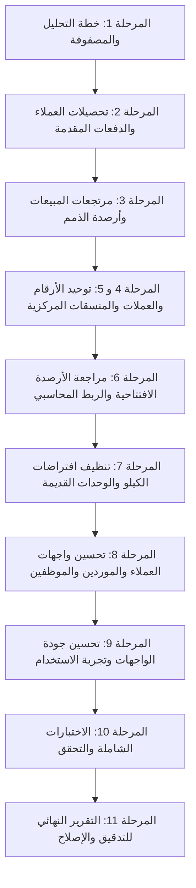

# خطة التدقيق التقني والمحاسبي والإصلاح الشامل — نظام Vortex ERP
**الملف:** `SYSTEM_AUDIT_AND_FIX_PLAN.md`  
**التاريخ:** نوفمبر 2026  
**الفرع:** `feature/comprehensive-audit-and-fixes-vortex`  
**النظام:** Vortex Market-Hub ERP  

---

## 1. الملخص التنفيذي والأهداف

يهدف هذا التدقيق إلى فحص وتصحيح كافة الاختلالات المحاسبية والوظيفية والواجهية في نظام Vortex ERP، مع التركيز على:
1. تصحيح دورة تحصيلات العملاء والدفعات المقدمة (Customer Advance Payments) وصلاحيات المالك والسوبر أدمن.
2. تصحيح دورة مرتجعات المبيعات (Sales Returns) على الفواتير الآجلة والنقدية وضمان تخفيض مديونية العميل لا زيادتها.
3. توحيد عرض الأرقام والعملات ومنع ظهور رمز العملة بجانب الكميات والأعداد أو تكراره.
4. توحيد تنسيق الأرقام العشرية ودقة العملات والكميات والأرقام اللاتينية/العربية.
5. مراجعة شاملة للأرصدة الافتتاحية وربطها بالدليل المحاسبي ودفاتر الأطراف والمخزون.
6. التخلص من افتراضات الكيلوغرام القديمة واعتماد وحدات القياس الحقيقية لكل صنف.
7. إصلاح واجهات العملاء والموردين والموظفين (Grid View Overflow، اتجاه حقول الهاتف والبريد، تبسيط النماذج، أزرار التفعيل/التحذير).

---

## 2. مصفوفة المشكلات المكتشفة والتحليل الجذري (Root Cause Analysis)

### المشكلة 1: حظر الدفعات المقدمة للعملاء (Customer Advance Payments)
- **الأعراض:** عند تسجيل دفعة مقدمة لعميل رصيده صفر أو دفعة تزيد عن مديونيته الحالية، تفشل العملية وتظهر رسالة خطأ.
- **السبب الجذري:**
  1. في دوال قاعدة البيانات `public.record_customer_payment` و `public.record_customer_payment_splits` (Migrations 76 و 9915)، يوجد شرط صريح:
     ```sql
     IF v_amount > greatest(coalesce(v_ledger_balance, 0), 0) + 0.001 THEN
       RAISE EXCEPTION 'Payment exceeds the customer outstanding balance (ledger %)';
     ```
     هذا الشرط يفترض خطأً أن كل دفعة يجب أن تكون سداداً لدين قائم، ويمنع تسجيل أي دفعة مقدمة (Credit balance).
  2. في الواجهة الأمامية (`src/routes/_app.payments.tsx` السطر 278):
     ```ts
     const payableAmount = selectedInvoice ? remaining : Number(selected.balance);
     if (amt > payableAmount + 0.001) return toast.error(t("payments.exceeds_remaining"));
     ```
     الواجهة تمنع أي تحصيل يزيد عن الرصيد الحالي للعميل.
  3. استخدام `greatest(balance - amount, 0)` في ترحيلات سابقة كان يقص الأرصدة الدائنة عند الصفر.
- **الحل الجذري:**
  - تعديل الدالة `record_customer_payment` و `record_customer_payment_splits` للسماح بالدفعات المقدمة (عند عدم تحديد فاتورة بعينها، أو الفائض عن الفواتير المستحقة).
  - توزيع المبلغ آلياً على الفواتير المستحقة (FIFO)، والفائض يُقيد كدفعة مقدمة / رصيد دائن في دفتر العميل (`customer_ledger`) مع قيد محاسبي سليم (من حـ/ النقدية أو البنك إلى حـ/ العملاء 1211).
  - تحديث رصيد العميل المخزن `customers.balance` ليقبل الرصيد الدائن (السالب).
  - تحديث واجهة التحصيل في `_app.payments.tsx` للتمييز بين سداد فاتورة محددة (بحد أقصى متبقي الفاتورة) وبين تحصيل عام / دفعة مقدمة مفتوحة.

---

### المشكلة 2: صلاحيات المالك والسوبر أدمن في التحصيلات والمالية
- **الأعراض:** قد يواجه المالك أو السوبر أدمن رسالة "You are not permitted to record customer payments" أو منعاً في دوال مالية.
- **السبب الجذري:**
  1. حراس الدوال (RPC guards) يعتمدون على فحص نصوص أدوار محددة مثل `has_role(v_user, 'owner')` وبعضها لا يتحقق من `is_platform_superadmin(v_user)`.
  2. دوال التحصيل والمطابقة تتطلب أذونات `GRANT EXECUTE` محددة لـ `authenticated` وسياسات RLS متوافقة مع حسابات الإشراف.
- **الحل الجذري:**
  - توحيد فحص الصلاحيات بحيث يرث المالك والسوبر أدمن تلقائياً كافة صلاحيات التحصيل وإدارة الحسابات.
  - منح أذونات التنفيذ للدوال لـ `authenticated` مع فحص داخلي صارم للهوية.

---

### المشكلة 3: الخلل المحاسبي في مرتجعات المبيعات (زيادة دين العميل بدلاً من تخفيضه)
- **الأعراض:** عند إرجاع بضاعة من فاتورة بيع آجلة، لا ينخفض دين العميل بل يظل محسوباً أو يزداد في الحسابات!
- **السبب الجذري:**
  1. في دالة `create_sales_return` (Migration 9914، السطر 273):
     ```sql
     UPDATE public.sales_invoices
     SET paid = greatest(round(coalesce(paid, 0) - v_credit_applied, 2), 0)
     ```
     تم خصم قيمة المرتجع من عمود `paid` الخاص بالفاتورة! وحيث أن المتبقي من الفاتورة يُحسب كـ `total - paid`، فإن إنقاص `paid` يؤدي رياضياً ومحاسبياً إلى **زيادة المبلغ المتبقي على العميل**! (مثلاً: فاتورة 100,000 مسدد منها 40,000 والمتبقي 60,000، عند إرجاع 20,000 أصبح `paid = 20,000` والمتبقي `100,000 - 20,000 = 80,000`!).
  2. منع طريقة الاسترداد الآجلة في دالة `create_sales_return` (السطر 91):
     `RAISE EXCEPTION 'A return refund method cannot be credit — pick the account the money leaves from'`
     النظام منع خيار "آجل" وأجبر الكاشير على اختيار صندوق نقدي أو بنكي حتى لو كانت الفاتورة آجلة ولم يُدفع منها ريال واحد!
  3. القيد المحاسبي كان يقيد الطرف الدائن على الصندوق (1101) بدلاً من ذمم العملاء (1211)، مما أدى إلى خروج وهمي للنقدية وبقاء ذمة العميل قائمة.
- **الحل الجذري:**
  - دعم الاسترداد بالخصم من الذمة (`credit` / on-account) في `create_sales_return` وفي واجهة المرتجعات `_app.sales-returns.tsx`.
  - عند المرتجع على فاتورة آجلة غير مسددة بالكامل: قيمة المرتجع تخصم من الذمة المتبقية للفاتورة.
  - إنشاء القيد المحاسبي الصحيح:
    - مدين: مردودات المبيعات / الإيرادات (4111/4211) وضريبة القيمة المضافة (2311).
    - دائن: ذمم العملاء (1211) بمقدار ما خُصم من الذمة (وليس الصندوق!).
    - مخزون: مدين المخزون (1313) ودائن تكلفة البضاعة المباعة (5111) بالتكلفة الفعلية.
  - تحديث حركة دفتر العميل `customer_ledger` بقيد دائن يخفض رصيد العميل فوراً.

---

### المشكلة 4: ظهور رمز العملة بجانب الأعداد والكميات وتكرار الرمز
- **الأعراض:**
  - بطاقة "إجمالي العملاء" تعرض `5 ر.ي`.
  - بطاقة "إجمالي المنتجات" تعرض رمز العملة.
  - بطاقات الديون تعرض `850,000 ر.ي ر.ي` مكررة مرتين!
- **السبب الجذري:**
  1. في المكون `VortexMetricCard` (`src/components/vortex-ui/finance/vortex-metric-card.tsx` السطر 99-103):
     ```tsx
     {(currency ?? currencySymbol) && (
       <span className="...">{currency ?? currencySymbol}</span>
     )}
     ```
     المكون يفرض `currencySymbol` تلقائياً كقيمة افتراضية على أي بطاقة لا تمرر `currency` صراحةً!
  2. بعض الشاشات تمرر القيمة كـ `value={money(amount)}`، وحيث أن `money()` تتضمن بالفعل رمز العملة، يقوم المكون بإضافة الرمز مرة أخرى فيظهر مكرراً.
- **الحل الجذري:**
  - تحسين `VortexMetricCard` ليدعم خاصية `type?: "currency" | "count" | "quantity" | "percentage"` أو `isCurrency?: boolean`. إذا كان النوع عدداً أو كمية، يُمنع إظهار رمز العملة قطعياً.
  - فحص القيمة الممررة: إذا كانت تحتوي بالفعل على رمز العملة، لا يتم تكرار الرمز.
  - بناء طبقة تنسيق مركزية موحدة `src/lib/formatters/` تفصل بين:
    - المبالغ المالية (`formatMoney`).
    - الأعداد والكميات (`formatCount`, `formatQuantity`).
    - النسب المئوية (`formatPercent`).

---

### المشكلة 5: تفاوت الأرقام العشرية والأرقام اللاتينية والعربية
- **الأعراض:** ظهور أصفار عشرية غير ضرورية في أعداد العناصر، تباين بين الأرقام الهندية/العربية والإنجليزية في الحقول المالية.
- **السبب الجذري:** غياب ضبط مركزي يتحكم في دقة المنازل العشرية بحسب نوع الحقل وسياق الاستخدام.
- **الحل الجذري:**
  - ضبط المنازل العشرية للمبالغ وفق إعدادات الشركة (افتراضياً 2 للعملات).
  - الأعداد والكميات الصحيحة تعرض بدون كسور (0 منازل عشرية)، والكميات المقاسة بأوزان دقيقة تعرض حسب دقة الوحدة.
  - توحيد تحويل الأرقام المدخلة من المستخدم عبر طبقة مسح وتنظيف (Sanitization) قبل الحفظ.

---

### المشكلة 6: تدقيق وتصحيح الأرصدة الافتتاحية والمخزون الأولي
- **الأعراض:**
  - وجود أرصدة سابقة للعملاء والموردين في جداول `customers` و `suppliers` بينما جدول `opening_balance_documents` فارغ تماماً (0 مستندات) و `customer_ledger` فارغ.
  - ظهور فجوات مطابقة (Integrity Gap) في كشوفات الحسابات.
  - شاشة الأرصدة الافتتاحية تفترض أن الأصناف مخزون حبوب فقط وتقيس بالكيلوغرام والأكياس بوزن 50 كجم ثابتاً، مما يعطل أصناف البضائع الأخرى (كرتون، علبة، قطار، إلخ).
- **السبب الجذري:**
  - إدخال بيانات افتتاحية سابقة عبر Seeding مباشر على مستوى أعمدة الرصيد دون تسجيل مستندات افتتاحية رسمية أو قيود أستاذ.
  - شاشة الأرصدة الافتتاحية `src/routes/_app.opening-balances.tsx` تحتوي على منطق قديم يحسب بالكيلو ووزن الكيس 50 كجم ثابتاً.
- **الحل الجذري:**
  - بناء مسار معتمد لتسجيل وترحيل الأرصدة الافتتاحية يولد القيود المحاسبية المقابلة (حـ/ 3111 رأس المال).
  - تحديث شاشة الأرصدة الافتتاحية لتدعم الوحدات الديناميكية لكل صنف (حسب نوعه ووحدته المعرفة في النظام) وليس الكيلو فقط.
  - مزامنة الأرصدة مع دفاتر الأستاذ وكشوفات الحسابات.

---

### المشكلة 7: التخلص من بقايا منطق الكيلوغرام الثابت
- **الأعراض:** افتراض أن المنتجات تقاس بالكيلو أو كيس 50 كجم.
- **السبب الجذري:** بقايا من نظام المطاحن الأولي الذي كان يفترض الحبوب فقط.
- **الحل الجذري:**
  - اعتماد نظام الوحدات المتعددة (UOM) المستند إلى الصنف.
  - إزالة حقول الكيلو الثابتة غير المستخدمة من نماذج الإدخال العامة للبضائع، مع الإبقاء على دعم الأوزان عند الحاجة في أصناف المطاحن فقط.

---

### المشكلة 8: إصلاح واجهات العملاء والموردين والموظفين
- **8.1 بطاقات العملاء في Grid View:**
  - **الخلل:** خروج نصوص وأزرار الإجراءات خارج حدود البطاقة عند تفعيل عرض الشبكة.
  - **الحل:** إعادة هيكلة بطاقة العميل بأسلوب بطاقات المنتجات الحديثة (`card-mullak`)، مع ضبط الهوامش ومنع الـ Overflow، وترتيب الأزرار بشكل أنيق.
- **8.2 اتجاه حقول الهاتف والبريد الإلكتروني:**
  - **الخلل:** تداخل الأيقونات مع النصوص بسبب تضارب `dir="ltr"` مع `text-right` و `start-3.5` في البيئة العربية RTL.
  - **الحل:** جعل حقل الهاتف وحقل البريد يعرض الأيقونة دائماً على اليسار مع محاذاة النص لليسار `text-left ps-10 dir="ltr"`.
- **8.3 تبسيط نموذج إضافة العميل والمورد:**
  - **الخلل:** ازدحام النموذج بحقول البريد والعنوان كحقول رئيسية.
  - **الحل:** جعل البريد والعنوان ضمن قسم فرعي اختياري "معلومات إضافية" (Collapsible / Optional section).
- **8.4 زر تفعيل/تعطيل العميل والموظف (التحذير):**
  - **الخلل:** مفتاح التبديل (Switch) يستخدم `translate-x-5` الثابتة مما يعكس حركة المؤشر في الواجهة العربية RTL فيبدو المؤشر في وضع التعطيل وهو مفعل أو العكس.
  - **الحل:** تصحيح الحركة بدعم اتجاه RTL (`ltr:translate-x-5 rtl:-translate-x-5`) واستخدام المكون القياسي الموحد.

---

## 3. خطة التنفيذ والترتيب والاعتماديات



### الترتيب الزمني والاعتماديات:
1. **الترحيل البرمجي وقاعدة البيانات (Backend & DB):**
   - إنشاء Migration جديدة (مثلاً `9917_customer_advances_and_sales_returns_reconciliation.sql`) تتضمن تصحيح:
     - `record_customer_payment` (السماح بالدفعات المقدمة).
     - `record_customer_payment_splits` (السماح بالدفعات المقدمة المجزأة).
     - `create_sales_return` (تصحيح معالجة الفاتورة الآجلة، دعم الاسترداد الآجل، القيد المحاسبي الصحيح).
     - `recalculate_customer_balance` وتوافق الأرصدة.
     - سياسات الصلاحيات للمالك والسوبر أدمن.
2. **الطبقة المركزية للتنسيق (Formatting Layer):**
   - تحسين `src/lib/format.ts` وتحديث `VortexMetricCard`.
   - تنظيف الشاشات الرئيسية من تكرار رمز العملة أو عرضه مع الكميات.
3. **الأرصدة الافتتاحية والمخزون:**
   - تحديث `src/routes/_app.opening-balances.tsx` و `src/lib/opening-balances/index.ts`.
4. **تحسين الواجهات والنماذج:**
   - بطاقات العملاء في `src/routes/_app.customers.tsx`.
   - نماذج `src/components/contacts/customer-form-dialog.tsx` و `supplier-form-dialog.tsx`.
   - زر التبديل والاتجاهات في العملاء والموظفين.
5. **الاختبارات الشاملة (TypeCheck + Lint + Unit Tests + Verification):**
   - التحقق من خلو الكود من أي أخطاء برمجية.
   - إنشاء التقرير النهائي `SYSTEM_AUDIT_AND_FIX_REPORT.md`.

---

## 4. المخاطر والتأثيرات الجانبية وإجراءات السلامة

| الخطر المحتمل | مستوى الخطر | إجراء الوقاية والتخفيف |
| :--- | :--- | :--- |
| كسر فواتير أو حركات سابقة أثناء تعديل `create_sales_return` | مرتفع | الحفاظ على توقيع الدالة وتوافق المدخلات مع الواجهات السابقة، وإضافة معالجة الفائض بدقة. |
| اختلاف رصيد العميل عن الدفتر بعد الدفعة المقدمة | مرتفع | استخدام دالة `recalculate_customer_balance` لضمان أن الرصيد المخزن هو دائماً صافي حركات الدفتر (مدين − دائن). |
| تكسير تنسيق العملة في تقارير أو طباعة الفواتير | متوسط | عدم تغيير دوال الطباعة المركزية والاعتماد على `formatMoney` المنسجم مع `currency` في إعدادات الشركة. |
| تأثر اتجاه النماذج العربية بالكامل عند تحويل الهاتف لـ LTR | منخفض | تطبيق `dir="ltr"` ومحاذاة الأيقونة حصرياً على حاوية الحقل (Input Container) فقط دون تغيير اتجاه النموذج. |

---
**الخلاصة:** اكتمل التحليل الهندسي والمحاسبي الشامل، والآن نبدأ التنفيذ الفوري للمراحل طبقاً لهذه الخطة المعتمدة.
