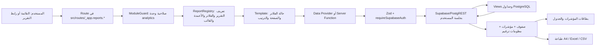
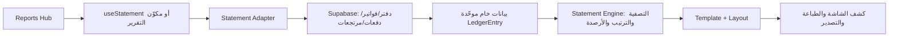

# دليل تدفق التقارير والكشوفات في Market Hub

> **الغرض:** شرح المسار الفعلي لبيانات التقارير من تعريف الشاشة وحقولها، مروراً بواجهة المستخدم وطبقة الخادم، وصولاً إلى Supabase/PostgREST وعروض SQL والجداول، ثم طريقة تجهيز النتائج وعرضها وتصديرها.
>
> **نطاق الدليل:** يميّز هذا المستند بين محرك التقارير الحديث تحت `/reports`، ومركز الكشوفات `/statements`، وتقارير المصروفات، وتقارير المطحنة. هذه مسارات مختلفة وليست واجهة واحدة أو مصدر بيانات واحداً.
>
> **ملاحظة معمارية:** لا يظهر في هذا المسار خادم أعمال مستقل منفصل عن التطبيق. تستخدم التقارير الحديثة دوال TanStack Start الخادمية، وتتصل هذه الدوال بـ Supabase بواسطة جلسة المستخدم؛ أما بعض الشاشات القديمة فتستعلم من Supabase مباشرة من المتصفح. وتظل قاعدة البيانات وسياسات RLS وعروضها ودوالها هي المصدر النهائي للبيانات.

---

## 1. خريطة التدفق المختصرة

### محرك `/reports` الحديث

### مركز الكشوفات `/statements`

---

## 2. أين توجد أجزاء النظام؟

| الطبقة | المسؤولية | أمثلة الملفات |
|---|---|---|
| المسارات والحماية | فتح مجال التقرير، حماية وحدة التحليلات، تركيب الصفحة | [مسار التقارير الأب](../src/routes/_app.reports.tsx)، [مسار المبيعات](../src/routes/_app.reports.sales.tsx)، [مسار المخزون](../src/routes/_app.reports.inventory.tsx) |
| تعريف التقرير | اسم التقرير، المجال، القالب، مصدر البيانات، الفلاتر، الأعمدة، المؤشرات والتصدير | [سجل تعريفات التقارير](../src/lib/reports/registry/index.ts)، [الأنواع والعقود](../src/lib/reports/types.ts) |
| تعريف الفلاتر المشتركة | نوع كل عنصر إدخال ومفتاحه وقائمة خياراته | [سجل الفلاتر](../src/lib/reports/registry/filter-registry.ts) |
| عناصر الواجهة | شريط الفلاتر، الجدول، مؤشرات الملخص، الترقيم، حالات الخطأ والفراغ | [شريط الفلاتر](../src/components/reports/shared/report-filters-bar.tsx)، [جدول البيانات](../src/components/reports/shared/report-data-table.tsx)، [بطاقات الملخص](../src/components/reports/shared/report-summary-deck.tsx)، [الترقيم](../src/components/reports/shared/report-pagination.tsx) |
| قوالب العرض | اختيار هيكل التقرير بحسب نوعه | [موجّه القوالب](../src/components/reports/report-template-renderer.tsx)، [قوالب التقارير](../src/components/reports/templates) |
| مزودات البيانات | تعريف شكل الصفوف والتحقق الأولي من الفلاتر ثم تمرير الطلب للخادم | [مجلد مزودات البيانات](../src/lib/reports/data-providers) |
| التنفيذ الخادمي | المصادقة والتحقق النهائي، تنفيذ الاستعلام، الحساب والترقيم | [دوال تنفيذ التقارير](../src/lib/reports/report-execution.functions.ts)، [وسيط مصادقة Supabase](../src/integrations/supabase/auth-middleware.ts) |
| مخطط قاعدة البيانات | عروض وسجلات القراءة المخصصة للتقارير | [عروض التقارير SQL](../supabase/migrations/12_reporting_views.sql) |
| قواعد الحساب | قواعد خالصة للتقريب والهامش والرصيد المتسلسل | [قواعد التقارير](../src/lib/reports/rules.ts) |
| الطباعة والتصدير | تكوين مخرجات الطباعة وExcel وCSV والإيصال الحراري | [محرك التصدير والطباعة](../src/lib/reports/export) |

---

## 3. تدفق فتح تقرير حديث بالتفصيل

1. يختار المستخدم «التقارير» من التنقل أو يفتح رابطاً مثل `/reports/sales?report=rep-sales-product`.
2. يمرّ المسار الأب عبر `ModuleGuard` لوحدة `analytics`. المسار `/reports` المجرد يحوّل المستخدم إلى تقرير المبيعات الافتراضي؛ ومسارات المجالات تعرض منفذ الصفحة الفرعية.
3. Route المجال يستدعي `useDomainReportSelection`. يقرأ المعرّف `report` من query string، ويتأكد أن التعريف موجود وينتمي للمجال نفسه، ثم يختار التقرير الافتراضي إذا لم يصلح المعرّف.
4. `DomainReportShell` يعرض اختيار المجال وبطاقات التقارير المسجلة في المجال. اختيار البطاقة يحدّث الرابط إلى `?report=<id>`، كي يمكن نسخ الرابط أو الرجوع للتقرير نفسه.
5. `ReportTemplateRenderer` يقرأ `viewTemplate` من تعريف التقرير، ثم يختار قالباً: جدول تفصيلي، ملخص، تجميع/ترتيب، حركة مخزون، مقارنة، أو استثناءات.
6. القالب يحتفظ بحالة الفلاتر والصفحة والفرز وأعمدة العرض. عند تغير أحد ما يُحمّل البيانات مجدداً، وتظهر حالات التحميل والخطأ والبيانات الفارغة في مكونات مشتركة.
7. عند طلب بيانات، ينشئ القالب طلباً يتضمن `reportId` والفلاتر والترقيم والفرز. في المزودات، يتحقق Zod من صيغة الفلاتر قبل استدعاء دالة الخادم.
8. دالة الخادم تستخدم `requireSupabaseAuth`، وتعيد التحقق من جسم الطلب بـ Zod، ثم تنفذ القراءة باستخدام `context.supabase` المرتبط بجلسة المستخدم. لذلك تظل سياسات RLS مطبقة؛ لا تستخدم دوال القراءة في هذا المسار مفتاح `service_role`.
9. تعود النتيجة إلى القالب: `rows` للصفحة المعروضة، و`metrics` للملخص، و`totalRowCount` ومعلومات الصفحة، و`meta` مثل الفلاتر المطبقة ورمز العملة وأساس التكلفة عند توفره.
10. تعرض الواجهة المؤشرات والصفوف. التصدير والطباعة يستهلكان نفس مجموعة الصفوف والمؤشرات الموجودة حالياً في الواجهة، ولا يعيدان تنفيذ استعلام شامل مستقل.

---

## 4. كيف تتحول الفلاتر إلى شروط قاعدة البيانات؟

### 4.1 تعريف الفلتر

تعريف التقرير يحدد عناصر الفلترة. سجل الفلاتر المشترك يعرّف مثلاً:

- `dateRange` للفترة.
- `customerId` و` supplierId` و`productId` و`warehouseId` لمحددات الجهات/الأصناف/المستودعات.
- `paymentMethod` لطريقة الدفع.
- `status` لحالة المستند.
- `search` للنص الحر.

### 4.2 عنصر الاختيار في الشاشة

`ReportFiltersBar` يقرأ تعريف الفلاتر ويعرض نوع التحكم المطابق. خيارات العملاء والموردين والمستودعات والمنتجات لا تُحمّل مباشرة بكامل الجداول؛ بل تستدعي `searchReportFilterOptions` الخادمية، التي تتحقق من المصدر المسموح به وتعيد حتى 100 خيار. المنتجات في بطاقة حركة الصنف لها أيضاً بحث خادمي خاص عبر `searchReportProducts`.

### 4.3 قيمة البحث والتاريخ

- البحث النصي يُكتب محلياً فوراً، ثم يرسل بعد توقف 300ms لتقليل تكرار طلبات التقرير.
- نطاق التاريخ الافتراضي في قوالب كثيرة هو من أول الشهر الحالي حتى اليوم.
- محدد الفترة يعرض اليوم، أمس، آخر 7 أيام، الشهر الحالي، الشهر السابق، وكل الفترات، إلى جانب حقلي تاريخ يدويين.
- التواريخ تتحول إلى `startDate` و`endDate`. الخادم يحول الحدود إلى ISO بواسطة `resolveDateRangeBoundaries`، ثم يطبق `gte` و`lte` على تاريخ المصدر.
- حالات التقرير والفلاتر تعيش داخل حالة React للقالب؛ اختيار التقرير نفسه محفوظ في الرابط، لكن لا ينبغي افتراض أن جميع الفلاتر الحالية تُحفظ في عنوان URL.

### 4.4 التحقق والتصفية الخادمية

مخططات Zod في `data-providers/filter-schemas.ts` تحدد أنواع UUID للمعرفات والفترة والحالة وطريقة الدفع والبحث. دوال الخادم تحدد أيضاً صفحات وفرزاً مضبوطين. البحث الذي يمر إلى PostgREST يُنظّف من الرموز `(` و`)` و`,` قبل استخدامه في `.or()`؛ كما أن حقول فرز المبيعات والمشتريات محصورة في قوائم مسموحة، بدلاً من تمرير اسم عمود حر للاستعلام.

### 4.5 الفلاتر المحلية في مسارات الكشوف الأقدم

ليست كل واجهات التقارير مبنية على هذا المحرك. في بعض مكونات مركز الكشوفات، يُطبّق التاريخ في الاستعلام، لكن البحث والحالة وطريقة الدفع قد تُطبّق بعد تحميل الصفوف في المتصفح. انظر قسم «المسارات الأخرى والفروقات» أدناه.

---

## 5. مصادر البيانات ومسار التقارير الأساسية

### 5.1 سجل المبيعات / تقرير المبيعات حسب المنتج

**الصفحة:** `/reports/sales`، والافتراضي `rep-sales-product`.

**التدفق:**

1. `GroupedRankingTemplate` يحدد `groupBy = product` لهذا التقرير، ويجمع الفترة والعميل والصنف وطريقة الدفع والبحث.
2. يستدعي `executeSalesGroupedReport` مباشرة عبر دالة TanStack الخادمية.
3. الخادم يقرأ بنود `sales_register` ويطبق الفلاتر، ويستبعد `cancelled` افتراضياً ما لم يطلب المستخدم حالة بعينها.
4. يعيد الخادم تجميع الصفوف حسب المنتج، ويحسب الكمية، والإجمالي الخام، والخصومات، وصافي المبيعات، والتكلفة والهامش ونسبته؛ ثم يفرز المجموعات ويجزئ **المجموعات** إلى الصفحة المطلوبة.
5. تصل إلى الواجهة النتائج المجمعة ومؤشرات الفترة. لا تُرسل البنود الخام إلى المتصفح لهذا التقرير.

**مصدر قاعدة البيانات:** العرض `public.sales_register` في [ترحيل عروض التقارير](../supabase/migrations/12_reporting_views.sql). العرض يربط `sales_invoice_items` مع `sales_invoices` و`products`، ويضم نوع البند وتأثيره على المخزون و`line_cost`. دالة `sales_line_cost` المضمنة في تعريف العرض تحاول استخدام تكلفة حركة الصرف الفعلية، ثم تكلفة معيارية مصرحاً بها، وتترك التكلفة غير معروفة `NULL` بدلاً من اختلاق قيمة.

**الفلاتر الفعلية:** تاريخ الإنشاء، العميل، المنتج، الحالة، طريقة الدفع، والبحث في رقم الفاتورة/اسم الصنف/SKU. تجميع العملاء يستخدم نفس دالة الخادم لكن `groupBy=customer`، ويعرض اسم العميل وعدد الفواتير والكمية وصافي المبيعات.

### 5.2 سجل المبيعات التفصيلي والملخص

`SalesRegisterDataProvider` يمرر الطلب إلى `executeSalesRegisterReport`. الخادم ينفذ استعلامين على `sales_register` بالفلاتر نفسها:

- استعلام صفوف بترقيم قاعدة البيانات عبر `.range(...)` وعدّ دقيق `count: exact`.
- استعلام أعمدة رقمية لتجميع المؤشرات على كامل النطاق المطابق، وليس الصفحة الحالية فقط.

بعدها يُثري صفوف الصفحة بأسماء العملاء من `customers`، ويعيد المؤشرات: عدد الصفوف، الكمية، المبيعات الخام، الخصم، الصافي، الضريبة، التكلفة، الهامش والنسبة. أي أن بطاقة الملخص تعبر عن كامل النطاق المحدد، بينما الجدول يعرض الصفحة الحالية.

### 5.3 سجل المشتريات والموردين

`PurchaseRegisterDataProvider` يستدعي `executePurchaseRegisterReport`؛ ويقرأ العرض `purchase_register`، الذي يجمع بنود `purchase_invoice_items` برأس `purchase_invoices` ويربط المنتج. الفلاتر المدعومة بالخادم: التاريخ، المورد، المنتج، الحالة، والبحث برقم الفاتورة/المنتج/SKU. الحالة الافتراضية تستبعد الملغاة. كما في المبيعات، صفوف الجدول مرقمة في قاعدة البيانات، والمؤشرات تحسب من كامل النطاق المطابق.

يستخدم تعريف التقرير نفسه للمشتريات والموردين في صفحة التقرير الحديثة. لا يعني ذلك وجود سجل مستقل لدفعات الموردين؛ دفعة الشراء التراكمية في الشاشات القديمة لها القيد الموضح بقسم الكشوفات.

### 5.4 بطاقة حركة الصنف المخزني

**التقرير:** `rep-inventory-item-card`، ويتطلب اختيار منتج. مصدره جدول `stock_movements` مع ربط `products` و`warehouses`.

1. واجهة الحركة تبحث عن المنتجات عبر `searchReportProducts` الخادمية؛ لا تحمل كتالوج المنتجات كاملاً.
2. عند اختيار المنتج، يمرر القالب المنتج والمستودع ونوع الحركة والفترة والترقيم إلى `executeInventoryMovementsReport`.
3. الخادم يحسب الرصيد الافتتاحي من الحركات السابقة لبداية الفترة عندما يوجد منتج وفترة بداية، ثم يجلب الحركات المطابقة مرتبة بحسب التاريخ ثم المعرّف.
4. يحول أنواع الحركة إلى وارد/صادر وفق `mapDbMovementTypeToKind`، ويحسب الرصيد التراكمي بواسطة `calculateRunningInventoryMovements`، ثم يرجع إجمالي الوارد والصادر والافتتاحي والختامي.
5. الترقيم في هذا المسار يتم بعد قراءة الحركات وحساب الرصيد، عبر تقطيع الصفوف في الخادم. لذلك قد يقرأ الخادم كل الحركات المطابقة قبل إرجاع الصفحة؛ وهو مختلف عن `.range()` داخل استعلام سجل المبيعات.

**قاعدة الحساب:** `runningBalance = openingBalance + inbound - outbound`. أنواع الشراء والمرتجع الوارد والتسوية الموجبة والتحويل الوارد تزيد الرصيد؛ البيع ومرتجع الشراء والتسوية السالبة والتحويل الصادر تنقصه. تعتمد النتيجة على قواعد [الحسابات النقية](../src/lib/reports/rules.ts).

### 5.5 المقارنة بين الفترات

`ComparisonTemplate` يطلب بيانات تفصيلية عبر مزود، ويطلب كتلة مقارنة منفصلة عبر `executeComparisonReport`. دالة المقارنة تحسب تجميع الفترة الحالية والفترة السابقة على الخادم، وتعيد القيمة الحالية والسابقة والفرق المطلق ونسبة التغير؛ لا تعيد صفوف التجميع الخام لهذا الجزء.

**تنبيه تنفيذي مهم:** دالة `executeComparisonReport` تستعلم من `sales_register` بصورة ثابتة. لا ينبغي اعتبار قالب المقارنة عاماً للمشتريات أو لمصادر أخرى دون إضافة تنفيذ مخصص؛ كما أن مزود الصفوف التفصيلية يختار مشتريات أو مبيعات بحسب `dataProviderId`. يلزم الحفاظ على هذا الفرق عند توسيع القالب.

### 5.6 تقارير الاستثناءات

`StatusExceptionsTemplate` يرسل الفلاتر والترقيم والفرز ومصدر الاستثناء إلى `executeExceptionsReport`. أنواع مصادر الاستثناء المعرفة في العقد تشمل سجل المبيعات، سجل المشتريات، المخزون المنخفض، المخزون الراكد، وفجوات تصنيف الأصناف. بعض هذه المصادر لها Views SQL واضحة مثل `item_classification_gaps`، بينما يجب مراجعة تنفيذ الدالة في `report-execution.functions.ts` عند إضافة/تعديل مصدر؛ مجرد وجود اسم المصدر في السجل أو النوع لا يثبت أن كل واجهة استثناءات مكتملة وظيفياً.

### 5.7 تعريفات التقارير ليست مرادفاً لتنفيذ مستقل لكل تقرير

يسجل [ReportRegistry](../src/lib/reports/registry/index.ts) 12 تعريفاً موزعة على المبيعات والمخزون والمشتريات والعملاء والموردين والرقابة. التعريف يحدد العرض والحقول والفلاتر و`dataProviderId`؛ لكنه وحده لا ينشئ اتصالاً بقاعدة البيانات. المزودات الموجودة حالياً هي سجل المبيعات، سجل المشتريات وحركة المخزون. لذلك عند مراجعة تقرير بعينه يجب تتبع السلسلة كاملة: Route ← قالب ← مزود/دالة خادم ← View/جدول، وعدم استنتاج توفر تنفيذه الكامل من ظهوره كبطاقة فقط.

---

## 6. الترتيب والترقيم والأعمدة والمؤشرات

### الجدول والفرز

- تعريف التقرير يوفر مفاتيح الأعمدة وأنواعها (`money`, `quantity`, `date`, `status_badge`...) ويحدد الأعمدة الأساسية والظاهرة افتراضياً.
- `ReportDataTable` ينسق الأرقام والتواريخ حسب نوع العمود، ويمنع إخفاء الأعمدة الموسومة `essential`.
- النقر على عنوان العمود يبدل اتجاه الفرز عندما يمرر القالب `onSort`. الفرز الفعلي يُرسل إلى دالة الخادم في القوالب التي تدعمه، وتتحقق الدالة من الحقول المقبولة.
- مجموعات `aggregate` في ذيل الجدول تحسب من صفوف الصفحة الموجودة في المتصفح. ليست هذه بالضرورة إجمالي كل صفحات التقرير؛ المؤشرات الخادمية هي المرجع لإجمالي النطاق الكامل.

### ترقيم الصفحات

يستقبل مكون الترقيم `page`, `pageSize`, `totalPages`, و`totalRowCount`. الخيارات المعروضة عادةً 25 و50 و100 صفاً. في مسارات المبيعات/المشتريات يحد الاستعلام نفسه الصفوف عبر `.range()`؛ في التجميع يتم تقطيع المجموعات بعد التجميع في الخادم؛ وفي حركة المخزون يتم تقطيع النتائج بعد تكوين الرصيد المتسلسل.

### اختيار الأعمدة

يُنشأ سجل أعمدة خاص بالتقرير بواسطة `createReportColumnRegistry`. بعض قوالب المحرك تمرر هذا السجل إلى `RecordsColumnPicker`، ويحدد `essential` الأعمدة غير القابلة للإخفاء. لا تؤثر رؤية العمود على الفلاتر أو مصدر البيانات أو الحساب؛ إنها تفضيل عرض فقط.

---

## 7. دقة الحساب والخصوصية

- عمليات قراءة المحرك الحديث تتم في دوال خادمية، وتتحقق من جلسة المستخدم ومن شكل البيانات قبل الاستعلام.
- تستخدم الاستعلامات `context.supabase` مع المستخدم المصادق عليه؛ سياسات RLS في PostgreSQL هي حد عزل البيانات الفعلي.
- حسابات المبيعات والهامش والتقريب وقواعد حركة المخزون موجودة في [rules.ts](../src/lib/reports/rules.ts). `round2` للأموال و`round3` للكميات.
- تكلفة المبيعات في `sales_register` ليست تقديراً تلقائياً من سعر الكتالوج؛ مصدر الحقيقة للتكلفة موضح عبر `sales_line_cost`. لكن `classifyCostBasis` يميز أساس التكلفة الذي تعيده واجهة التقرير، ولذلك ينبغي عرض الشارة وعدم وصف تكلفة مرجعية بأنها تكلفة فعلية.
- التصدير لا ينبغي أن يعيد الحساب التجاري. إنه يأخذ الصفوف والمؤشرات الجاهزة من نتيجة التقرير ويهيئها بصيغة الإخراج.

---

## 8. الطباعة والتصدير

من `ReportExportDialog` يصل المستخدم إلى:

- **طباعة A4:** HTML للطباعة الرسمية، حسب قالب `summary` أو `detailed` أو `movement` المعرف للتقرير.
- **إيصال حراري 80mm:** يظهر فقط إذا فعّل التقرير `directPrintSlip`.
- **Excel:** ملف XML بصيغة Excel يتضمن ورقة للمؤشرات وورقة للبيانات، مع اتجاه RTL وتنسيق الأرقام.
- **CSV:** يولد على دفعات لتقليل تجميد المتصفح، يعرض تقدم العملية ويسمح بالإلغاء. يضيف UTF-8 BOM، ويهرب الخلايا ويحمي النصوص التي قد تفسرها برامج الجداول كصيغ.

تعمل هذه المحركات على `ReportExportPayload` الذي يحوي `definition`, `rows`, `metrics`, و`appliedFilters`. وبما أن صفوف الجدول في الـ payload هي الصفوف المحملة حالياً، فالتصدير من هذه النافذة لا يعني تلقائياً جلب كل صفحات الاستعلام.

---

## 9. المسارات الأخرى للتقارير والكشوفات

### 9.1 مركز الكشوفات `/statements`

هذا محرك مختلف عن `/reports`. نقطة دخوله البرمجية `useStatement` في [use-statement.ts](../src/hooks/use-statement.ts):

1. يطلب `loadStatementSource(entityType, entityId)` من سجل المحولات [adapters/index.ts](../src/lib/statements/adapters/index.ts).
2. محول العميل يقرأ بيانات العميل وقيوده من `customers` و`customer_ledger`، ويرتبها ويثري مراجعها. محول المورد يشتق الحركات من `purchase_invoices` و`purchase_returns` لعدم وجود دفتر مورد مستقل حسب تعليق المحول. محول الخزينة يجمع التحصيلات والفواتير/المدفوعات والمصروفات من مصادرها.
3. يحول كل محول النتائج إلى `LedgerEntry` موحد. لا يحسب المحول الرصيد النهائي.
4. `buildStatement` في محرك الكشوف يطبق الفترة وخيار إظهار الحركات الصفرية، يرتب الحركات، يحسب الرصيد الافتتاحي وحركة الفترة والرصيد المتسلسل والختامي، ويقارن رصيد الدفتر بالرصيد المخزن عند توفره.
5. `resolveStatementLayout` يختار القالب والأعمدة الظاهرة وتسمياتها. القالب ينسق العرض ولا يعيد الحساب.

**معنى الفترة:** قد تُحمّل المحولات الحركات ثم يطبق المحرك نطاق التاريخ محلياً. لذلك هذا ليس نموذج ترقيم/تصفية SQL نفسه الموجود في مزودات `/reports`، ويجب مراعاة حجم المصدر عند تقييم الأداء.

### 9.2 القيود والفجوات في كشف المورد

يوضح [supplier adapter](../src/lib/statements/adapters/supplier.ts) أن رصيد المورد مشتق من فواتير التوريد والمرتجعات، وأن قيمة `purchase_invoices.paid` تراكمية ولا تحمل تاريخ سداد مستقل. لهذا تُعرض دفعة المورد على أنها سداد مرافق للفاتورة، ولا يصح التعامل معها كحركة نقدية مستقلة بتاريخ مؤكد.

### 9.3 التقارير التشغيلية القديمة في Reports Hub

يعرض `reports-hub-tab.tsx` تقارير متعددة ويستخدم مكونات مثل [operational-reports.tsx](../src/components/statements/operational-reports.tsx)، [purchases-report.tsx](../src/components/statements/purchases-report.tsx)، و[profit-sales-report.tsx](../src/components/statements/profit-sales-report.tsx). هذه الواجهات تختلف عن التنفيذ الخادمي الحديث:

- تقرير الفواتير يقرأ `sales_invoices` مباشرة، والشراء يقرأ `purchase_invoices` مباشرة.
- المصروفات التشغيلية القديمة تقرأ `expense_entries` مباشرة؛ وحركة المخزون تقرأ `stock_movements` مباشرة؛ والمرتجعات تقرأ `sales_returns` و`purchase_returns` مباشرة.
- نطاق التاريخ قد يُطبّق في استعلام Supabase، لكن البحث والحالة وطريقة الدفع في `OperationalReports` تصفية داخل الذاكرة بعد جلب النتائج.
- الشراء يجلب الفواتير ضمن الفترة، ثم يبحث محلياً في رقم الفاتورة واسم المورد.
- تقرير الأرباح الأساسي يقرأ الفواتير والبنود والمرتجعات والمصروفات مباشرة، ويحسب المجاميع في المتصفح؛ كما يستدعي `sales_line_cost` لكل بند مبيعات. وصف الشاشة نفسه يقدمه كتقدير تشغيلي لا كقائمة دخل محاسبية نهائية.

هذه الملاحظات مهمة عند تفسير الأرقام ومقارنة تلك الشاشة مع تقارير `/reports`؛ لا تفترض أن كليهما يستخدم View أو قاعدة حساب واحدة.

### 9.4 المصروفات الحديثة

وحدة المصروفات لها طبقة قراءة مستقلة في [use-expenses.ts](../src/hooks/use-expenses.ts):

- `useExpenseList` يستدعي RPC `list_expenses` مع البحث والحالة والتصنيف والمستودع ومركز التكلفة والمشروع والمورد والموظف وحالة الدفع والتاريخ والمبلغ، ويستخدم **keyset pagination** بصفحات حجمها 50.
- `useExpenseSummary` يستدعي `expense_summary`؛ المجاميع تحسب في SQL ضمن الفترة/المستودع.
- `useExpenseLookups` يستدعي `expense_lookups` لقوائم الفلاتر والمرجعيات.
- `useExpenseReport` وتقارير المصروفات تستخدم `expense_report` بحسب محور التجميع. أسماء الدوال وتعريفها موثقان أيضاً في [توثيق وحدة المصروفات](./EXPENSES_MODULE.md).

هذه الدوال RPC في PostgreSQL، وليست نفس `createServerFn` لمزودات `/reports`. يجب تتبع معاملات RPC وسياسات قاعدة البيانات الخاصة بكل تقرير عند إضافة فلتر.

### 9.5 تقارير المطحنة

مسار `/milling/reports` في [صفحة تقارير المطحنة](../src/routes/_app.milling.reports.tsx) يطلب ثلاثة استعلامات React Query:

- `fetchEfficiencyReport` لكفاءة الاستخلاص والفاقد والفواتير المرتبطة.
- `fetchIntakeHealth` لسلامة ربط سند الاستلام بالفحص/درجة الحبوب.
- `fetchPricingDiagnostics` لكشف غياب الأجرة أو وجود أساسَي تسعير معاً.

المصادر معرفة في `12_reporting_views.sql` كالعروض `milling_efficiency_report`, `milling_intake_health`, و`milling_pricing_diagnostics`. الشاشة تحسب بعض بطاقات الأرقام من الصفوف العائدة في المتصفح، وتبني CSV محلياً من صفوف الكفاءة. توجد أيضاً شاشة كشف أمانات العميل التي تفصل بين الكميات العينية والذمم المالية؛ تعرض [صفحة كشف المطحنة](../src/routes/_app.milling.customer-statement.tsx) هذا الفصل وتستخدم قراءات `milling_customer_custody`, `milling_output_balances` و`milling_service_money` عبر مكتبة المطحنة.

---

## 10. أمثلة تتبع عملية واحدة

### مثال: المستخدم يختار فترة المبيعات ومنتجاً

1. يتغير `filters.startDate` أو `filters.productId` في قالب التقرير.
2. يؤدي تغير الحالة إلى تشغيل `fetchData` مجدداً.
3. يرسل القالب `filters` و`page/pageSize` و`sort` إلى `executeSalesGroupedReport`.
4. يتحقق الخادم من الصيغة، يحول حدود التاريخ، ويضيف شروط `.gte/.lte/.eq` إلى الاستعلام على `sales_register`.
5. يحسب الخادم التجميع والمؤشرات ويفرز النتيجة، ثم يعيد شريحة الصفحة.
6. تعرض `ReportSummaryDeck` المؤشرات، ويعرض `ReportDataTable` الصفوف؛ ويمكن فتح حوار الطباعة أو التصدير للنتيجة نفسها.

### مثال: المستخدم يطلب بطاقة حركة لصنف

1. كتابة اسم الصنف تستدعي بحث الخيارات الخادمي المحدود.
2. اختيار الصنف يسمح للقالب بطلب الحركات.
3. الخادم يقرأ الحركات السابقة لاحتساب الافتتاحي ثم حركات الفترة والمستودع.
4. تتحول أنواع الحركات إلى كميات داخلة/خارجة، ويحسب الرصيد المتسلسل في الخادم.
5. يعود الرصيد الافتتاحي والإجمالي والختامي مع صفوف الصفحة.

### مثال: المستخدم يفتح كشف حساب عميل

1. يتحدد العميل والفترة وخيار الصفوف الصفرية في واجهة مركز الكشوفات.
2. `useStatement` يجلب مصدر العميل عبر المحول ويخزنه مؤقتاً في React Query.
3. `buildStatement` يطبق فترة العرض على بيانات المصدر ويحسب الرصيد الافتتاحي والتراكمي والختامي.
4. `resolveStatementLayout` يختار القالب والأعمدة والتسميات؛ وتستخدم الشاشة/الطباعة الناتج الموحد.

---

## 11. اعتبارات التطوير والصيانة

عند إنشاء تقرير أو تعديل فلتر:

1. حدّد أولاً هل المطلوب تقرير حديث تحت `/reports`، أو كشف حساب تحت `/statements`، أو تقرير مصروفات، أو تقرير مطحنة. لا تخلط عقودها.
2. أضف تعريف التقرير إلى `ReportRegistry` مع `domain`, و`viewTemplate`, و`dataProviderId`, ومصدر البيانات، وحبيبات الصف، والفلاتر والأعمدة والمؤشرات.
3. تحقق أن القالب المستخدم يستطيع فعلاً التعامل مع نوع المزود. وجود `dataProviderId` داخل التعريف لا يربط مزوداً تلقائياً؛ بعض القوالب تختار صراحة بين مبيعات ومشتريات، وبعضها يستخدم دالة خاصة.
4. عرّف مخطط Zod للفلاتر في العميل والخادم، وتحقق من UUID والحدود والصفحات والفرز. لا تمرر اسم عمود أو جزء SQL يحدده المستخدم.
5. نفّذ الاستعلام في خادم موثق أو RPC مناسب؛ حافظ على RLS ولا تنقل مفتاح خدمة للمتصفح.
6. استخدم Views أو RPCs القائمة عند ملاءمتها، وحدد بوضوح هل المؤشرات تخص كل النتائج أم الصفحة فقط، وهل الترقيم داخل SQL أم بعد الحساب في الخادم.
7. اختبر الفلاتر منفردة ومجتمعة، والحالات الملغاة/المسودات/المرتجعة، والفترات الحدية، وبيانات المستخدمين ذوي الصلاحيات المختلفة.
8. اجعل الطباعة والتصدير تستهلك النتائج نفسها قدر الإمكان. إذا كان التصدير يجب أن يشمل جميع الصفحات، فأنشئ مساراً خادمياً للتصدير أو جلباً مجزأً؛ لا تفترض أن الصفوف المحملة حالياً تمثل كل النتائج.
9. وثّق الفجوات بوضوح: أساس التكلفة، مصدر الرصيد، تاريخ السداد، واستبعاد الحالات؛ هذه معلومات تعريفية تؤثر في معنى الرقم.

---

## 12. حدود هذا التوثيق

هذا المستند يشرح التدفق الظاهر من ملفات المصدر الحالية والبنية المُعرّفة في ترحيلات قاعدة البيانات. لا يثبت وحده أن كل ترحيل مطبق على بيئة الإنتاج، أو أن بيانات البيئة مطابقة للمخطط، أو أن كل بطاقة تقرير في السجل لها تنفيذ مكتمل. للتحقق من بيئة بعينها يجب مقارنة ملفات `supabase/migrations` بالمخطط المنشور، ومراجعة RLS الفعلية ونتائج الاختبارات والبيانات.
