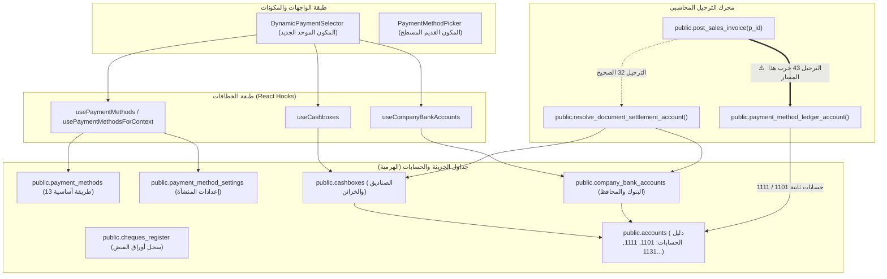

# تقرير التدقيق والتحليل الشامل لمنظومة طرق الدفع والحسابات والخزينة
## Market Hub ERP — Comprehensive Payment Methods, Treasury & UI Audit

> **تاريخ التقرير:** 24 أكتوبر 2026  
> **الفرع المنشأ للتطوير والإصلاح:** `feature/payment-methods-enhancements` (متفرع من أحدث نسخة في `origin/main` عند الالتزام `80a2e5c`)  
> **نطاق الفحص:** قاعدة البيانات، دوال الترحيل، دليل الحسابات، مكونات واجهة المستخدم (UI Components)، وتحليل استخداماتها عبر كافة شاشات النظام.

---

## الفهرس
1. [ملخص تنفيذي وتأكيد الفرع الجديد](#1-ملخص-تنفيذي-وتأكيد-الفرع-الجديد)
2. [لغز وقصة نص «لم يتم ربط حساب افتراضي بعد» (Root Cause Analysis)](#2-لغز-وقصة-نص-لم-يتم-ربط-حساب-افتراضي-بعد-root-cause-analysis)
3. [البنية التحتية لطرق الدفع والحسابات في قاعدة البيانات](#3-البنية-التحتية-لطرق-الدفع-والحسابات-في-قاعدة-البيانات)
4. [تحليل مكونات التصميم الخاصة بطرق الدفع (UI Components)](#4-تحليل-مكونات-التصميم-الخاصة-بطرق-الدفع-ui-components)
5. [تدقيق استخدام طرق الدفع في الشاشات (Screen-by-Screen Audit)](#5-تدقيق-استخدام-طرق-الدفع-في-الشاشات-screen-by-screen-audit)
6. [مصفوفة المقارنة والتقييم لجميع الشاشات](#6-مصفوفة-المقارنة-والتقييم-لجميع-الشاشات)
7. [خطة العمل والإصلاحات المقترحة في الفرع الجديد](#7-خطة-العمل-والإصلاحات-المقترحة-في-الفرع-الجديد)

---

## 1. ملخص تنفيذي وتأكيد الفرع الجديد

تم بحمد الله إنشاء وتفعيل البرانش الجديد الخاص بالتطوير والإصلاحات المالية:
- **اسم البرانش:** `feature/payment-methods-enhancements`
- **نقطة الانطلاق:** أحدث نسخة على الخادم البعيد `origin/main` (commit `80a2e5c`).
- **جاهزية مساحة العمل:** الشجرة نظيفة، وتتبع البرانش معد وجاهز للعمل والتعديل دون المساس بتاريخ Git المنشور حفاظاً على توافقية Lovable.

### أبرز نتائج التدقيق والتحليل:
1. **نص "لم يتم ربط حساب افتراضي بعد"** ليس مجرد رسالة خطأ عامة، بل هو ناتج عن شرط برمجي صريح في المكون `DynamicPaymentSelector` في وضعه المختصر (`compact`) بسبب تجاهل معالجة الدفع بالبطاقة/الشبكة (`CARD`)، وتأخر استجابة بيانات الخزينة من Supabase عند التحميل الأولي، وغياب ربط الحساب الافتراضي في بعض المحافظ.
2. **ازدواجية المكونات:** يعاني النظام من وجود مكوّنين متنافسين لاختيار طريقة الدفع: المكون الحديث الهرمي `DynamicPaymentSelector` والمكون القديم المسطح `PaymentMethodPicker`.
3. **انقطاع الترحيل المحاسبي (Regression في الترحيل 43):** بينما بنى الترحيل رقم `32` دالة ذكية (`resolve_document_settlement_account`) لترحيل المبالغ بدقة إلى الصندوق أو البنك أو المحفظة المختارة، جاء الترحيل رقم `43` وأعاد كتابة `post_sales_invoice` بدالة قديمة تتجاهل الصناديق وتصب كل النقد في الحساب `1101` وكل البنوك في `1111`!
4. **شاشة نقطة البيع (POS) تهدر بيانات الخزينة:** يقوم الكاشير في شاشة POS باختيار طريقة الدفع أو الصندوق أو البنك، ولكن عند الضغط على "إتمام البيع"، يتم إرسال النص القديم فقط (`cash`, `card`) إلى الدالة `create_sale`، ويُهمل كائن التسوية (`settlement`) بالكامل!

---

## 2. لغز وقصة نص «لم يتم ربط حساب افتراضي بعد» (Root Cause Analysis)

### 2.1 أين يظهر هذا النص؟
يظهر هذا النص في الملف:  
[`src/components/ui/payment-method/dynamic-payment-selector.tsx`](file:///h:/em/market-hub/src/components/ui/payment-method/dynamic-payment-selector.tsx#L216-L238)

```tsx
// السطر 216 - 238 في dynamic-payment-selector.tsx
<div className="flex min-h-6 items-center gap-1.5 border-t border-border/50 bg-muted/25 px-3 py-1 text-[10px] leading-tight">
  {currentKind === "CREDIT" ? (
    <span className="font-medium text-violet-700 dark:text-violet-300">
      {isAr ? "ذمم العميل — لا يوجد حساب تحصيل" : "Customer receivable — no collection account"}
    </span>
  ) : selectedAccountName ? (
    <>
      <Check className="size-3 shrink-0 text-emerald-600" />
      <span className="truncate font-medium text-emerald-700 dark:text-emerald-400">
        {selectedAccountName}
      </span>
      <span className="shrink-0 text-muted-foreground">
        · {isAr ? "مرتبط بالدليل المحاسبي" : "Ledger linked"}
      </span>
    </>
  ) : (
    <span className="text-amber-700 dark:text-amber-400">
      {isAr ? "لم يتم ربط حساب افتراضي بعد" : "No default account linked"}
    </span>
  )}
</div>
```

وكذلك يظهر داخل خيارات القائمة المنسدلة `<select>` في السطر 205:
```tsx
const accountName = account
  ? ...
  : method.ledgerKind === "CREDIT"
    ? (isAr ? "ذمم العميل" : "Customer receivable")
    : (isAr ? "غير مرتبط" : "Not linked");
```

---

### 2.2 الأسباب التقنية الخمسة لظهور هذه الرسالة:

#### السبب الأول: نسيان عائلة البطاقات (`CARD` / شبكة مدى) برمجياً
في السطور 166-171 من المكون:
```typescript
const accountForMethod = (method: ResolvedPaymentMethod) => {
  if (method.ledgerKind === "CASH") return defaultCashbox;
  if (method.ledgerKind === "BANK") return defaultBank;
  if (method.ledgerKind === "WALLET") return defaultWallet;
  return null; // <-- هنا الكارثة!
};
```
- إذا كانت طريقة الدفع `CARD` (بطاقة/شبكة): لا يوجد فحص لـ `CARD`!
- تعيد الدالة `null`.
- يصبح `selectedAccount = null` و `selectedAccountName = null`.
- النتيجة الحتمية: **في أي شاشة تستخدم الوضع `compact`، بمجرد اختيار الكاشير "بطاقة / شبكة"، تظهر له فوراً عبارة: `لم يتم ربط حساب افتراضي بعد` باللون الأصفر التحذيري، وفي خيارات القائمة يظهر: `بطاقة / شبكة — غير مرتبط`!**

#### السبب الثاني: سباق التحميل الأولي (Asynchronous Race Condition)
عند فتح الشاشة (مثل شاشة POS أو الفواتير):
1. يتم ضبط طريقة الدفع الأولية على `cash`.
2. يتم تشغيل استعلام `useCashboxes()` و `useCompanyBankAccounts()`.
3. ريثما ترد استجابة الخادم (مئات الأجزاء من الثانية):
   - تكون `activeCashboxes` مصفوفة فارغة `[]`.
   - يكون `defaultCashbox` هو `undefined`.
   - يكون كائن `settlement` الأولي خاليًا من اسم الصندوق `cashboxName`.
4. الدالة تجد `selectedAccountName = undefined`، فيظهر النص المحرج للمستخدم `لم يتم ربط حساب افتراضي بعد` حتى ينتهي التحميل!

#### السبب الثالث: شاشات تعمل بدون تهيئة حسابات الخزينة في السحابة
إذا فُتح النظام على قاعدة بيانات جديدة، أو لم يتم تشغيل بذور الترحيل 32، أو كان المستخدم يدخل بحساب غير مصرح له بقراءة جدول `company_bank_accounts` عبر سياسات RLS:
- تفشل استعلامات الخزينة أو تعيد مصفوفات فارغة.
- لا يوجد `defaultBank` ولا `defaultWallet`.
- تظل جميع الطرق عدا الكاش والآجل تظهر عبارة `لم يتم ربط حساب افتراضي بعد`.

#### السبب الرابع: غياب `is_default` عن المحافظ في بذرة الترحيل 32
في الترحيل `32_treasury_cashboxes_and_payment_hierarchy.sql` (السطور 218-240):
تم زرع محافظ (جيب، ون كاش، جوالي، فلوسك) وكانت قيمة `is_default` لجميعها تساوي `false`:
```sql
INSERT INTO public.company_bank_accounts (name_ar, kind, bank_name, account_id, is_default, is_active)
VALUES ('محفظة جيب', 'WALLET', 'شركة الأهدل المالية', v_jaib_acct, false, true); -- false!
```
بينما في بنك الكريمي تم وضعها `true`. وبالتالي عند تصفية المحافظ في `useCompanyBankAccounts`:
`const defaultWallet = wallets.find((w) => w.is_default) ?? wallets[0];`
فإذا كانت `wallets` فارغة أو لم تتطابق أسماؤها مع ما يطلبه المكون، تصبح القيمة فارغة ويظهر التحذير.

#### السبب الخامس: الشاشات التي تفعل الوضع المختصر `compact={true}`
النص لا يظهر إلا في الشاشات التي ترسل الخاصية `compact`، وهذه الشاشات هي:
1. `src/routes/_app.pos.tsx` (نقطة البيع السريعة).
2. `src/components/invoices/standard-invoice-composer.tsx` (محرر فواتير البيع والشراء الموحد).
3. `src/routes/_app.purchase-returns.tsx` (مرتجعات المشتريات).
4. `src/routes/_app.sales-returns.tsx` (مرتجعات المبيعات).
5. `src/routes/_app.milling.intake.tsx` (استلام حبوب المطحنة).

---

## 3. البنية التحتية لطرق الدفع والحسابات في قاعدة البيانات



### 3.1 جداول الكتالوج والإعدادات (الترحيل 16)
1. **جدول `payment_methods`**: الكتالوج المعتمد من المطورين (13 طريقة نظامية: نقد، بطاقة، بنك، كريمي، يمن كويت، جيب، ون كاش، فلوسك، جوالي، شيك، مجزأ...).
2. **جدول `payment_method_settings`**: إعدادات المنشأة الخاصة (تفعيل/تعطيل، ترتيب العرض، السياقات المسموحة).
3. **النوع ENUM `payment_method`**: يحتوي 7 قيم تاريخية قديمة فقط (`cash`, `card`, `bank_transfer`, `credit`, `mobile_money`, `split`, `cheque`).

### 3.2 منظومة الخزينة متعددة الصناديق والبنوك (الترحيل 32)
أضاف الترحيل 32 نقلة نوعية ضخمة:
1. جدول `cashboxes`: لدعم صناديق الكاشيرات والخزائن الرئيسية، وكل صندوق مربوط بحسابه المالي في الدليل `accounts(id)`.
2. جدول `company_bank_accounts`: لدعم حسابات البنوك والمحافظ الإلكترونية للمنشأة، وكل حساب مربوط بحسابه في الدليل.
3. دالة `resolve_document_settlement_account(p_payment_method, p_cashbox_id, p_bank_account_id, p_payment_method_id)`: تبحث أولاً عن حساب الصندوق المختار، ثم حساب البنك/المحفظة، ثم حساب الكتالوج، وتمنع الخلط المالي.

### 3.3 الانتكاسة المحاسبية الكبرى (Regression في الترحيل 43)
عند مراجعة الترحيل `supabase/migrations/43_audit_remediation_delivery_blockers.sql` (السطور 758-865):
- قام كاتب الترحيل بإعادة إنشاء دالة `post_sales_invoice` لحل مشاكل إيرادات الخدمات والمخزون.
- لكنه **نسخ نسخة قديمة من الدالة** تحتوي على:
  ```sql
  v_cash_acct := public.payment_method_ledger_account(v_inv.payment_method::text);
  ```
- **الأثر الكارثي:** هذا السطر مسح التعديل المتقدم للترحيل 32! حتى لو اختار المستخدم صندوقاً أو محفظة جيب أو بنك الكريمي، فإن محرك الترحيل في الترحيل 43 يتجاهل أعمدة `cashbox_id` و `bank_account_id` المضافة للفاتورة، ويرمي كل النقدية في حساب `1101` وكل البنوك في `1111`!

---

## 4. تحليل مكونات التصميم الخاصة بطرق الدفع (UI Components)

### 4.1 مقارنة معمارية بين المكونين الموجودين في النظام

| وجه المقارنة | المكون الحديث `DynamicPaymentSelector` | المكون القديم `PaymentMethodPicker` |
|---|---|---|
| **نوع الاختيار** | هرمي على مستويين (Two-Tier Hierarchical) | قائمة منسدلة مسطحة أحادية (Flat Select) |
| **دعم الصناديق (Cashboxes)** | نعم (يعرض الصناديق المتاحة ويحدد المستلم) | ❌ لا يدعم (لا يعرف الصناديق) |
| **دعم الحسابات البنكية للمنشأة** | نعم (يعرض حسابات بنوك المنشأة مع الآيبان ورقم الحساب) | ❌ لا يدعم (يعرض البنك كطريقة دفع مجردة) |
| **دعم المحافظ الإلكترونية** | نعم (أزرار للمحافظ مع حقل رقم العملية/الإشعار) | ❌ لا يدعم (فقط خيار اسم المحفظة) |
| **دعم بيانات الشيك** | نعم (رقم الشيك، تاريخ الاستحقاق، البنك المسحوب عليه، الساحب) | ❌ لا يدعم (فقط خيار كلمة شيك) |
| **نوع كائن الحالة (State)** | كائن تسوية كامل `PaymentSettlementSelection` | نص مجرد `string` |
| **أماكن الاستخدام الحالية** | POS، الفواتير، المصروفات، التحصيل، المرتجعات، المطحنة | شيت المشتريات، POS المشتريات، لوحة الدفع الجزئي |

---

### 4.2 مشاكل التصميم والواجهة في `DynamicPaymentSelector`:

1. **مشكلة ضغط الشاشة واختيار الوضع المختصر `compact` في POS:**
   - شاشة POS تحتاج سرعة قصوى (Fast Checkout) بلمسة زر واحدة.
   - المكون يملك وضعين:
     - **الوضع الكامل:** أزرار كبيرة واضحة لكل طريقة (نقد، بطاقة، محفظة...) وتحتها أزرار فرعية.
     - **الوضع المختصر (`compact`):** قائمة منسدلة عادية HTML `<select>` وتحتها شريط صغير للمعلومات.
   - في شاشة POS (`src/routes/_app.pos.tsx`) تم تفعيل `compact={true}` لحشر المكون في الشريط الجانبي الأيمن، مما أفقد الكاشير ميزة الأزرار السريعة بلمسة واحدة، وأجبره على فتح قائمة منسدلة، علاوة على ظهور نص "لم يتم ربط حساب افتراضي بعد".

2. **خلل دمج وتكرار الطرق عبر `m.legacyValue`:**
   في السطور 153-163 من المكون:
   ```typescript
   const primaryButtons = useMemo(() => {
     const map = new Map<string, ResolvedPaymentMethod>();
     for (const m of methods) {
       const key = m.legacyValue;
       if (!map.has(key)) map.set(key, m);
     }
     return Array.from(map.values());
   }, [methods]);
   ```
   - هذا الدمج يعني أن طرق المحافظ (`jawali`, `jaib`, `floosak`, `one_cash`) تشترك جميعها في `legacyValue = "mobile_money"`.
   - يتم إبقاء الطريقة الأولى فقط (`jawali`) وحذف البقية من القائمة الرئيسية!
   - في الوضع المختصر (`compact`)، لا تظهر المحافظ الأخرى في القائمة المنسدلة على الإطلاق!

3. **حفظ المحافظ كـ Bank Accounts:**
   في جدول `company_bank_accounts`، يتم تخزين المحافظ بنوع `kind = 'WALLET'`. ولكن في كود `DynamicPaymentSelector`:
   ```typescript
   const matchedAcc = wallets.find(
     (acc) => acc.bank_name.includes(w.nameAr) || acc.name_ar.includes(w.nameAr)
   );
   ```
   هذا التطابق عبر النصوص (`includes`) هش وعرضة للكسر إذا اختلف الاسم العربي للمحفظة عن اسم مزود الخدمة المسجل.

---

## 5. تدقيق استخدام طرق الدفع في الشاشات (Screen-by-Screen Audit)

### 5.1 شاشة نقطة البيع POS (`src/routes/_app.pos.tsx`)
- **المكون المستخدم:** `DynamicPaymentSelector` مع خاصية `compact`.
- **المشكلة التشغيلية والواجهة:**
  1. يظهر نص "لم يتم ربط حساب افتراضي بعد" فور اختيار "بطاقة / شبكة" أو أثناء التحميل الأولي.
  2. القائمة المنسدلة تبطئ الكاشير مقارنة بالأزرار الكبيرة المباشرة.
- **المشكلة البرمجية الحرجة:**
  - يتم تعريف الحالة: `const [settlement, setSettlement] = useState<PaymentSettlementSelection>({ method: "cash" });`
  - لكن عند استدعاء `supabase.rpc("create_sale", ...)` في السطر 1479، **لا يتم تمرير أي حقل من حقول `settlement`!**
  - لا يُرسل `cashbox_id` ولا `bank_account_id` ولا بيانات الشيك!
  - تُحفظ الفاتورة بدون صندوق أو بنك، وتسقط بيانات الخزينة في الهواء!

---

### 5.2 شاشة نقطة بيع المشتريات (`src/routes/_app.purchase-pos.tsx`)
- **المكون المستخدم:** `PaymentMethodPicker` (القديم المسطح).
- **المفارقة:** الملف يستورد `DynamicPaymentSelector` في السطر 59، لكنه لا يستخدمه! ويستخدم المكون القديم في السطر 1732.
- **النتيجة:** مستخدم POS المشتريات لا يستطيع تحديد الصندوق الذي خرج منه النقد، ولا البنك المحول منه، ولا المحفظة.

---

### 5.3 شاشة فواتير المبيعات (`_app.sales-invoice.tsx` & `standard-invoice-composer.tsx`)
- **المكون المستخدم:** `DynamicPaymentSelector` مع `compact` في المحرر الموحد.
- **طريقة الحفظ:**
  1. يتم استدعاء `create_sale` RPC أولاً لحفظ الفاتورة وترحيل القيد المحاسبي.
  2. ثم بعد انتهاء الـ RPC، يقوم الفرونت إند بعمل `update` لاحق على جدول `sales_invoices` لتحديث `cashbox_id` و `bank_account_id`.
- **الخلل المحاسبي:**
  - عند تشغيل الـ RPC، يتم ترحيل القيد المحاسبي فوراً بحساب نقد افتراضي `1101` لأن الحقول كانت `NULL` وقت الترحيل.
  - الـ `update` اللاحق يحدث رأس الفاتورة فقط ولا يعيد توليد القيد المحاسبي بالصندوق الحقيقي!

---

### 5.4 شاشة المشتريات الرئيسية (`src/routes/_app.purchases.tsx`)
- **المكون المستخدم:** `DynamicPaymentSelector` في النموذج الرئيسي الكامل.
- **التقييم:** ممتاز؛ يتم تخزين `cashbox_id` و `bank_account_id` ومرجع التحويل بصورة صحيحة.

---

### 5.5 شاشة سندات القبض والتحصيل (`src/routes/_app.payments.tsx`)
- **المكون المستخدم:** `DynamicPaymentSelector` بالوضع الكامل.
- **طريقة الحفظ:** ترسل المعلمات بدقة إلى `record_customer_payment`:
  `_cashbox_id`, `_bank_account_id`, `_cheque_number`, `_cheque_due_date`...
- **التقييم:** تطبيق ممتاز وسليم من حيث الواجهة وربط البيانات.

---

### 5.6 شاشة المصروفات (`src/components/expenses/expense-form.tsx`)
- **المكون المستخدم:** `DynamicPaymentSelector` بالوضع الكامل.
- **طريقة الحفظ:** يتم تحديث `accountId` المرتبط بالصندوق أو البنك فوراً:
  ```typescript
  onSettlementChange={(s) => {
    setSettlement(s);
    if (s.chartAccountId) setAccountId(s.chartAccountId);
  }}
  ```
- **التقييم:** هذا هو أفضل وأصح تطبيق في النظام بأكمله؛ لأنه يربط حساب الخزينة بحساب الأستاذ العام المالي مباشرة.

---

### 5.7 شاشات المرتجعات (`sales-returns.tsx` & `purchase-returns.tsx`)
- **المكون المستخدم:** `DynamicPaymentSelector` بوضع `compact`.
- **الملاحظة:** تظهر عبارة "لم يتم ربط حساب افتراضي بعد" عند اختيار البطاقة، ويتم الحفظ عبر تحديث لاحق للمرتجع.

---

### 5.8 شاشة استلام حبوب المطحنة (`src/routes/_app.milling.intake.tsx`)
- **المكون المستخدم:** `DynamicPaymentSelector` بوضع `compact`.
- **الملاحظة:** تظهر نفس رسالة الحساب غير المرتبط عند اختيار البطاقة.

---

## 6. مصفوفة المقارنة والتقييم لجميع الشاشات

| الشاشة / الملف | المكون المستخدم | الوضع | هل يدعم الصناديق؟ | هل يدعم البنوك/المحافظ؟ | هل يحفظ الخزينة بالداتابيز؟ | حالة ظهور «لم يتم ربط» |
|---|---|---|:---:|:---:|:---:|:---:|
| **نقطة البيع POS** (`_app.pos.tsx`) | `DynamicPaymentSelector` | `compact` | جزئي | جزئي | ❌ **لا (تُهدر البيانات)** | ⚠️ **تظهر (عند الشبكة والتحميل)** |
| **POS المشتريات** (`_app.purchase-pos.tsx`) | `PaymentMethodPicker` | قديم مسطح | ❌ | ❌ | ❌ | لا (مكون قديم) |
| **فاتورة المبيعات** (`sales-invoice.tsx`) | `DynamicPaymentSelector` | `compact` | ✅ | ✅ | ⚠️ تحديث لاحق بعد الترحيل | ⚠️ تظهر عند الشبكة |
| **المشتريات** (`_app.purchases.tsx`) | `DynamicPaymentSelector` | كامل | ✅ | ✅ | ✅ سليم | غير ظاهرة |
| **المصروفات** (`expense-form.tsx`) | `DynamicPaymentSelector` | كامل | ✅ | ✅ | ✅ سليم تماماً | غير ظاهرة |
| **سندات القبض** (`_app.payments.tsx`) | `DynamicPaymentSelector` | كامل | ✅ | ✅ | ✅ سليم مع الشيكات | غير ظاهرة |
| **مرتجع المبيعات** (`sales-returns.tsx`) | `DynamicPaymentSelector` | `compact` | ✅ | ✅ | ⚠️ تحديث لاحق | ⚠️ تظهر عند الشبكة |
| **مرتجع المشتريات** (`purchase-returns.tsx`) | `DynamicPaymentSelector` | `compact` | ✅ | ✅ | ⚠️ تحديث لاحق | ⚠️ تظهر عند الشبكة |
| **استلام المطحنة** (`milling.intake.tsx`) | `DynamicPaymentSelector` | `compact` | ✅ | ✅ | ⚠️ تحديث لاحق | ⚠️ تظهر عند الشبكة |

---

## 7. خطة العمل والإصلاحات المقترحة في الفرع الجديد

بناءً على هذا التحليل الشامل في البرانش الجديد `feature/payment-methods-enhancements`، نلخص خطة الحل المتكاملة إلى خمس حزم عمل رئيسية:

### الحزمة 1: إصلاح مكون `DynamicPaymentSelector` وإلغاء رسالة "لم يتم ربط" نهائياً
1. إضافة عائلة `CARD` إلى دالة حل الحساب:
   - ربط البطاقة/الشبكة بحساب البنك الافتراضي (`defaultBank`) أو حساب تسوية مدى/الشبكة (`1111` أو `1112`).
2. معالجة حالة التحميل الأولي (Loading Skeleton / Fallback):
   - عدم إظهار نص التحذير أثناء جلب البيانات من الخادم، وعرض مؤشر تحميل هادئ أو اعتماد الصندوق الافتراضي الشائع فوراً.
3. معالجة اختيار المحافظ في القائمة المنسدلة للوضع المختصر:
   - إظهار كل محفظة باسمها وحسابها دون دمجها في سطر واحد غامض.
4. تحسين نص وحالة الربط بالدليل المحاسبي ليقدم معلومات واضحة للكاشير والمحاسب.

### الحزمة 2: توحيد المكونات وإلغاء `PaymentMethodPicker` القديم
1. استبدال `PaymentMethodPicker` القديم في شاشة `purchase-pos.tsx` وشيت المشتريات بالمكون الموحد `DynamicPaymentSelector`.
2. ضمان تجربة مستخدم متناسقة وهوية بصرية واحدة لجميع أزرار وأيقونات طرق الدفع.

### الحزمة 3: إصلاح حفظ بيانات الخزينة في نقطة البيع (POS)
1. تعديل دالة `create_sale` RPC لتقبل:
   `_cashbox_id uuid DEFAULT NULL`, `_bank_account_id uuid DEFAULT NULL`, `_payment_method_id text DEFAULT NULL`.
2. تحديث استدعاء `create_sale` في `_app.pos.tsx` لتمرير قيم `settlement.cashboxId` و `settlement.bankAccountId` وبيانات الشيك.
3. حفظ الفاتورة مباشرة مع ربط الصندوق والبنك لحظياً دون الحاجة لتحديثات لاحقة.

### الحزمة 4: معالجة الانتكاسة المحاسبية في ترحيل الفواتير (Regression Fix)
1. تحديث دالة `post_sales_invoice` ودالة `post_purchase_invoice` في ترحيل جديد لإعادة تفعيل استدعاء:
   ```sql
   v_cash_acct := public.resolve_document_settlement_account(
     v_inv.payment_method::text,
     v_inv.cashbox_id,
     v_inv.bank_account_id,
     v_inv.payment_method_id
   );
   ```
2. التأكد من أن قيد اليومية الآلي يُسجل مديونية الصندوق المختار أو البنك المختار فعلياً في ميزان المراجعة ودفتر الأستاذ.

### الحزمة 5: اختبارات التحقق الشاملة (Verification & Smoke Tests)
1. اختبار إصدار فاتورة POS نقدية بصندوق محدد والتحقق من رقم حساب القيد في جدول `journal_lines`.
2. اختبار فاتورة POS بشبكة/بطاقة والتأكد من اختفاء رسالة التحذير تماماً.
3. اختبار تحصيل عميل بمحفظة جيب والتأكد من إيداع المبلغ في حساب محفظة جيب `1132`.
4. اختبار سند صرف مصروف من صندوق فرعي والتأكد من خروج النقدية من الصندوق الصحيح.

---
**جاهزون للبدء في تنفيذ الخطوات البرمجية فور توجيهكم على البرانش الجديد.**
