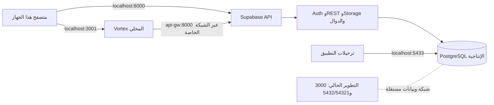

# تجهيز قاعدة بيانات الإنتاج على Docker المحلي

هذا الدليل يجهّز تشغيلًا محليًا مستقلًا لـVortex وSupabase على جهاز Windows الحالي. لا يجهّز خادمًا عامًا ولا يربط التطبيق بالسحابة. **لم تُنزّل صورًا، ولم تُنشأ حاويات أو قاعدة إنتاج محلية، ولم تُطبّق ترحيلات أو بذور.** التنفيذ مؤجل حتى يتوفر اتصال وقرص ومساحة ذاكرة كافية.

## 1. النتيجة المقصودة

| الجزء | العنوان على الجهاز | الاستخدام |
| --- | --- | --- |
| نسخة التطبيق المحلية الإنتاجية | `http://localhost:3001` | المتصفح يفتح التطبيق |
| Supabase API | `http://localhost:8000` | اتصال المتصفح بالتوثيق وREST وStorage والدوال |
| PostgreSQL الإنتاجية | `127.0.0.1:5433` | الترحيلات والنسخ الاحتياطي من هذا الجهاز فقط |
| تطبيق التطوير الحالي | `http://localhost:3000` | يبقى منفصلًا عن النسخة المحلية الإنتاجية |
| Supabase التطوير الحالية | المنافذ والشبكة التي أنشأها Supabase CLI | لا تُستخدم لترحيلات الإنتاج ولا تُحذف |

يكون اتصال التطبيق داخل Docker إلى `http://api-gw:8000` على شبكة `supabase_default`. أما المتصفح فيستخدم `localhost:8000`. تُربط المنافذ المنشورة بـ`127.0.0.1` حتى لا تستقبل اتصالات من الشبكة المحلية. لا يعمل Caddy ولا تُستخدم نطاقات عامة.



> هذه نسخة محلية على جهاز واحد. لن يصل إليها موظف من جهاز آخر، ولن تعمل إذا أُغلق الجهاز أو Docker Desktop. استخدامها عبر الإنترنت أو كخدمة متاحة للفروع يتطلب إعداد نشر منفصلًا وHTTPS ونسخًا احتياطية خارج الجهاز.

## 2. حالة الجهاز ولماذا نؤجل التنزيل

عند إعداد هذا الدليل:

- Docker Desktop يعمل، وحاويات التطوير الحالية نشطة على شبكة Supabase خاصة بمشروع التطوير. تُترك كما هي.
- قائمة توزيعات WSL تحتوي حاليًا على `docker-desktop` فقط؛ لا توجد توزيعة Ubuntu جاهزة لتشغيل أداة التهيئة.
- قرص `C:` لديه قرابة **1.72 GiB** فارغة، وذاكرة الجهاز نحو **15.7 GiB** منها **1.29 GiB** متاحة وقت الفحص.
- لدى Docker صور محلية بحجم **7.255 GB**؛ هذا حجمها المحلي، وليس تقديرًا لحجم التنزيل القادم.

تذكر متطلبات Supabase الرسمية حدًا أدنى قدره 4 GB RAM و40 GB SSD لتشغيل جميع المكونات، وتوصي بـ8 GB RAM و80 GB SSD. التنزيل الأول قد يستهلك عدة جيجابايت بحسب الصور المخزنة مسبقًا وإصداراتها؛ لا يمكن إعطاء رقم دقيق قبل فحص الصور المطلوبة. لذلك المساحة والذاكرة الحاليتان غير كافيتين لبدء المكدس كاملًا. إن كان لديك قرص آخر، انقل موقع بيانات Docker Desktop إليه من إعداداته بعد التأكد من وجود مساحة مناسبة؛ لا تحذف وحدات أو بيانات Docker الموجودة لتوفير المساحة.

راجع [متطلبات Supabase الرسمية](https://supabase.com/docs/guides/self-hosting/docker#system-requirements) قبل التنفيذ.

## 3. ملفات التجهيز التي أضيفت

- `deploy/supabase-local-production.override.yaml`: يعزل منفذ API وقاعدة البيانات على loopback، ويوقف منافذ Supavisor المنشورة.
- `deploy/compose.local-production.override.yaml`: يربط التطبيق المحلي على المنفذ `3001`، ويمنع منافذ Caddy العامة.
- `deploy/app.local-production.env.example`: يشرح القيم المتوقعة للعنوان المحلي؛ لا يحتوي أسرارًا فعلية.
- `deploy/bootstrap-self-hosted-supabase.sh --local`: يهيئ مكدس Supabase محليًا بإصدار رسمي مثبّت، وينشئ مفاتيح جديدة، ويكتب `.env.local-production`، ويجهز وظائف Edge الموجودة في المشروع. يحتاج اتصالًا لتنزيل إعدادات المصدر، لكنه لا يبدأ Docker ولا يسحب الصور.
- `npm run db:selfhosted:protect:local`: يقيّد صلاحية قراءة ملفي الأسرار على حساب Windows الحالي وSYSTEM وAdministrators. ملفات `chmod 600` داخل مسار `/mnt/c` قد لا تحصل وحدها على صلاحيات Windows المطلوبة.
- `npm run db:selfhosted:push:local`: يشغّل أداة Windows PowerShell، ويفحص تكرار إصدارات ملفات الترحيل، ثم يطبق المعلّق على قاعدة `127.0.0.1:5433` ويسأل عن التأكيد قبل الترحيل والبذور. لا يحتاج Ubuntu بعد اكتمال تجهيز Supabase.
- `npm run db:selfhosted:owner:local`: ينشئ حساب المالك الأول بأمر صريح بعد اكتمال الترحيلات. يطلب كلمة المرور دون عرضها، ولا يفعّل قاعدة «أول حساب يصبح مالكًا».

ملف `.env.local-production` ومجلد `deploy/supabase-stack/` مستثنيان من Git وسياق بناء Docker. لا تنسخ الأسرار إلى `VITE_*` سوى مفتاح النشر العام؛ يبقى `SUPABASE_SECRET_KEY` في بيئة الخادم فقط.

## 4. تجهيز Windows/WSL عند توفر الإنترنت

### أ. تثبيت Ubuntu وربطها بـDocker Desktop

من PowerShell كمسؤول، ثبّت Ubuntu إذا لم تكن موجودة:

```powershell
wsl --install -d Ubuntu
```

قد يتطلب التثبيت إعادة تشغيل وتنزيل Ubuntu. بعد إعداد اسم مستخدم Ubuntu، فعّل تكاملها من Docker Desktop عبر **Settings → Resources → WSL Integration**. افتح Ubuntu وتحقق من:

```bash
sudo apt-get update
sudo apt-get install -y git python3 openssl jq
docker compose version
```

يجب أن يعرض آخر أمر Compose إصدارًا `2.24.4` أو أحدث. لا تثبّت محرك Docker ثانيًا داخل Ubuntu؛ استخدم Docker Desktop الموجود وتكامله مع WSL.

### ب. إنشاء الإعداد والأسرار

من Ubuntu:

```bash
cd /mnt/c/Users/mousa/Desktop/project/market-hup
bash deploy/bootstrap-self-hosted-supabase.sh --local
```

يسحب هذا الأمر إعداد Compose الرسمي المثبّت على `self-hosted/v0.8.3` ويولد أسرارًا جديدة خاصة بهذا المكدس، ويولّد كلمة مرور جديدة لـStudio وينسخ دوال المشروع المطلوبة لإدارة الموظفين. لا يطبع قيم الأسرار، ويرفض الكتابة فوق إعداد موجود، ولا ينفذ `docker compose pull` أو `up`. عناوين Auth ستكون `http://localhost:8000/auth/v1`، وموقع التطبيق `http://localhost:3001`، والتسجيل العام والهاتف والتأكيد التلقائي معطلة.

بعد عودة الأمر بنجاح، ومن PowerShell:

```powershell
npm run db:selfhosted:protect:local
```

هذا يزيل صلاحيات القراءة الموروثة عن ملفي الأسرار ويمنحها لحساب Windows الحالي وSYSTEM ومديري الجهاز. لا تعرض الملفات في الطرفية ولا ترسلها أو ترفعها إلى Git.

مصدر الإعداد المثبّت: [Compose الرسمي للإصدار v0.8.3](https://raw.githubusercontent.com/supabase/supabase/self-hosted/v0.8.3/docker/docker-compose.yml) و[ملف إعداداته](https://raw.githubusercontent.com/supabase/supabase/self-hosted/v0.8.3/docker/.env.example). لا تشغّل الملف الرسمي مباشرة؛ استخدم ملفات التعديل المحلية المرفقة بهذا المشروع.

### ج. فحص الإعداد قبل أي تنزيل

من PowerShell في جذر المشروع:

```powershell
docker compose --project-name supabase --env-file deploy/supabase-stack/.env `
  -f deploy/supabase-stack/docker-compose.yml `
  -f deploy/supabase-stack/docker-compose.local-production.override.yaml config --quiet

docker compose --env-file deploy/.env.local-production `
  -f deploy/compose.production.yaml `
  -f deploy/compose.local-production.override.yaml config --quiet
```

الأمران يقرآن الإعداد فقط ولا ينشئان حاويات. إذا ظهر خطأ، أوقف التنفيذ وراجعه قبل سحب الصور. لا تستخدم `docker compose config` دون `--quiet` لأن المخرجات الكاملة قد تتضمن أسرار البيئة.

### د. تنزيل الصور وتشغيل Supabase المحلي الإنتاجي

نفذ هذه المرحلة فقط بعد توفر إنترنت ومساحة كافية. الأمر `pull` هو الذي يستهلك الإنترنت:

```powershell
docker compose --project-name supabase --env-file deploy/supabase-stack/.env `
  -f deploy/supabase-stack/docker-compose.yml `
  -f deploy/supabase-stack/docker-compose.local-production.override.yaml pull
```

بعد اكتمال السحب، شغّل المكدس وانتظر صحته:

```powershell
docker compose --project-name supabase --env-file deploy/supabase-stack/.env `
  -f deploy/supabase-stack/docker-compose.yml `
  -f deploy/supabase-stack/docker-compose.local-production.override.yaml up -d --wait
```

هذه قاعدة جديدة ذات مجلد بيانات منفصل عن قاعدة التطوير. لا تنفذ `supabase start` لتشغيل هذه القاعدة، ولا توجه التطبيق إلى شبكة التطوير `supabase_network_kwzqvgdyadylwnvjghqn`.

## 5. تطبيق مخطط قاعدة البيانات والبذور

قبل التطبيق، تأكد أن تغييرات العمل وملف الترحيل النشط `supabase/migrations/9917_product_delete_guard_custody_refs.sql` محفوظة. الملف `9917` غير متعقب في Git حاليًا؛ لذلك احفظه ضمن نسخة المشروع أو أضفه إلى commit قبل نقل المشروع أو تبديل الفرع.

نفذ من PowerShell في جذر المشروع بعد أن تصبح قاعدة Supabase سليمة:

```powershell
npm run db:selfhosted:push:local
```

السكربت:

1. يتحقق من صيغة أسماء الترحيلات ومن عدم تكرار رقم إصدار.
2. يتصل فقط بقاعدة PostgreSQL على `127.0.0.1:5433`، ويطلب كتابة `APPLY SELF-HOSTED MIGRATIONS`.
3. يطبق الترحيلات الموجودة في `supabase/migrations` التي لم تُطبق؛ لا ينفذ reset ولا يمسح قاعدة التطوير أو السحابة.
4. يطلب تأكيدًا ثانيًا بكتابة `SEED SELF-HOSTED PRODUCTION` ثم يطبق بذور النظام فقط.

قائمة بذور النظام المسموحة هي الوحدات، الخطط، دليل الحسابات، وحدات القياس، تصنيفات المصروفات، ترقيم المستندات، طرق الدفع، الشركاء الأساسيون، وإعدادات مصروفات الإنتاج الافتراضية. يتجاوز السكربت `06_platform_admins.sql` وبيانات العينات؛ لا تُنشأ حسابات مسؤولي المنصة أو بيانات معاملات تجريبية.

## 6. إنشاء المالك الأول وتسجيل الدخول

قاعدة البيانات لا تجعل أول مستخدم مالكًا تلقائيًا عمدًا. بعد اكتمال الترحيلات والبذور، أنشئ المالك صراحة:

```powershell
npm run db:selfhosted:owner:local
```

الأداة تتحقق أن هدفي المتصفح والخادم مضبوطين على Docker المحلي، وأن جدول المستخدمين والأدوار خاليان، ثم تنشئ الحساب عبر Supabase Auth Admin وتمنحه دور `owner` صراحة. كلمة المرور مطلوبة بحد أدنى 16 حرفًا وتُقرأ كحقل مخفي. إذا وجدت الأداة مستخدمًا أو دورًا سابقًا، تتوقف كي لا تغيّر الصلاحيات القائمة. إذا توقفت بعد إنشاء حساب Auth وقبل تعيين الدور، فقد يكون الحساب موجودًا بلا صلاحية؛ افحصه يدويًا قبل أي إعادة محاولة.

بعدها شغّل نسخة التطبيق المحلية:

```powershell
docker compose --env-file deploy/.env.local-production `
  -f deploy/compose.production.yaml `
  -f deploy/compose.local-production.override.yaml build app

docker compose --env-file deploy/.env.local-production `
  -f deploy/compose.production.yaml `
  -f deploy/compose.local-production.override.yaml up -d app
```

افتح `http://localhost:3001` وسجّل الدخول بحساب المالك الذي أنشأته. الـEdge Function `admin-create-user` تُنسخ أثناء التهيئة لتعمل إضافة الموظفين من واجهة إدارة المستخدمين. لا يوجد تحويل تلقائي إلى مشروع Supabase السحابي عند تعطل Docker.

## 7. التحقق بعد التشغيل

```powershell
docker compose --project-name supabase --env-file deploy/supabase-stack/.env `
  -f deploy/supabase-stack/docker-compose.yml `
  -f deploy/supabase-stack/docker-compose.local-production.override.yaml ps

docker exec supabase-db pg_isready -U postgres -d postgres
Invoke-WebRequest http://localhost:8000/auth/v1/health
Invoke-WebRequest http://localhost:3001
```

افتح التطبيق، تحقق من تسجيل دخول المالك، ثم أنشئ مستخدمًا تجريبيًا من واجهة المستخدمين للتأكد من عمل Edge Function والصلاحيات. لا تبدأ معاملات محاسبية حقيقية قبل إجراء مراجعة قبول وظيفية للشراء والبيع والمخزون والقيود والنسخ الاحتياطي.

## 8. التشغيل اليومي والنسخ الاحتياطي

لإيقاف المكدسين مع حفظ البيانات استخدم `stop`، ولإعادتهما استخدم `up -d --wait` بالأعلام والملفات نفسها. لا تستخدم `down -v` أو `reset.sh` أو `git clean -xfd`؛ قد تحذف قاعدة البيانات والملفات المرفقة. تخزين Postgres والملفات موجود تحت `deploy/supabase-stack/volumes/`، لذلك لا تحذف هذا المجلد ولا تنقل المستودع دون نسخه.

مثال لنسخة قاعدة بيانات قبل تغيير مهم؛ ينشئ dump داخل الحاوية ثم ينسخه إلى مجلد خاص خارج المستودع:

```powershell
$stamp = Get-Date -Format "yyyyMMdd-HHmmss"
$backupDir = Join-Path $env:USERPROFILE "MarketHubBackups\$stamp"
New-Item -ItemType Directory -Force -Path $backupDir | Out-Null
docker exec supabase-db pg_dump -U postgres -d postgres -Fc -f "/tmp/market-hub-$stamp.dump"
docker cp "supabase-db:/tmp/market-hub-$stamp.dump" (Join-Path $backupDir "database.dump")
docker exec supabase-db rm -f "/tmp/market-hub-$stamp.dump"
```

هذه النسخة تشمل قاعدة PostgreSQL ولا تشمل ملفات Supabase Storage. انسخ `deploy/supabase-stack/volumes/storage` وسري البيئة إلى وسيط آمن منفصل عند الحاجة، واحتفظ بنسخ مشفرة بعيدًا عن قرص الجهاز. لا تُعد قاعدة من النسخة فوق قاعدة مستخدمة قبل مراجعة الهدف والنسخة.

## 9. ما أُنجز وما لم يُنفذ

- جهزت إعدادات Compose محلية معزولة عن Compose الخادم العام وعن قاعدة التطوير، ومسارًا لتوليد أسرار جديدة، وتطبيق الترحيلات والبذور، وإنشاء المالك الأول.
- لم يُسحب أي image في هذه المرحلة، ولم يبدأ مكدس إنتاج محلي، ولم تُطبق أي ترحيلة أو seed، ولم يتم الاتصال بقاعدة السحابة.
- نقطة التوقف الحالية متعمدة: المساحة المتاحة على `C:` أقل من 2 GiB وWSL Ubuntu غير مثبتة. بعد توفير مساحة مناسبة واتصال إنترنت، نتابع بدءًا من قسم 4 ثم ننفذ خطوة خطوة ونتحقق بعد كل مرحلة.
