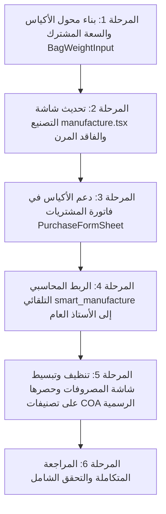

# 🌾 وثيقة الماستر بلان الشاملة: تطوير عمليات المطحنة، إدارة الأكياس، التكلفة الذكية، والربط المحاسبي الكامل

**Document ID:** `DOC-MILLING-ERP-MASTER-2026-V2-AUDITED`  
**Status:** مدققة ومطابقة 100% لدليل الحسابات الرسمي (Chart of Accounts) وقواعد النظام المحاسبي.  
**Target:** لكافة الوكلاء الأذكياء (Agents) والمطورين للبدء والتنفيذ المباشر خطوة بخطوة.  
**Scope:** منظومة المطحنة، المنتجات، المشتريات، المخزون، القيود المحاسبية، المصروفات، الأصول الثابتة، والأرصدة الافتتاحية.

---

## 🎯 الرؤية والمنهجية الصارمة (Strict Accounting Compliance)

1. **الامتثال التام لشجرة الحسابات الرسمية:** لا يتم استحداث أي حساب عشوائي أو نصوص وهمية من خارج شجرة الحسابات المعتمدة في النظام (`03_chart_of_accounts.sql` و `05_expense_categories.sql`).
2. **فصل الاختصاصات المحاسبية ومنع التكرار:**
   - **المصروفات التشغيلية (`/expenses`):** تقتصر حصراً على مصروفات الفترة العادية المرتبطة بتصنيفات جدول `expense_categories`.
   - **المصروفات المدفوعة مقدماً (`1511`) والمؤجلة (`1512`):** لها شاشتها ومحركها المحاسبي المستقل (`prepayments_deferred`) ولا تظهر أو تتداخل مع شاشة المصروفات اليومية.
   - **الأصول الثابتة (`1411`..`1491`):** لها شاشتها المستقلة المخصصة للأصول الثابتة والإهلاك (`/fixed-assets`).
3. **وحدات التداول الطبيعية (الأكياس وسعاتها) مقابل الكيلوجرام:** توحيد سعة الكيس `products.package_weight_kg` كنظام ثنائي متزامن في المشتريات، التصنيع، والمخازن.
4. **تكامل قيود اليومية الآلية للجرد المستمر:** ربط حركات التصنيع وصرف المستهلكات بحسابات المخزون والتكلفة الرسمية في دفتر الأستاذ العام.

---

## 🏛️ المرجع المحاسبي المعتمد من شجرة الحسابات (COA Source of Truth)

تعتمد كافة العمليات والقيود في هذه الخطة على الأكواد الرسمية الثابتة في النظام:

| كود الحساب          | اسم الحساب الرسمي في النظام   | النوع         | الاستخدام في عمليات المنظومة                                |
| :------------------ | :---------------------------- | :------------ | :---------------------------------------------------------- |
| **`1101`**          | **النقدية بالصندوق**          | أصل متداول    | الصندوق الرئيسي والدرج للتحصيل وسداد المصروفات              |
| **`1111` / `1112`** | **البنوك**                    | أصل متداول    | الحسابات البنكية للمدفوعات والمقبوضات                       |
| **`1131`–`1139`**   | **المحافظ الإلكترونية**       | أصل متداول    | حسابات الدفع عبر المحافظ (جوالي، جيب، فلوسك...)             |
| **`1211`**          | **ذمم العملاء**               | أصل متداول    | مطالبات المبيعات الآجلة وأجور خدمات الطحن                   |
| **`1311`**          | **مخزون مواد أولية**          | أصل متداول    | الحبوب الخام (القمح، الذرة، الشعير)                         |
| **`1312`**          | **مخزون إنتاج تحت التنفيذ**   | أصل متداول    | تكلفة الإنتاج أثناء التشغيل                                 |
| **`1313`**          | **مخزون منتجات تامة**         | أصل متداول    | الدقيق التام الجاهز للبيع بمختلف أنواعه                     |
| **`1314`**          | **مخزون نواتج ثانوية**        | أصل متداول    | النخالة ونواتج الطحن الجانبية                               |
| **`1315`**          | **مخزون مواد التعبئة**        | أصل متداول    | الأكياس الفارغة والخيوط ومواد التغليف المخزنية              |
| **`1321`**          | **بضاعة أمانات عندنا**        | أصل متداول    | كميات حبوب العملاء المودعة للطحن (يقابلها 2121)             |
| **`1411`**          | **آلات ومعدات**               | أصل ثابت      | آلات الطحن، الغرابيل، ماكينات التعبئة، المولدات             |
| **`1491`**          | **مجمع إهلاك الأصول الثابتة** | أصل مقابل     | مجمع الإهلاك التراكمي لآلات ومعدات المنشأة                  |
| **`1511`**          | **مصروفات مدفوعة مقدمًا**     | أصل متداول    | إيجارات وتأمينات مدفوعة مقدماً (شاشة Prepayments)           |
| **`2111`**          | **ذمم الموردين**              | التزام متداول | التزامات مشتريات الحبوب والمستهلكات الآجلة                  |
| **`2121`**          | **أمانات العملاء**            | التزام متداول | الالتزام المقابل لحبوب العميل الموجودة بالمطحنة             |
| **`4111`**          | **إيراد المبيعات**            | إيراد تشغيلي  | إيراد بيع السلع والمنتجات التامة (الدقيق)                   |
| **`4211`**          | **إيراد النواتج الثانوية**    | إيراد تشغيلي  | إيراد بيع النواتج العرضية (النخالة)                         |
| **`4311`**          | **إيراد الخدمات**             | إيراد تشغيلي  | **الحساب الرسمي لأجور وخدمات الطحن والتشغيل** (نوع SERVICE) |
| **`5111`**          | **تكلفة المبيعات**            | مصروف         | تكلفة البضاعة المباعة الخارجة من المخزون                    |
| **`5211`**          | **أجور العمالة المباشرة**     | مصروف تشغيل   | أجور عمال التشغيل والإنتاج اليومية والمباشرة                |
| **`5221`**          | **رواتب إدارية**              | مصروف إداري   | رواتب الموظفين والإداريين                                   |
| **`5311`**          | **كهرباء ووقود**              | مصروف تشغيل   | الطاقة، الكهرباء، والديزل والوقود                           |
| **`5312`**          | **مياه واتصالات وإنترنت**     | مصروف تشغيل   | فواتير المياه، الهاتف، واشتراكات الإنترنت                   |
| **`5313`**          | **إيجارات**                   | مصروف تشغيل   | إيجار الفترة الحالي                                         |
| **`5314`**          | **صيانة وإصلاح**              | مصروف تشغيل   | صيانة الآلات والمعدات وقطع الغيار                           |
| **`5315`**          | **مواصلات ونقل**              | مصروف تشغيل   | نولون ونقل البضائع والمشتريات                               |
| **`5316`**          | **مواد تعبئة وتغليف**         | مصروف تشغيل   | أكياس وخيوط مستهلكة مباشرة أثناء التشغيل                    |
| **`5611`**          | **إهلاك الأصول الثابتة**      | مصروف         | قسط الإهلاك الدوري لآلات ومعدات المنشأة                     |
| **`5921`**          | **فاقد وتلف**                 | مصروف / خسارة | فاقد وتلف التشغيل والهدر الطبيعي وغير الطبيعي               |

---

## 🧭 الفهرس العام للمحاور الستة

- [المحور 1: المعمارية الموحدة للأكياس والسعة (Bags & Capacity Engine)](#المحور-1-المعمارية-الموحدة-للأكياس-والسعة)
- [المحور 2: تطوير شاشة إنتاج وتصنيع المطحنة والتصنيع الذكي](#المحور-2-تطوير-شاشة-إنتاج-وتصنيع-المطحنة)
- [المحور 3: المنظومة الرياضية للتكلفة والتسعير (Costing & Pricing)](#المحور-3-المنظومة-الرياضية-للتكلفة-والتسعير)
- [المحور 4: الربط المحاسبي الآلي لعمليات المطحنة بدفتر الأستاذ العام (GL)](#المحور-4-الربط-المحاسبي-الآلي-لعمليات-المطحنة)
- [المحور 5: ضبط وتكامل واجهة المصروفات ومنع ازدواجية الحسابات](#المحور-5-ضبط-وتكامل-واجهة-المصروفات)
- [المحور 6: تكامل الأصول الثابتة والإهلاك والأرصدة الافتتاحية](#المحور-6-تكامل-الأصول-الثابتة-والإهلاك-والأرصدة-الافتتاحية)
- [خارطة طريق التنفيذ التقني للوكلاء (Agent Execution Phases)](#خارطة-طريق-التنفيذ-التقني-للوكلاء)

---

## المحور 1: المعمارية الموحدة للأكياس والسعة (Bags & Capacity Engine)

### 1.1 المبدأ المعماري الموحد

- **قاعدة التخزين المحاسبي:** الكيلوجرام (`kg`) هو وحدة القياس المحاسبية الدقيقة للجرد المستمر لمنع كسور التدوير.
- **واجهة الاستخدام التفاعلية:** محوّل ثنائي ذكي متزامن **[أكياس + سعة الكيس / كيلوجرام مباشر]** يعتمد على سعة العبوة الرسمية للصنف `products.package_weight_kg`.
- **المعادلة الرياضية الثابتة:**
  $$\text{الوزن الإجمالي (كجم)} = \text{عدد الأكياس} \times \text{سعة الكيس (كجم)}$$
  $$\text{سعر الكيلو} = \frac{\text{سعر الكيس}}{\text{سعة الكيس (كجم)}}$$

### 1.2 تطبيق محول الأكياس في فاتورة المشتريات (`PurchaseFormSheet`)

- عند شراء حبوب (قمح مثلاً) أو دقيق:
  - يتيح السطر للمستخدم الاختيار:
    - **شراء بالأكياس:** يحدد عدد الأكياس (مثلاً `100 كيس`) مع سعة الكيس (`50 كجم`) وسعر الكيس (`20,000 ريال`).
    - **التحويل التلقائي الشفاف:**
      - إجمالي الوزن المخزني = 5,000 كجم.
      - تكلفة الكيلو المباشرة = 400 ريال/كجم.
      - إجمالي الفاتورة للمورد = 2,000,000 ريال.
    - **شراء بالكيلوجرام (سائب):** يتيح إدخال الوزن وسعر الكيلو المباشر.
  - يمنع أي التباس بين وزن الصنف وعدد وحداته، ويضمن دقة طبقات التكلفة المخزنية (`item_cost_layers`).

---

## المحور 2: تطوير شاشة إنتاج وتصنيع المطحنة (`/milling/manufacture`)

### 2.1 مدخلات الحبوب (المادة الخام)

- ترقية مدخلات القمح لتشمل:
  - خيار إدخال بعدد الأكياس وسعة الكيس (مثال: `50 كيس` سعة `50 كجم` = `2500 كجم`).
  - خيار إدخال مباشر بالكيلو (مع اشتقاق عدد الأكياس تلقائياً).
  - فحص الرصيد المتوفر في المخزن وعرضه بالأكياس والكيلو (مثال: متوفر 120 كيس سعة 50 كجم = 6,000 كجم).

### 2.2 مخرجات النواتج (الدقيق والنخالة)

- دعم سعة الكيس لكل صنف ناتج (دقيق أبيض ممتاز 50 كجم، دقيق بر 50 كجم، نخالة 50 كجم، دقيق عبوة 25 كجم).
- إدخال عدد الأكياس المستخرجة ليحسب النظام الوزن الإجمالي وقيمة الناتج السوقية.

### 2.3 الفاقد التشغيلي المرن والاختياري (Flexible & Optional Waste)

- **المعالجة:** لا يُفرض الفاقد كمعادلة صامتة غامضة:
  - **إدخال اختياري من المستخدم:** يمكن للمستخدم كتابة الفاقد يدوياً (مثلاً `10 كجم` تطاير غبار، أو `1 كيس سعة 50 كجم` تلف تشغيلي).
  - **احتساب تلقائي عند تركه فارغاً:** يقوم النظام بحساب الفرق آلياً كـ (وزن القمح المدخل - إجمالي وزن النواتج المستخرجة).
  - **تحقق الأمان الصارم:** تنبيه ومنع الاعتماد إذا كان إجمالي (النواتج + الفاقد) يتجاوز وزن القمح المدخل.

### 2.4 المساعد الذكي المقترح (Smart Calculation Assistant - Helper)

- زر مقترح اختياري `⚡ اقتراح حساب الأكياس`:
  - إذا اختار المستخدم ناتجاً واحداً بسعة 25 كجم مع إدخال 50 كيس قمح سعة 50 كجم (2,500 كجم):
  - يظهر الزر ليقترح ملء الناتج بـ 100 كيس بنقرة واحدة.
  - **قاعدة الأمان:** الميزة اختيارية ومساعدة فقط، ولا تفرض نفسها آلياً لتفادي أي أخطاء عند تعدد النواتج واختلاف الفاقد في الواقع العملي.

---

## المحور 3: المنظومة الرياضية للتكلفة والتسعير (Costing & Pricing)

### 3.1 قاعدة التوزيع النسبي حسب القيمة البيعية (Relative Sales Value)

في الصناعات التحويلية والمطاحن، يتم استخراج أكثر من ناتج (Joint Products) من نفس المادة الخام:

- تكلفة القمح المدخل = $\text{كمية القمح} \times \text{متوسط تكلفة الكيلو}$
- النواتج لها أسعار بيع مختلفة (الدقيق أعلى قيمة من النخالة).
- يتم توزيع تكلفة القمح بالكامل على النواتج بحسب نسبة قيمتها البيعية:
  $$\text{نسبة الناتج } i = \frac{\text{كمية الناتج } i \times \text{سعر بيع الناتج } i}{\sum (\text{كميات النواتج} \times \text{أسعار البيع})}$$
  $$\text{حصة الناتج من التكلفة} = \text{تكلفة القمح الإجمالية} \times \text{نسبة الناتج } i$$
  $$\text{تكلفة الكيس الواحد للناتج} = \frac{\text{حصة الناتج من التكلفة}}{\text{عدد أكياس الناتج}}$$

### 3.2 العرض المبسط والشفاف لصاحب المنشأة

- إظهار كرت ملخص ذكي في الشاشة يوضح:
  - إجمالي تكلفة القمح المستخدم.
  - تكلفة الكيس التقديرية لكل ناتج (مثال: كيس دقيق ممتاز كلفته 23,150 ريال، كيس نخالة كلفته 9,250 ريال).
  - هامش الربح المتوقع لكل كيس مقارنة بسعر البيع.

---

## المحور 4: الربط المحاسبي الآلي لعمليات المطحنة بدفتر الأستاذ العام (GL)

### 4.1 قيد عملية التصنيع الذكي (`smart_manufacture`)

يتم توليد قيد يومية متوازن آلياً في جدول `journal_entries` برقم مرجع التصنيع `SM-YYYYMM-XXXX`:

```text
قيد تصنيع ذكي (مستند رقم SM-202610-0012)
─────────────────────────────────────────────────────────────
من مذكورين:
  حـ/ 1313 مخزون منتجات تامة (دقيق)         [بحصة تكلفة الدقيق الموزعة]
  حـ/ 1314 مخزون نواتج ثانوية (نخالة)      [بحصة تكلفة النخالة الموزعة]
  حـ/ 5921 فاقد وتلف                     [بتكلفة الفاقد التشغيلي إن وجد]
إلى حـ/:
  حـ/ 1311 مخزون مواد أولية (القمح الخام)   [بإجمالي تكلفة القمح المسحوب]
─────────────────────────────────────────────────────────────
```

### 4.2 قيد صرف المستهلكات التشغيلية (`consume_internal_supplies`)

(صرف أكياس التعبئة وخيوط الخياطة ومواد التغليف):

```text
قيد صرف مستهلكات تعبئة وتشغيل
─────────────────────────────────────────────────────────────
من حـ/ 5316 مواد تعبئة وتغليف               [تكلفة الأكياس والخيوط المستهلكة]
إلى حـ/ 1315 مخزون مواد التعبئة             [بتكلفتها المنصرفة من المخزن]
─────────────────────────────────────────────────────────────
```

### 4.3 قيد إيرادات خدمات الطحن والتشغيل للأمانات (`custody_milling`)

- **تدقيق الحساب الرسمي:** الحساب المعتمد رسمياً في النظام لخدمات الطحن هو **`4311 إيراد الخدمات`** (وليس 4102):

```text
قيد إثبات أجور خدمة الطحن والتشغيل
─────────────────────────────────────────────────────────────
من حـ/ 1101 النقدية بالصندوق (أو 1211 ذمم العملاء في الآجل)
إلى حـ/ 4311 إيراد الخدمات (أجور وخدمات الطحن والتشغيل)
─────────────────────────────────────────────────────────────
```

---

## المحور 5: ضبط وتكامل واجهة المصروفات ومنع ازدواجية الحسابات

### 5.1 القواعد الصارمة لواجهة المصروفات (`/expenses`)

1. **استخدام تصنيفات النظام الرسمية فقط (`expense_categories`):**
   - تُربط كل حركة بأحد التصنيفات المعتمدة المرتبطة بحساباتها في شجرة الحسابات:
     - `كهرباء ووقود (5311)` — للطاقة والمحروقات.
     - `صيانة وإصلاح (5314)` — لصيانة الآلات والمعدات.
     - `تعبئة وتغليف (5316)` — لمواد التغليف المباشرة.
     - `أجور وعمالة مباشرة (5211)` أو `رواتب (5221)`.
     - `مواصلات ونقل (5315)`.
     - `إيجارات (5313)`.
     - `مصروفات أخرى (5911)`.
   - **ممنوع تماماً:** اختراع أو كتابة أسماء حسابات وتصنيفات مخصصة خارج شجرة الحسابات.
2. **عزل العمليات المتقدمة ومنع الازدواجية:**
   - **المصروفات المدفوعة مقدماً (`1511`) والمؤجلة (`1512`):** تُدار عبر محرك العقود والاستحقاق المستقل (`prepayments_deferred`) وتُستبعد تماماً من شاشة المصروفات اليومية منعاً لأي خلط محاسبي.
   - **مشتريات الأصول الثابتة (`1411`):** لا تُسجل كمصروف يومي، بل تُسجل حصراً في شاشة الأصول الثابتة.
3. **تبسيط نموذج إدخال المصروف:**
   - الحقول الأساسية: المبلغ، التصنيف المحاسبي المعتمد (من القائمة المنسدلة)، طريقة الدفع (صندوق نقدية `1101` أو بنك `1111` أو محفظة `1131`..)، والبيان.
   - إخفاء التفاصيل المحاسبية المعقدة ومراكز التكلفة داخل تبويب متقدم اختياري للمحاسب فقط.

---

## المحور 6: تكامل الأصول الثابتة والإهلاك والأرصدة الافتتاحية

### 6.1 الأصول الثابتة والإهلاك الدوري (`/fixed-assets`)

- تسجيل الآلات والمعدات الإنتاجية بربطها بالحسابات الرسمية:
  - الأصل: `1411 آلات ومعدات`.
  - مجمع الإهلاك: `1491 مجمع إهلاك الأصول الثابتة`.
- قيد الإهلاك الشهري التلقائي:

```text
قيد إهلاك شهري للآلات والمعدات
─────────────────────────────────────────────────────────────
من حـ/ 5611 إهلاك الأصول الثابتة
إلى حـ/ 1491 مجمع إهلاك الأصول الثابتة
─────────────────────────────────────────────────────────────
```

### 6.2 الأرصدة الافتتاحية (`/opening-balances`)

- في قسم المخزون (`STOCK`):
  - إدخال الأرصدة الافتتاحية للحبوب والمخزون بالأكياس وسعة الكيس، مع حفظ إجمالي الوزن بالكيلو وتكلفة الكيس.
  - حسابات الترحيل المقابلة:
    - مدين: `1311 مخزون مواد أولية` أو `1313 مخزون منتجات تامة`.
    - دائن: `3111 رأس المال`.

---

## خارطة طريق التنفيذ التقني للوكلاء (Agent Execution Roadmap)



### المهام التنفيذية المحددة:

1. **المرحلة 1:** إنشاء المكون الموحد `src/components/milling/bag-weight-input.tsx` (ربط الأكياس وسعة الكيس بالكيلو).
2. **المرحلة 2:** تحديث `src/routes/_app.milling.manufacture.tsx` (مدخلات الحبوب بالأكياس، الفاقد المرن، زر الاقتراح الذكي الاختياري، وعرض تكلفة الكيس وهامش الربح).
3. **المرحلة 3:** تحديث `src/components/purchases/purchase-form-sheet.tsx` (دعم الشراء بالأكياس مع السعة وتحويلها لوزن وتكلفة رسمية).
4. **المرحلة 4:** كتابة ميجريشن وتحديث دوال الترحيل المحاسبي لـ `smart_manufacture` و `consume_internal_supplies` لإنشاء قيود اليومية الآلية في `journal_entries` باستخدام الحسابات الرسمية (`1311`, `1313`, `1314`, `1315`, `5316`, `5921`, `4311`).
5. **المرحلة 5:** تحديث `src/components/expenses/expense-form.tsx` وقصر التصنيفات على جدول `expense_categories` الرسمي وعزل أي تداخل مع المصروفات المقدمة أو الأصول.
6. **المرحلة 6:** الفحص الشامل واختبار كافة دورات التشغيل.
