# خطة تعديل وتطوير نظام التقارير — Vortex ERP

> [!IMPORTANT]
> هذه الخطة التطويرية الشاملة تعالج مشاكل التصميم وتجربة المستخدم في شاشات التقارير.
> يجب تنفيذها بالترتيب المحدد لتجنب كسر الوظائف الحالية.

---

## الملفات المتأثرة

| الملف                                                                                                          | الدور                                                   |
| -------------------------------------------------------------------------------------------------------------- | ------------------------------------------------------- |
| [`domain-report-shell.tsx`](file:///H:/em/market-hub/src/components/reports/shared/domain-report-shell.tsx)    | الإطار الرئيسي لشاشة التقارير — يحتاج إعادة هيكلة كاملة |
| [`report-filters-bar.tsx`](file:///H:/em/market-hub/src/components/reports/shared/report-filters-bar.tsx)      | شريط الفلاتر — يحتاج تقسيم إلى بطاقات ثلاث + تجاوب جوال |
| [`report-header.tsx`](file:///H:/em/market-hub/src/components/reports/shared/report-header.tsx)                | ترويسة التقرير — يحتاج دمج مع أزرار الطباعة والقوالب    |
| [`report-states.tsx`](file:///H:/em/market-hub/src/components/reports/shared/report-states.tsx)                | حالات الفراغ والخطأ — يحتاج رسائل ذكية                  |
| [`report-summary-deck.tsx`](file:///H:/em/market-hub/src/components/reports/shared/report-summary-deck.tsx)    | بطاقات المقاييس — يحتاج ربط بالعملة الديناميكية         |
| [`report-data-table.tsx`](file:///H:/em/market-hub/src/components/reports/shared/report-data-table.tsx)        | جدول البيانات — يحتاج ربط بالعملة + اسم المؤسسة         |
| [`report-template-renderer.tsx`](file:///H:/em/market-hub/src/components/reports/report-template-renderer.tsx) | موجّه القوالب — لا تغيير جوهري                          |
| جميع القوالب الستة في `templates/`                                                                             | ربط العملة الديناميكية واسم المؤسسة                     |
| [`registry/index.ts`](file:///H:/em/market-hub/src/lib/reports/registry/index.ts)                              | السجل المركزي — تصحيح رمز العملة                        |
| [`types.ts`](file:///H:/em/market-hub/src/lib/reports/types.ts)                                                | الأنواع — لا تغيير                                      |
| جميع صفحات المسارات `_app.reports.*.tsx`                                                                       | لا تغيير جوهري                                          |

---

## المرحلة 1: إعادة هيكلة الإطار الرئيسي (`domain-report-shell.tsx`)

### المشكلة الحالية

- **الخلط بين "أنواع التقارير" و "قوالب العرض"**: بطاقات اختيار التقرير تعرض الأسماء مثل "الملخص اليومي للمبيعات" و"مقارنة أداء المبيعات" كأنها تقارير مختلفة، بينما هي في الحقيقة أنواع تقارير داخل مجال المبيعات. المستخدم لا يفهم أن هناك 6 قوالب عرض مختلفة (`summary`, `detailed_table`, `movement_statement`, `grouped_ranking`, `comparison`, `status_exceptions`) ولا يعرف أين تظهر أو كيف.
- **مساحات فارغة كبيرة**: بين هيدر الموقع وبداية محتوى التقرير هناك فراغات (`gap-5`, `p-4 sm:p-6`) تضيع مساحة العرض.
- **Hero Header ضخم**: يأخذ مساحة كبيرة بنصوص وصفية ليست ضرورية (الوصف العربي، عدد التقارير).
- **بطاقات اختيار التقرير ضخمة**: كل بطاقة `min-h-24` مع وصف ونوع القالب — تأخذ مساحة كبيرة.

### التعديل المطلوب

#### الصف الأول: شريط اختيار نوع التقرير (ملتصق بالهيدر)

```
┌─────────────────────────────────────────────────────────────────┐
│ [تقرير المبيعات حسب المنتج] [الملخص اليومي] [مقارنة الأداء]   │
│  ↑ أزرار صغيرة tabs/pills بحجم compact                         │
│  ↑ تعرض فقط التقارير المتوفرة في هذا المجال                    │
│  ↑ إذا لم تكن هناك تقارير، يظهر النص "لا توجد تقارير متاحة"  │
└─────────────────────────────────────────────────────────────────┘
```

**التعليمات التقنية:**

1. **إزالة Hero Header بالكامل** — حذف الـ `div` الذي يحتوي على الأيقونة والعنوان والوصف والـ breadcrumb والـ domain switcher pills.
2. **إزالة قسم بطاقات "اختر التقرير"** — الـ `section` بالكامل مع البطاقات الكبيرة.
3. **استبدالهما بصف واحد** ملتصق مباشرة أسفل هيدر الموقع:
   - **بدون `p-4 sm:p-6`** و **بدون `gap-5`** — استخدم `gap-0` بين العناصر و `px-3 py-1.5` للصف.
   - أزرار من نوع `tabs` أو `pills` بحجم صغير (`text-xs`, `h-7`, `px-2.5`).
   - كل زر يعرض **اسم التقرير** فقط (`titleAr`) بدون وصف وبدون نوع القالب.
   - الزر النشط يكون مميزاً بلون `primary`.
   - إذا المجال لا يحتوي تقارير، يظهر نص `لا توجد تقارير متاحة حالياً` في وسط الصف.
   - عند إضافة تقارير جديدة للمجال في `registry/index.ts`، ستظهر تلقائياً هنا.

**الكود المطلوب تعديله في** [`domain-report-shell.tsx`](file:///H:/em/market-hub/src/components/reports/shared/domain-report-shell.tsx):

```tsx
// قبل (السطور 119-237)
<div className="flex flex-col gap-5 p-4 sm:p-6 max-w-7xl mx-auto w-full ...">
  {/* Hero Header — يُحذف بالكامل */}
  {/* بطاقات اختيار التقرير — تُحذف بالكامل */}
  <div className="w-full">{children}</div>
</div>

// بعد
<div className="flex flex-col gap-0 max-w-7xl mx-auto w-full animate-in fade-in duration-300">
  {/* ── الصف 1: شريط اختيار نوع التقرير (tabs) ── */}
  <div className="flex items-center gap-1 overflow-x-auto no-scrollbar border-b border-border bg-card/50 px-3 py-1.5">
    {domainReports.length > 0 ? (
      domainReports.map((report) => (
        <button
          key={report.id}
          onClick={() => onSelectReport?.(report.id)}
          className={`shrink-0 h-7 px-2.5 rounded-md text-xs font-medium transition-all ${
            activeReportId === report.id
              ? 'bg-primary text-primary-foreground shadow-sm'
              : 'text-muted-foreground hover:text-foreground hover:bg-muted/50'
          }`}
        >
          {report.titleAr}
        </button>
      ))
    ) : (
      <span className="text-xs text-muted-foreground py-1">
        لا توجد تقارير متاحة حالياً في هذا المجال
      </span>
    )}
  </div>

  {/* ── محتوى التقرير النشط ── */}
  <div className="w-full">{children}</div>
</div>
```

> [!WARNING]
> عند حذف Hero Header، ستُزال أيضاً أزرار التنقل بين المجالات (Domain Switcher Pills). هذا مقصود لأن التنقل بين المجالات موجود بالفعل في القائمة الجانبية (sidebar) الخاصة بالتطبيق. إذا أردت الاحتفاظ بها، أضفها كـ dropdown صغير في أقصى يسار صف اختيار التقرير.

---

## المرحلة 2: إعادة هيكلة منطقة الفلاتر إلى 3 بطاقات

### المشكلة الحالية

- الفلاتر معروضة في صف واحد أفقي (`flex-wrap`) بشكل مسطح بلا تنظيم.
- لا تمييز بين فلاتر التصفية وخيارات التخصيص والمقاييس.
- على الجوال تنزل عناصر الفلترة تحت بعضها بشكل فوضوي.

### التصميم الجديد (Desktop)

```
┌─────────────────────────────────────────────────────────────────┐
│ 📊 الصف 1: شريط اختيار نوع التقرير (tabs من المرحلة 1)         │
├─────────────────────┬──────────────────┬────────────────────────┤
│ 🔍 بطاقة 1: الفلترة │ ⚙️ بطاقة 2:       │ 📐 بطاقة 3: المقاييس  │
│                     │ التخصيص           │ ومصادر التقرير        │
│ • الفترة الزمنية    │ • تخصيص الأعمدة  │ • مصدر البيانات       │
│ • البحث النصي       │ • الترتيب        │ • حبيبة الصف          │
│ • العميل/المورد     │                  │ • نوع التكلفة         │
│ • المنتج/المستودع   │                  │                       │
│ • طريقة الدفع       │                  │                       │
│ • حالة الفاتورة     │                  │                       │
├─────────────────────┴──────────────────┴────────────────────────┤
│  [معاينة] [إعادة الفلترة] [إلغاء]                              │
├─────────────────────────────────────────────────────────────────┤
│ 🖨️ [طباعة] [تصدير]  |  📊 [جدول] [ملخص] [مقارنة] [حركة]      │
│ ↑ أزرار طباعة        |  ↑ أيقونات صغيرة لنوع قالب العرض        │
│   وتصدير             |    (للقراءة فقط - توضح القالب الحالي)    │
└─────────────────────────────────────────────────────────────────┘
```

### التعليمات التقنية

#### الملف [`report-filters-bar.tsx`](file:///H:/em/market-hub/src/components/reports/shared/report-filters-bar.tsx) — إعادة كتابة

**أ. تقسيم المحتوى إلى 3 بطاقات في `grid grid-cols-1 md:grid-cols-3`:**

1. **بطاقة الفلترة** (`card-1-filters`):
   - تحتوي على: فلتر الفترة الزمنية (date_range)، البحث النصي (text_search)، والفلاتر الديناميكية (customer_select, supplier_select, warehouse_select, product_select, payment_method_select, invoice_status_select).
   - كل فلتر بحجم صغير (`h-7`, `text-xs`).
   - عنوان البطاقة: "الفلترة" مع أيقونة `Filter`.

2. **بطاقة التخصيص** (`card-2-customize`):
   - زر "تخصيص الأعمدة" (`onOpenColumnPicker`).
   - خيار الترتيب الافتراضي (اختياري — يمكن تأجيله).
   - عنوان البطاقة: "التخصيص" مع أيقونة `SlidersHorizontal`.

3. **بطاقة المقاييس والمصادر** (`card-3-metrics-source`):
   - عرض `dataSourceName` و `rowGrainAr` من تعريف التقرير (للقراءة فقط).
   - إذا كان `costBasisNotice` متوفراً، يعرض نوع التكلفة.
   - عنوان البطاقة: "مصادر التقرير" مع أيقونة `Database`.

> [!NOTE]
> يجب تمرير `definition: ReportDefinition` كـ prop جديد إلى `ReportFiltersBar` لعرض `dataSourceName` و `rowGrainAr`.

**ب. صف أزرار الإجراءات (تحت البطاقات مباشرة):**

```tsx
<div className="flex items-center justify-between border-b border-border bg-card/30 px-3 py-1.5">
  <div className="flex items-center gap-1.5">
    <Button size="sm" variant="default" className="h-7 text-xs gap-1" onClick={onPreview}>
      <Eye className="h-3 w-3" /> معاينة
    </Button>
    <Button size="sm" variant="ghost" className="h-7 text-xs gap-1" onClick={onReset}>
      <RotateCcw className="h-3 w-3" /> إعادة الفلترة
    </Button>
  </div>
</div>
```

**ج. صف الطباعة ونوع القالب (تحت الأزرار مباشرة):**

```tsx
<div className="flex items-center justify-between border-b border-border bg-muted/10 px-3 py-1">
  {/* أزرار الطباعة والتصدير */}
  <div className="flex items-center gap-1">
    <Button size="sm" variant="ghost" className="h-6 w-6 p-0" onClick={onPrint}>
      <Printer className="h-3.5 w-3.5" />
    </Button>
    <Button size="sm" variant="ghost" className="h-6 w-6 p-0" onClick={onExport}>
      <Download className="h-3.5 w-3.5" />
    </Button>
  </div>
  {/* أيقونات نوع القالب (للقراءة فقط) */}
  <div className="flex items-center gap-1">
    {/* تُظهر أيقونة القالب الحالي مميزة */}
    <TemplateTypeIndicator currentTemplate={definition.viewTemplate} />
  </div>
</div>
```

> [!IMPORTANT]
> **قرار تقني**: هل تتغير الفلاتر حسب نوع قالب العرض؟
> **الإجابة**: لا. الفلاتر مرتبطة بـ `ReportDefinition.filters` وليس بالقالب. كل تقرير يُعرّف فلاتره الخاصة في [`registry/index.ts`](file:///H:/em/market-hub/src/lib/reports/registry/index.ts). القالب (`viewTemplate`) يحدد فقط **كيف** تُعرض البيانات (جدول/ملخص/مقارنة/حركة/تجميع/استثناءات)، بينما الفلاتر تحدد **أي** بيانات تُجلب. لذلك لا حاجة لتغيير الفلاتر عند تغيير القالب.

---

## المرحلة 3: تجاوب الجوال (Mobile Responsive)

### المشكلة الحالية

- على الجوال، الفلاتر والبطاقات تتكدس تحت بعضها وتأخذ مساحة كبيرة.
- المستخدم يضطر للتمرير كثيراً قبل الوصول للجدول.

### التصميم المطلوب (Mobile)

```
┌────────────────────────┐
│ [نوع التقرير ▼] scroll │ ← شريط التقارير يبقى كما هو (scrollable)
├────────────────────────┤
│ [🔍 الفلاتر] [⚙️ خيارات]│ ← زرين فقط يفتحان نوافذ (sheets)
├────────────────────────┤
│ 🖨️ [طباعة] [📊 القالب] │ ← صف مصغّر
├────────────────────────┤
│        الجدول          │
└────────────────────────┘
```

### التعليمات التقنية

1. **تقليص البطاقات الثلاث إلى زرين** على الشاشات `< md`:
   - **زر "الفلاتر"**: يفتح `Sheet` (drawer من الأسفل) يحتوي على بطاقة الفلترة كاملة.
   - **زر "الخيارات"**: يفتح `Sheet` يحتوي على بطاقة التخصيص + بطاقة المقاييس والمصادر.

2. **استخدام المكون `Sheet`** الموجود في shadcn/ui:

```tsx
// على الجوال فقط (md:hidden)
<div className="flex items-center gap-2 md:hidden border-b border-border px-3 py-1.5">
  <Sheet>
    <SheetTrigger asChild>
      <Button size="sm" variant="outline" className="h-7 text-xs gap-1">
        <Filter className="h-3 w-3" /> الفلاتر
        {activeFilterCount > 0 && (
          <Badge variant="secondary" className="h-4 min-w-4 px-1 text-[10px]">
            {activeFilterCount}
          </Badge>
        )}
      </Button>
    </SheetTrigger>
    <SheetContent side="bottom" className="max-h-[70vh]">
      {/* محتوى بطاقة الفلترة */}
    </SheetContent>
  </Sheet>

  <Sheet>
    <SheetTrigger asChild>
      <Button size="sm" variant="outline" className="h-7 text-xs gap-1">
        <Settings className="h-3 w-3" /> الخيارات
      </Button>
    </SheetTrigger>
    <SheetContent side="bottom" className="max-h-[70vh]">
      {/* محتوى التخصيص + المقاييس */}
    </SheetContent>
  </Sheet>
</div>

// على الديسكتوب فقط (hidden md:grid)
<div className="hidden md:grid grid-cols-3 gap-2 p-2 border-b border-border">
  {/* البطاقات الثلاث */}
</div>
```

3. **عرض عدد الفلاتر النشطة** كـ badge على زر الفلاتر في الجوال لإعلام المستخدم أن هناك فلاتر مطبقة.

---

## المرحلة 4: العملة واسم المؤسسة

### المشكلة الحالية

- رمز العملة مكتوب بشكل ثابت `'ر.س'` (ريال سعودي) في:
  - [`report-summary-deck.tsx`](file:///H:/em/market-hub/src/components/reports/shared/report-summary-deck.tsx) سطر 14: `currencySymbol = 'ر.س'`
  - [`report-data-table.tsx`](file:///H:/em/market-hub/src/components/reports/shared/report-data-table.tsx) سطر 33: `currencySymbol = 'ر.س'`
  - جميع القوالب الستة تمرر `currencySymbol: 'ر.س'` في `exportPayload`
  - [`report-execution.functions.ts`](file:///H:/em/market-hub/src/lib/reports/report-execution.functions.ts) — عدة أسطر تحتوي `currencySymbol: 'ر.س'`
  - [`registry/index.ts`](file:///H:/em/market-hub/src/lib/reports/registry/index.ts) — أعمدة التقارير تحتوي `unit: 'ر.س'`
- بينما العملة الصحيحة هي **ريال يمني** (`ر.ي`) كما هو محدد في [`company.ts`](file:///H:/em/market-hub/src/lib/statements/company.ts) سطر 27.
- اسم المؤسسة لا يظهر في شاشة التقرير.

### التعديلات المطلوبة

#### أ. إنشاء Hook مركزي لمعلومات المؤسسة في التقارير

```tsx
// ملف جديد: src/hooks/use-report-company-info.ts

import { useEffect, useState } from "react";
import { loadStatementCompany, type StatementCompanyInfo } from "@/lib/statements/company";
import { getCompanyCurrencySymbol } from "@/lib/format";

interface ReportCompanyInfo {
  companyName: string;
  currencySymbol: string;
  loading: boolean;
}

export function useReportCompanyInfo(): ReportCompanyInfo {
  const [info, setInfo] = useState<ReportCompanyInfo>({
    companyName: "",
    currencySymbol: getCompanyCurrencySymbol(), // fallback فوري من localStorage
    loading: true,
  });

  useEffect(() => {
    loadStatementCompany().then((company) => {
      setInfo({
        companyName: company.name,
        currencySymbol: company.currencySymbol,
        loading: false,
      });
    });
  }, []);

  return info;
}
```

#### ب. تمرير العملة واسم المؤسسة من القوالب

كل قالب من القوالب الستة يجب أن:

1. يستدعي `useReportCompanyInfo()`.
2. يمرر `currencySymbol` إلى `ReportSummaryDeck` و `ReportDataTable` و `exportPayload`.
3. يمرر `companyName` إلى `ReportHeader` (إن احتجناه في ترويسة التقرير).

**مثال التعديل في** [`summary-template.tsx`](file:///H:/em/market-hub/src/components/reports/templates/summary-template.tsx):

```diff
+ import { useReportCompanyInfo } from '@/hooks/use-report-company-info';

  export function SummaryTemplate({ definition }: SummaryTemplateProps) {
+   const { companyName, currencySymbol } = useReportCompanyInfo();
    // ...
    const exportPayload = useMemo(() => ({
      definition,
      rows,
      metrics,
      appliedFilters: filters,
-     currencySymbol: 'ر.س',
+     currencySymbol,
    }), [...]);

    return (
      // ...
-     <ReportSummaryDeck metricsDefinitions={definition.metrics} metricsValues={metrics} />
+     <ReportSummaryDeck metricsDefinitions={definition.metrics} metricsValues={metrics} currencySymbol={currencySymbol} />
      // ...
-     <ReportDataTable columns={definition.columns} rows={rows} ... />
+     <ReportDataTable columns={definition.columns} rows={rows} currencySymbol={currencySymbol} ... />
    );
  }
```

> [!CAUTION]
> **يجب تعديل نفس النمط في جميع القوالب الستة:**
>
> - [`summary-template.tsx`](file:///H:/em/market-hub/src/components/reports/templates/summary-template.tsx)
> - [`detailed-table-template.tsx`](file:///H:/em/market-hub/src/components/reports/templates/detailed-table-template.tsx)
> - [`grouped-ranking-template.tsx`](file:///H:/em/market-hub/src/components/reports/templates/grouped-ranking-template.tsx)
> - [`movement-statement-template.tsx`](file:///H:/em/market-hub/src/components/reports/templates/movement-statement-template.tsx)
> - [`comparison-template.tsx`](file:///H:/em/market-hub/src/components/reports/templates/comparison-template.tsx)
> - [`status-exceptions-template.tsx`](file:///H:/em/market-hub/src/components/reports/templates/status-exceptions-template.tsx)

#### ج. تصحيح `unit` في أعمدة السجل المركزي

في [`registry/index.ts`](file:///H:/em/market-hub/src/lib/reports/registry/index.ts)، يجب **إزالة** `unit: 'ر.س'` من جميع أعمدة الأموال، أو تغييرها إلى `unit: undefined` ليستخدم القالب رمز العملة الديناميكي:

```diff
  {
    key: 'gross_sales',
    labelAr: 'إجمالي المبيعات',
    dataType: 'money',
-   unit: 'ر.س',
+   // يُستخدم currencySymbol الديناميكي من القالب
  },
```

> [!TIP]
> يمكن عمل بحث واستبدال في الملف: `unit: 'ر.س'` → حذف السطر أو تعليقه. هذا يؤثر على حوالي 15 عمود في الملف.

#### د. عرض اسم المؤسسة في ترويسة التقرير

في [`report-header.tsx`](file:///H:/em/market-hub/src/components/reports/shared/report-header.tsx)، أضف prop `companyName`:

```diff
  interface ReportHeaderProps {
    definition: ReportDefinition;
+   companyName?: string;
    costBasisNotice?: 'ACTUAL' | 'REFERENCE_ONLY' | 'MIXED';
    // ...
  }

  // داخل JSX
+ {companyName && (
+   <span className="text-[10px] text-muted-foreground font-medium">
+     {companyName}
+   </span>
+ )}
```

---

## المرحلة 5: التأكد من أن بيانات الفلاتر حقيقية

### الوضع الحالي

الفلاتر تستخدم `searchReportFilterOptions` من [`report-execution.functions.ts`](file:///H:/em/market-hub/src/lib/reports/report-execution.functions.ts) لجلب خيارات القوائم المنسدلة (العملاء، الموردين، المستودعات، المنتجات). هذه الدالة تستعلم من Supabase مباشرة.

### التحقق المطلوب

1. **تأكد أن `searchReportFilterOptions`** تستعلم من الجداول الأساسية:
   - `customers` → فلتر العميل ✅ (يجب التأكد)
   - `suppliers` → فلتر المورد ✅ (يجب التأكد)
   - `warehouses` → فلتر المستودع ✅ (يجب التأكد)
   - `products` → فلتر المنتج ✅ (يجب التأكد)

2. **فلاتر طريقة الدفع وحالة الفاتورة** — حالياً مكتوبة بشكل ثابت (hardcoded) في [`report-filters-bar.tsx`](file:///H:/em/market-hub/src/components/reports/shared/report-filters-bar.tsx) سطور 24-37. هذا مقبول لأنها قيم ثابتة في النظام (enum)، ولكن يجب التأكد أن القيم متطابقة مع ما يُخزن في قاعدة البيانات:

```typescript
// التحقق: هل القيم في PAYMENT_METHODS تطابق عمود payment_method في invoices؟
const PAYMENT_METHODS = [
  { value: "cash", label: "نقدي" },
  { value: "card", label: "بطاقة" },
  { value: "bank_transfer", label: "تحويل بنكي" },
  { value: "credit", label: "آجل" },
];

// التحقق: هل القيم في INVOICE_STATUSES تطابق عمود status في invoices؟
const INVOICE_STATUSES = [
  { value: "draft", label: "مسودة" },
  { value: "confirmed", label: "مؤكدة" },
  { value: "completed", label: "مكتملة" },
  { value: "cancelled", label: "ملغاة" },
  { value: "returned", label: "مرتجعة" },
];
```

> [!NOTE]
> إذا أضاف النظام طرق دفع أو حالات جديدة مستقبلاً، يجب تحديث هذه القوائم يدوياً. الحل الأمثل هو جلبها من جدول `enum` أو من الخادم، لكن هذا تحسين مستقبلي وليس ضرورياً الآن.

---

## المرحلة 6: تحسين رسائل حالة عدم توفر البيانات

### المشكلة الحالية

في [`report-states.tsx`](file:///H:/em/market-hub/src/components/reports/shared/report-states.tsx)، عند عدم توفر بيانات يتم عرض رسالة واحدة عامة:

```
"لا توجد بيانات تطابق الفلاتر المحددة"
"جرّب توسيع النطاق الزمني أو تفريغ الفلاتر للبحث عن سجلات أخرى."
```

هذا لا يساعد المستخدم على معرفة **سبب** عدم وجود بيانات. هل لأن:

- لا توجد فواتير في هذه الفترة الزمنية؟
- لا يوجد بيانات لهذا العميل/المورد المحدد؟
- لا يوجد بيانات أصلاً في النظام (لم يتم إدخال أي فواتير)؟
- الفلتر المطلوب (مثل المنتج في كشف الحركة) غير محدد؟

### التعديل المطلوب

#### أ. تمرير سياق الفلاتر إلى `ReportEmptyState`

```tsx
// تحديث الواجهة
interface ReportEmptyStateProps {
  title?: string;
  description?: string;
  onResetFilters?: () => void;
  // سياق جديد لتحديد نوع الرسالة
  context?: {
    hasAnyFilters: boolean; // هل هناك فلاتر مطبقة؟
    hasRequiredFilter: boolean; // هل هناك فلتر مطلوب غير محدد؟
    requiredFilterLabel?: string; // اسم الفلتر المطلوب
    isInitialLoad: boolean; // هل هذا أول تحميل للتقرير؟
    totalSystemRecords?: number; // عدد السجلات الكلية في النظام (اختياري)
  };
}
```

#### ب. عرض رسائل مختلفة حسب السبب

```tsx
export function ReportEmptyState({ context, onResetFilters, ...props }: ReportEmptyStateProps) {
  // تحديد الرسالة المناسبة
  let title = props.title;
  let description = props.description;
  let icon = FileSearch;

  if (context?.hasRequiredFilter === false && context?.requiredFilterLabel) {
    // فلتر مطلوب غير محدد
    title = `يجب تحديد ${context.requiredFilterLabel} أولاً`;
    description = `هذا التقرير يتطلب اختيار ${context.requiredFilterLabel} لعرض البيانات.`;
    icon = AlertCircle; // أيقونة تحذيرية
  } else if (!context?.hasAnyFilters) {
    // لا توجد فلاتر وليس هناك بيانات — النظام فارغ
    title = "لا توجد بيانات مسجلة بعد";
    description = "ابدأ بإدخال الفواتير والعمليات لتظهر في التقارير تلقائياً.";
    icon = InboxIcon;
  } else {
    // فلاتر مطبقة ولا نتائج
    title = title || "لا توجد نتائج لهذه الفلاتر";
    description = description || "جرّب تغيير الفترة الزمنية أو تخفيف شروط البحث.";
  }

  return (
    <div className="flex flex-col items-center justify-center p-10 text-center bg-card/10">
      <div className="rounded-full bg-muted/60 p-3 text-muted-foreground mb-3">
        <Icon className="h-6 w-6" />
      </div>
      <h3 className="text-sm font-semibold text-foreground">{title}</h3>
      <p className="mt-1 text-xs text-muted-foreground max-w-sm">{description}</p>
      {context?.hasAnyFilters && onResetFilters && (
        <Button
          variant="outline"
          size="sm"
          onClick={onResetFilters}
          className="mt-4 gap-1.5 text-xs"
        >
          <RotateCcw className="h-3 w-3" /> إعادة ضبط الفلاتر
        </Button>
      )}
    </div>
  );
}
```

#### ج. تحديث استدعاءات `ReportEmptyState` في القوالب

في كل قالب، بدلاً من:

```tsx
<ReportEmptyState onResetFilters={() => setFilters({})} />
```

يصبح:

```tsx
<ReportEmptyState
  onResetFilters={() => setFilters({})}
  context={{
    hasAnyFilters: Object.keys(filters).some((k) => filters[k] !== undefined && filters[k] !== ""),
    hasRequiredFilter: !definition.filters.some((f) => f.required && !filters[f.key]),
    requiredFilterLabel: definition.filters.find((f) => f.required && !filters[f.key])?.labelAr,
    isInitialLoad: !loading && rows.length === 0 && Object.keys(filters).length <= 2,
  }}
/>
```

---

## المرحلة 7: نوع عرض القالب — مؤشر بصري

### المشكلة الحالية

المستخدم لا يعرف أن هناك 6 قوالب عرض مختلفة ولا يعرف أي قالب يستخدمه التقرير الحالي.

### التعديل المطلوب

إنشاء مكون `TemplateTypeIndicator` يعرض أيقونات صغيرة في صف الطباعة:

```tsx
// ملف جديد: src/components/reports/shared/template-type-indicator.tsx

import { BarChart3, Table2, ArrowLeftRight, GitBranch, LineChart, ShieldAlert } from "lucide-react";
import type { ReportViewTemplateType } from "@/lib/reports/types";

const TEMPLATE_ICONS: Record<
  ReportViewTemplateType,
  {
    icon: React.ComponentType<{ className?: string }>;
    label: string;
  }
> = {
  summary: { icon: BarChart3, label: "ملخص مؤشرات" },
  detailed_table: { icon: Table2, label: "كشف تفصيلي" },
  movement_statement: { icon: GitBranch, label: "كشف حركة" },
  grouped_ranking: { icon: LineChart, label: "تحليل وتجميع" },
  comparison: { icon: ArrowLeftRight, label: "مقارنة فترات" },
  status_exceptions: { icon: ShieldAlert, label: "استثناءات" },
};

interface TemplateTypeIndicatorProps {
  currentTemplate: ReportViewTemplateType;
}

export function TemplateTypeIndicator({ currentTemplate }: TemplateTypeIndicatorProps) {
  return (
    <div className="flex items-center gap-0.5">
      {Object.entries(TEMPLATE_ICONS).map(([key, { icon: Icon, label }]) => {
        const isActive = key === currentTemplate;
        return (
          <div
            key={key}
            title={label}
            className={`p-1 rounded transition-colors ${
              isActive ? "bg-primary/10 text-primary" : "text-muted-foreground/30"
            }`}
          >
            <Icon className="h-3 w-3" />
          </div>
        );
      })}
    </div>
  );
}
```

> [!NOTE]
> هذا المكون **للقراءة فقط** — لا يسمح بتغيير القالب لأن القالب مرتبط بتعريف التقرير. الغرض هو **توضيح** للمستخدم نوع العرض الحالي.

---

## المرحلة 8: تصحيح نوعية الأرقام

### المشكلة الحالية

في [`report-data-table.tsx`](file:///H:/em/market-hub/src/components/reports/shared/report-data-table.tsx) و [`report-summary-deck.tsx`](file:///H:/em/market-hub/src/components/reports/shared/report-summary-deck.tsx)، التنسيق يستخدم `'en-US'` locale:

```typescript
const moneyFormatter = new Intl.NumberFormat('en-US', { ... });
```

### التعديل المطلوب

يجب مراعاة إعدادات تنسيق الأرقام من إعدادات المؤسسة. لكن حالياً الأرقام بالتنسيق الإنجليزي (`1,234.56`) وهو الشائع في أنظمة ERP اليمنية. **لا حاجة للتغيير إلا إذا أراد المستخدم أرقام عربية** — يمكن تبديل `'en-US'` بـ `'ar-SA'` لعرض `١٬٢٣٤٫٥٦`.

> [!TIP]
> الحل الأمثل: إضافة إعداد `numberLocale` في إعدادات المؤسسة يسمح بالاختيار بين `en-US` (أرقام إنجليزية) و `ar-SA` (أرقام عربية). هذا تحسين مستقبلي.

---

## ملخص المشاكل الإضافية المكتشفة

| #   | المشكلة                                                                                                       | الملف                                                           | الخطورة                            |
| --- | ------------------------------------------------------------------------------------------------------------- | --------------------------------------------------------------- | ---------------------------------- |
| 1   | رمز العملة ثابت `'ر.س'` بدلاً من الديناميكي `'ر.ي'`                                                           | 6 قوالب + `registry/index.ts` + `report-execution.functions.ts` | 🔴 عالية                           |
| 2   | `REPORT_DOMAINS_CONFIG` مكرر — يمكن أن يتعارض مع القائمة الجانبية                                             | `domain-report-shell.tsx`                                       | 🟡 متوسطة                          |
| 3   | `searchFilter` debounce 300ms — قد يكون بطيئاً على الجوال                                                     | `report-filters-bar.tsx`                                        | 🟢 منخفضة                          |
| 4   | `comparison` template لا يمرر `sortField/sortOrder` — الفرز لا يعمل فيه                                       | `comparison-template.tsx` سطر 270-275                           | 🟡 متوسطة                          |
| 5   | `grouped-ranking-template.tsx` يحتوي hardcoded check `rep-customers-sales-turnover` — ليس مرناً               | سطر 60                                                          | 🟡 متوسطة                          |
| 6   | `useEffect` في القوالب يفتقر `eslint-disable` مع deps ناقصة (`fetchData` يعتمد على `dataProvider`)            | جميع القوالب                                                    | 🟢 منخفضة                          |
| 7   | `ReportPagination` — أيقونات الأسهم مقلوبة (`ChevronsRight` للصفحة الأولى) بسبب RTL                           | `report-pagination.tsx`                                         | 🟢 منخفضة (قد يكون مقصوداً لـ RTL) |
| 8   | `report-summary-deck.tsx` — تحديد الربح/الخسارة يعتمد على `key.includes('margin')` وهو هش                     | سطر 45-46                                                       | 🟡 متوسطة                          |
| 9   | لا يوجد loading state للـ Hero Header القديم عند التنقل بين المجالات                                          | `domain-report-shell.tsx`                                       | 🟢 منخفضة (يُحل بالحذف)            |
| 10  | `ReportExportDialog` يستخدم `caps.pdfTemplate` لتحديد نوع الطباعة لكن القالب الفعلي يختلف عن template المعرّف | `report-export-dialog.tsx`                                      | 🟢 منخفضة                          |

---

## ترتيب التنفيذ المقترح

```mermaid
gantt
    title ترتيب تنفيذ مراحل تطوير التقارير
    dateFormat X
    axisFormat %s

    section المرحلة 1
    إعادة هيكلة domain-report-shell        :m1, 0, 2

    section المرحلة 2
    إعادة هيكلة report-filters-bar         :m2, 2, 5
    إنشاء TemplateTypeIndicator            :m2b, 4, 5

    section المرحلة 3
    تجاوب الجوال (Mobile Sheets)           :m3, 5, 7

    section المرحلة 4
    إنشاء useReportCompanyInfo hook        :m4a, 7, 8
    تصحيح العملة في القوالب الستة         :m4b, 8, 10
    تصحيح unit في registry                :m4c, 8, 9
    إضافة اسم المؤسسة للترويسة            :m4d, 9, 10

    section المرحلة 5
    التحقق من مصادر الفلاتر               :m5, 10, 11

    section المرحلة 6
    تحسين رسائل الحالة الفارغة            :m6, 11, 13

    section المرحلة 7-8
    مؤشر نوع القالب                       :m7, 5, 6
    مراجعة تنسيق الأرقام                  :m8, 13, 14
```



---

## تعليمات للإيجنت المنفّذ

> [!IMPORTANT]
> **قواعد التنفيذ الحرجة:**

1. **نفّذ كل مرحلة على حدة** — لا تدمج مراحل متعددة في commit واحد.
2. **اختبر بعد كل مرحلة** — تأكد أن التطبيق يعمل بدون أخطاء قبل الانتقال للمرحلة التالية.
3. **لا تحذف أي تعليقات** موجودة في الكود إلا إذا حُذف الكود الذي تعلق عليه.
4. **لا تُعدّل أسماء الملفات** — حافظ على نفس البنية.
5. **حافظ على التوافق مع RTL** — التطبيق عربي والاتجاه من اليمين لليسار.
6. **استخدم `getCompanyCurrencySymbol()`** من `@/lib/format` كـ fallback فوري، و `loadStatementCompany()` للقيمة النهائية.
7. **لا تضف بيانات وهمية (mock data)** — كل البيانات يجب أن تأتي من Supabase.
8. **عند إزالة `unit: 'ر.س'`** من السجل المركزي، تأكد أن `ReportDataTable.formatCellValue` يستخدم `currencySymbol` prop كـ fallback عندما `col.unit` غير محدد.
9. **الأحجام الصغيرة**: استخدم `h-7` للأزرار، `text-xs` للنصوص، `gap-1` للمسافات — الهدف هو الاقتصاد في المساحة.
10. **لا تضف Domain Switcher** جديد — التنقل بين المجالات موجود في sidebar التطبيق.
11. **تأكد من عمل `onPreview` (المعاينة)**: زر المعاينة يجب أن يستدعي `fetchData()` مع الفلاتر الحالية.
12. **عند تحسين `comparison-template.tsx`**: أضف `onSort` prop لـ `ReportDataTable` كما هو في القوالب الأخرى.
