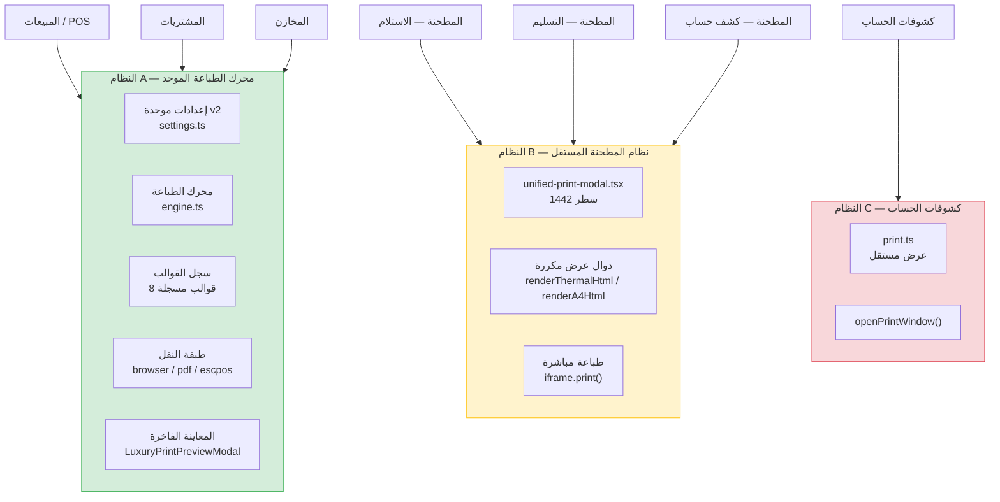
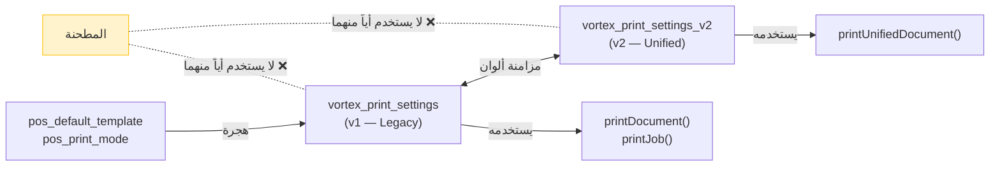
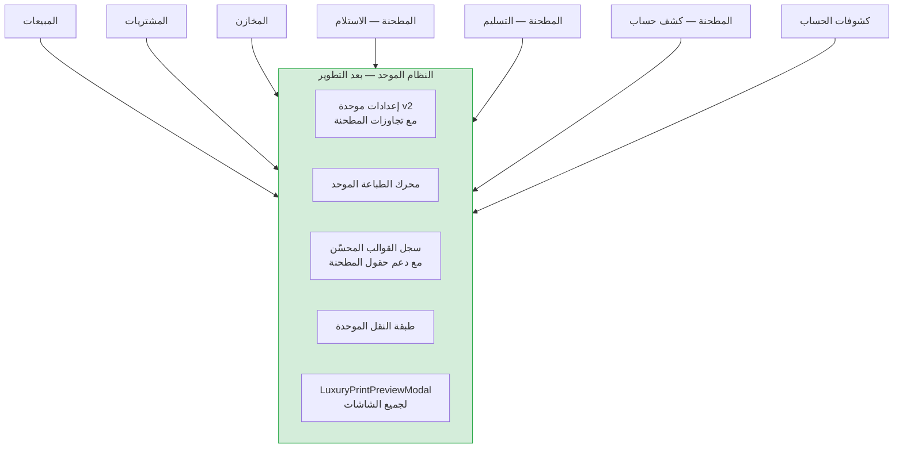

# 🔍 تحليل شامل لنظام طباعة الفواتير — Market Hub

> [!IMPORTANT]
> يوجد في المشروع **ثلاثة أنظمة طباعة منفصلة** تعمل بالتوازي دون تكامل حقيقي بينها، مما يُسبب تكراراً ضخماً في الكود وتناقضات في تجربة المستخدم.

---

## 📊 الهيكل العام لنظام الطباعة



---

## 🏗️ ملفات النظام الرئيسية

### النظام A — محرك الطباعة الموحد
| الملف | الوظيفة |
|---|---|
| [`settings.ts`](file:///h:/em/market-hub/src/lib/printing/settings.ts) | إعدادات `UnifiedPrintSettings` v2 — تجاوزات لكل نوع مستند |
| [`engine.ts`](file:///h:/em/market-hub/src/lib/printing/engine.ts) | `renderUnifiedDocument()` و `printUnifiedDocument()` |
| [`index.ts`](file:///h:/em/market-hub/src/lib/templates/index.ts) | سجل القوالب — 8 قوالب مسجلة |
| [`luxury-print-preview-modal.tsx`](file:///h:/em/market-hub/src/components/luxury-print-preview-modal.tsx) | نافذة المعاينة الفاخرة للمبيعات |
| [`print-settings-card.tsx`](file:///h:/em/market-hub/src/components/print-settings-card.tsx) | واجهة إعدادات الطباعة الموحدة |
| [`invoice-print.ts`](file:///h:/em/market-hub/src/lib/invoice-print.ts) | جسر التوافق الرجعي |

### النظام B — نظام المطحنة المستقل
| الملف | الوظيفة |
|---|---|
| [`unified-print-modal.tsx`](file:///h:/em/market-hub/src/components/milling/unified-print-modal.tsx) | نظام طباعة مستقل كامل — 1442 سطر |
| [`milling-clean.ts`](file:///h:/em/market-hub/src/lib/templates/milling-clean.ts) | قالب الفاتورة الرسمية *(مسجّل لكن لا تستخدمه المطحنة)* |
| [`thermal-milling.ts`](file:///h:/em/market-hub/src/lib/templates/thermal-milling.ts) | قالب الإيصال الحراري *(مسجّل لكن لا تستخدمه المطحنة)* |
| [`milling-master.ts`](file:///h:/em/market-hub/src/lib/templates/milling-master.ts) | قالب خدمات المطحنة المعتمد *(مسجّل لكن لا تستخدمه المطحنة)* |

### النظام C — كشوفات الحساب
| الملف | الوظيفة |
|---|---|
| [`print.ts`](file:///h:/em/market-hub/src/lib/statements/print.ts) | عرض وطباعة مستقل للكشوفات |
| [`print-sections.ts`](file:///h:/em/market-hub/src/lib/statements/print-sections.ts) | أقسام الكشف |
| [`print-styles.ts`](file:///h:/em/market-hub/src/lib/statements/print-styles.ts) | أنماط CSS |

---

## 🔴 المشكلة الجوهرية: لماذا لا تستخدم المطحنة النظام الموحد؟

### التشخيص التفصيلي

شاشات المطحنة ([`_app.milling.intake.tsx`](file:///h:/em/market-hub/src/routes/_app.milling.intake.tsx), [`_app.milling.delivery.tsx`](file:///h:/em/market-hub/src/routes/_app.milling.delivery.tsx)) تستخدم [`UnifiedPrintModal`](file:///h:/em/market-hub/src/components/milling/unified-print-modal.tsx#L266-L1063) بدلاً من [`LuxuryPrintPreviewModal`](file:///h:/em/market-hub/src/components/luxury-print-preview-modal.tsx).

هذا `UnifiedPrintModal` يحتوي على **نظام طباعة مستقل بالكامل**:

#### 1. نموذج بيانات مخصص منفصل
```typescript
// المطحنة تحوّل البيانات إلى UnifiedTicketPrintData — نوع خاص بها فقط
export interface UnifiedTicketPrintData {
  stage?: MillingTicketStage;
  ticketNumber: string;
  grainType?: string;
  bagCount?: number;
  // ... حقول لا تتطابق مع UnifiedDocumentData
}
```

> [!NOTE]
> بينما النظام الموحد يعمل على `UnifiedDocumentData` (النوع المشترك لجميع المستندات)، المطحنة تحوّل البيانات إلى `UnifiedTicketPrintData` ثم تعرضها بطريقتها الخاصة.

#### 2. دوال عرض HTML مكررة بالكامل
- [`renderThermalHtml()`](file:///h:/em/market-hub/src/components/milling/unified-print-modal.tsx#L1103-L1281) — **178 سطر** من HTML الحراري المولّد يدوياً
- [`renderA4Html()`](file:///h:/em/market-hub/src/components/milling/unified-print-modal.tsx#L1283-L1441) — **158 سطر** من HTML الرسمي المولّد يدوياً

#### 3. دالة طباعة مستقلة
```typescript
// المطحنة: إنشاء iframe مباشر — بدون transport layer
export function printUnifiedTicket(data, paper, thermalWidth) {
  const iframe = document.createElement("iframe");
  doc.write(html);
  iframe.contentWindow?.print();
}

// النظام الموحد: يمر عبر adapters → transports → openPrintWindow
async function printUnifiedDocument(request) {
  const html = renderUnifiedDocument(request);
  const result = await printWithFallback(transportId, { html }, context);
}
```

### الأسباب المحتملة لهذا الانفصال

| السبب | التفسير |
|---|---|
| **تطور تاريخي** | المطحنة بُنيت أولاً بنظام طباعة خاص، ثم أُنشئ النظام الموحد لاحقاً دون ترحيل المطحنة |
| **بنية بيانات مختلفة** | مستندات المطحنة (`MillingDocumentDetails`) لها حقول فريدة (حبوب، أكياس، وزن، فاقد) لا يدعمها `UnifiedDocumentData` بشكل مباشر |
| **متطلبات عرض مخصصة** | تذاكر المطحنة تعرض أقساماً خاصة (تفاصيل الحبوب المستلمة، نواتج الطحن، الفاقد التشغيلي) غير موجودة في القوالب العامة |
| **عدم وجود `mill_document` في الإعدادات** | رغم أن `document-types.ts` يُعرّف `mill_document`، لا يوجد تجاوز افتراضي له في `DEFAULT_DOCUMENT_OVERRIDES` |

---

## ⚠️ المشاكل المكتشفة

### المشكلة 1: تكرار ضخم في الكود (Critical)

| الجانب | النظام الموحد | نظام المطحنة |
|---|---|---|
| **عرض ترويسة الشركة** | عبر القوالب المسجلة | مكرر في `renderThermalHtml` و `renderA4Html` |
| **عرض الباركود** | عبر `barcode-qr.ts` | يستخدم نفس الوحدة ✓ لكن ضمن HTML مكرر |
| **تنسيق التاريخ** | عبر `date-time.ts` | مكرر يدوياً بنفس المنطق |
| **التفاصيل المالية** | عبر أقسام القالب | مكررة في 3 أماكن (معاينة حرارية + معاينة A4 + HTML الطباعة) |
| **أنماط CSS** | مُدارة عبر `paper.ts` | مكررة بالكامل في كل دالة عرض |

> **حجم التكرار المقدّر**: ~600 سطر من الكود المكرر يمكن حذفها.

### المشكلة 2: مخزنا إعدادات متوازيان (High)



- [`settings-store.ts`](file:///h:/em/market-hub/src/lib/templates/settings-store.ts) — v1 (مفتاح `vortex_print_settings`)
- [`settings.ts`](file:///h:/em/market-hub/src/lib/printing/settings.ts) — v2 (مفتاح `vortex_print_settings_v2`)
- **المطحنة لا تقرأ أياً من المخزنين** — إعداداتها (حجم الورق، القالب) مُعرّفة كـ `useState` محلي

### المشكلة 3: إعدادات المستخدم لا تنطبق على المطحنة (High)

عندما يذهب المستخدم إلى **إعدادات الطباعة** ويُعدّل:
- ✅ قالب قسم المبيعات → ينطبق على المبيعات
- ✅ مقاس الورق → ينطبق على المبيعات
- ✅ عدد النسخ → ينطبق على المبيعات
- ✅ إظهار/إخفاء الباركود → ينطبق على المبيعات
- ❌ **لا شيء من ذلك ينطبق على شاشات المطحنة**

### المشكلة 4: استيراد غير مستخدم (Low)

في [`_app.milling.intake.tsx`](file:///h:/em/market-hub/src/routes/_app.milling.intake.tsx#L46):
```typescript
import { LuxuryPrintPreviewModal } from "@/components/luxury-print-preview-modal";
// ↑ مستورد لكن لا يُستخدم — dead import
```

### المشكلة 5: لا تجاوزات افتراضية لأنواع مستندات المطحنة (Medium)

في [`settings.ts`](file:///h:/em/market-hub/src/lib/printing/settings.ts#L51-L88):
- يوجد `DEFAULT_DOCUMENT_OVERRIDES` لـ: `customer_invoice`, `purchase_invoice`, `delivery_note`, `inventory_document`, `sales_return`, `payment_receipt`
- **لا يوجد** تجاوز لـ `mill_document` أو `daily_ticket` (رغم تعريفهما في [`document-types.ts`](file:///h:/em/market-hub/src/lib/printing/document-types.ts#L8-L9))

### المشكلة 6: لا دعم لميزات متقدمة في المطحنة (Medium)

| الميزة | المبيعات | المطحنة |
|---|---|---|
| تبديل القوالب (8 قوالب) | ✅ | ❌ فقط حراري/A4 |
| ألوان مخصصة (Accent) | ✅ | ❌ |
| نسخ متعددة (1-20) | ✅ | ❌ دائماً نسخة واحدة |
| تصدير PDF | ✅ | ❌ |
| إظهار/إخفاء حقول | ✅ | ❌ الكل ظاهر دائماً |
| رمز QR | ✅ قابل للتفعيل | ❌ غير موجود |
| ESC/POS | ✅ | ❌ |
| تكبير/تصغير A4 | ✅ | ✅ |

### المشكلة 7: تسمية القوالب مُربكة (Low)

القوالب المسماة بـ "milling" هي في الحقيقة قوالب عامة الاستخدام:
- `thermal-milling` → "قالب الإيصال الحراري الاحترافي" (عام)
- `milling-clean` → "قالب الفاتورة الرسمية المبسطة" (عام)
- ولكن `milling-master` → "قالب خدمات المطحنة والتسليم المعتمد" (متخصص فعلاً)

### المشكلة 8: شاشات مطحنة بدون طباعة إطلاقاً (Medium)

| الشاشة | حالة الطباعة |
|---|---|
| [`_app.milling.intake.tsx`](file:///h:/em/market-hub/src/routes/_app.milling.intake.tsx) | ✅ `UnifiedPrintModal` |
| [`_app.milling.delivery.tsx`](file:///h:/em/market-hub/src/routes/_app.milling.delivery.tsx) | ✅ `UnifiedPrintModal` |
| [`_app.milling.customer-statement.tsx`](file:///h:/em/market-hub/src/routes/_app.milling.customer-statement.tsx) | ✅ `UnifiedPrintModal` |
| [`_app.milling.manufacture.tsx`](file:///h:/em/market-hub/src/routes/_app.milling.manufacture.tsx) | ❌ لا طباعة |
| [`_app.milling.custody-delivery.tsx`](file:///h:/em/market-hub/src/routes/_app.milling.custody-delivery.tsx) | ❌ لا طباعة |
| [`_app.milling.production-orders.tsx`](file:///h:/em/market-hub/src/routes/_app.milling.production-orders.tsx) | ❌ لا طباعة |

---

## 🚀 خطة التطوير والتحسين المقترحة

### المرحلة 1: توحيد نظام الطباعة (أولوية عالية)

#### الخطوة 1.1 — إضافة تجاوزات المطحنة للإعدادات الموحدة

```typescript
// في settings.ts — إضافة تجاوزات لـ mill_document و daily_ticket
const DEFAULT_DOCUMENT_OVERRIDES = {
  // ... الموجود حالياً ...
  mill_document: {
    templateId: "thermal-milling",
    theme: "standard",
    paperId: "thermal-80",
    method: "thermal",
  },
  daily_ticket: {
    templateId: "thermal-milling",
    theme: "standard",
    paperId: "thermal-80",
    method: "thermal",
  },
};
```

#### الخطوة 1.2 — توسيع `UnifiedDocumentData` لدعم حقول المطحنة

إضافة حقول اختيارية في `types.ts` لدعم بيانات المطحنة:
```typescript
interface UnifiedDocumentData {
  // ... الحقول الموجودة ...
  // حقول المطحنة (اختيارية)
  grainLines?: GrainLine[];
  outputItems?: OutputItem[];
  lossKg?: number;
  millingTypeLabel?: string;
  custodyStage?: "intake" | "milled" | "delivery";
}
```

#### الخطوة 1.3 — تعديل قوالب المطحنة المسجلة

تعديل [`thermal-milling.ts`](file:///h:/em/market-hub/src/lib/templates/thermal-milling.ts) و [`milling-clean.ts`](file:///h:/em/market-hub/src/lib/templates/milling-clean.ts) لعرض أقسام المطحنة المخصصة (الحبوب، النواتج، الفاقد) عند وجود `grainLines` أو `custodyStage` في المستند.

#### الخطوة 1.4 — ترحيل المطحنة لاستخدام `LuxuryPrintPreviewModal`

```typescript
// قبل (في _app.milling.intake.tsx):
<UnifiedPrintModal
  open={printModalOpen}
  onClose={() => setPrintModalOpen(false)}
  details={activeDetails}
  doc={printDoc}
  stage="intake"
/>

// بعد:
<LuxuryPrintPreviewModal
  open={printModalOpen}
  onClose={() => setPrintModalOpen(false)}
  doc={printDoc}          // UnifiedDocumentData مع حقول المطحنة
  documentType="mill_document"
  templateId="thermal-milling"
  rtl={true}
/>
```

#### الخطوة 1.5 — حذف الكود المكرر

بعد الترحيل، حذف من [`unified-print-modal.tsx`](file:///h:/em/market-hub/src/components/milling/unified-print-modal.tsx):
- `renderThermalHtml()` (~178 سطر)
- `renderA4Html()` (~158 سطر)
- `printUnifiedTicket()` (~32 سطر)
- معاينة HTML المكررة في JSX (~400 سطر)

> **التوفير المقدّر**: ~770 سطر من الكود المكرر

---

### المرحلة 2: دمج مخزني الإعدادات (أولوية متوسطة)

#### الخطوة 2.1 — ترحيل v1 بالكامل إلى v2

- نقل كل ما يقرأ من `getPrintSettings()` (v1) إلى `getUnifiedPrintSettings()` (v2)
- إبقاء طبقة توافق رجعي رقيقة تقرأ v1 وتكتب في v2

#### الخطوة 2.2 — حذف المفاتيح القديمة

بعد فترة انتقالية:
- حذف `pos_default_template` و `pos_print_mode`
- حذف `vortex_print_settings` (v1)
- إبقاء `vortex_print_settings_v2` فقط

---

### المرحلة 3: إضافة المطحنة لإعدادات الطباعة (أولوية متوسطة)

#### الخطوة 3.1 — إضافة قسم المطحنة في `PrintSettingsCard`

في [`print-settings-card.tsx`](file:///h:/em/market-hub/src/components/print-settings-card.tsx#L68-L123)، إضافة قسمين جديدين:

```typescript
const DEPARTMENTS: DepartmentConfig[] = [
  // ... الأقسام الموجودة ...
  {
    id: "mill_document",
    titleAr: "قسم المطحنة والأمانات",
    descAr: "سندات استلام الحبوب وتسليم نواتج الطحن وفواتير أجور المطحنة",
    icon: Scale,
    defaultMethod: "thermal",
    defaultTemplate: "thermal-milling",
    defaultPaper: "thermal-80",
  },
  {
    id: "daily_ticket",
    titleAr: "التذاكر اليومية",
    descAr: "تذاكر العمليات اليومية والإيصالات السريعة",
    icon: Receipt,
    defaultMethod: "thermal",
    defaultTemplate: "thermal-milling",
    defaultPaper: "thermal-80",
  },
];
```

---

### المرحلة 4: تحسينات إضافية (أولوية منخفضة)

#### 4.1 — إعادة تسمية القوالب

| المعرّف الحالي | المعرّف المقترح | السبب |
|---|---|---|
| `thermal-milling` | يبقى كما هو | تغييره يكسر الإعدادات المحفوظة — يُحتفظ بالاسم العربي "الاحترافي" |
| `milling-clean` | يبقى كما هو | نفس السبب |
| `milling-master` | يبقى كما هو | هذا فعلاً متخصص للمطحنة |

> [!TIP]
> الأفضل عدم تغيير معرّفات القوالب لأنها محفوظة في `localStorage` المستخدمين. يكفي أن الأسماء العربية المعروضة واضحة.

#### 4.2 — إضافة طباعة لشاشات المطحنة الناقصة

- شاشة التصنيع (`manufacture`) — إضافة طباعة أمر تصنيع
- شاشة أوامر الإنتاج (`production-orders`) — إضافة طباعة أمر إنتاج
- شاشة تسليم الأمانات (`custody-delivery`) — إضافة طباعة سند تسليم

#### 4.3 — توحيد طباعة كشوفات الحساب

ترحيل [`statements/print.ts`](file:///h:/em/market-hub/src/lib/statements/print.ts) لاستخدام `printUnifiedDocument()` بقالب مخصص لكشوفات الحساب.

#### 4.4 — حذف الاستيراد غير المستخدم

```diff
// في _app.milling.intake.tsx — سطر 46
- import { LuxuryPrintPreviewModal } from "@/components/luxury-print-preview-modal";
```

---

## 📋 ملخص الأولويات

| الأولوية | المهمة | الأثر | الجهد |
|---|---|---|---|
| 🔴 عالية | ترحيل المطحنة للنظام الموحد | توحيد التجربة + حذف ~770 سطر مكرر | متوسط-عالي |
| 🔴 عالية | إضافة `mill_document` للإعدادات | يمكّن المستخدم من ضبط طباعة المطحنة | منخفض |
| 🟡 متوسطة | دمج مخزني الإعدادات v1/v2 | تبسيط الكود + منع التناقضات | متوسط |
| 🟡 متوسطة | إضافة طباعة للشاشات الناقصة | اكتمال وظيفي | منخفض-متوسط |
| 🟢 منخفضة | توحيد طباعة الكشوفات | اتساق معماري | متوسط |
| 🟢 منخفضة | حذف الاستيرادات غير المستخدمة | نظافة الكود | تافه |

---

## 🎯 النتيجة المتوقعة بعد التنفيذ



> [!CAUTION]
> عند تنفيذ الترحيل، يجب التأكد من أن جميع الحقول المخصصة بالمطحنة (الحبوب، الأكياس، الوزن، الفاقد، النواتج، أرصدة الأمانات) تُعرض بشكل صحيح في القوالب الموحدة قبل حذف النظام القديم. يُنصح بفترة انتقالية يعمل فيها النظامان معاً.
