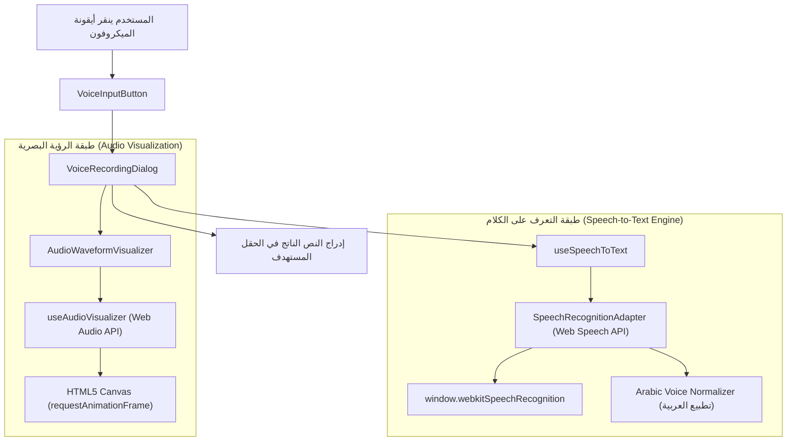

# تقرير الفحص والتحليل الشامل لنظام التسجيل والإدخال الصوتي (Voice-to-Text)

**تاريخ التقرير:** 2026-11-07  
**النظام المستهدف:** Market Hub ERP  
**حالة الفحص:** فحص وقراءة معمارية كاملة واختبار برمجي منعزل (بدون المساس بملفات العمل الجارية أو فروع Git).

---

## 1. الملخص التنفيذي (Executive Summary)

تم تصميم وبناء وحدة الإدخال والتسجيل الصوتي في نظام **Market Hub** لتمكين المستخدمين (خاصة الكاشير، المحاسبين، ومسؤولي المستودعات والمطاحن) من إدخال النصوص والبيانات في الحقول المختلفة (حقول البحث، أشكال العملاء، سندات الصرف والقبض، بنود الفواتير والملاحظات) بالصوت مع معالجة ذكية للهجات والترقيم باللغة العربية.

### الخلاصة السريعة:
1. **كيف تم البناء؟** تم بناؤه بنظام معماري متعدد الطبقات (TypeScript/React):
   - طبقة المعالجة اللغوية (`arabic-voice-normalizer.ts`).
   - طبقة وسيط المتصفح للتعرف على الصوت (`speech-recognition-adapter.ts`).
   - خطاف التحكم وإدارة الحالة (`use-speech-to-text.ts`).
   - محرك تحليل ورسم الموجات الصوتية اللحظي بدون إعادة ريندر (`use-audio-visualizer.ts` و `audio-waveform-visualizer.tsx`).
   - واجهة المستخدم التفاعلية (`voice-recording-dialog.tsx` و `voice-input-button.tsx`).
   - التكامل داخل مكونات الحقول العامة (`Input`, `SearchInput`, `Textarea`).

2. **هل يعمل محلياً بدون إنترنت؟**
   - **الواجهة ورسم الترددات الصوتية والمعالجة اللغوية:** نعم، تعمل محلياً 100% دون إنترنت.
   - **التعرف على الصوت وتحويله إلى نص (STT):** **لا يعمل بدون إنترنت على المتصفحات المكتبية القياسية (Chrome / Edge)**، لأن واجهة المتصفح `webkitSpeechRecognition` تعتمد سحابياً على خوادم Google/Microsoft. عند انقطاع الإنترنت يظهر خطأ `network`.

3. **هل الـ UI / UX سليم؟**
   - التصميم الجمالي، التجاوب، والحركات ممتازة ومتناسقة مع الـ Design System للنظام، ويدعم اختصارات لوحة المفاتيح (`Enter` للحفظ و `Escape` للإلغاء).
   - توجد **6 ملاحظات حرجة وعيوب برمجية وتجربة مستخدم (UX Edge Cases)** تم اكتشافها بالتدقيق (أبرزها: اختفاء النص المسبق بصرياً أثناء التحدث، عيب مقياس الشاشات عالية الدقة في رسم الموجات، وتزاحم الأزرار داخل الحقول، وغياب زر الإيقاف المؤقت في البيئات المليئة بالضوضاء).

---

## 2. التحليل المعماري التفصيلي: كيف تم بناؤه؟

تم توزيع النظام الصوتي على 4 طبقات رئيسية:



### 1) طبقة البيانات والأنواع (`src/lib/voice/voice-types.ts`)
- تُعرّف دورة حياة الجلسة الصوتية:
  - `VoiceRecognitionStatus`: `"idle" | "requesting_permission" | "listening" | "processing" | "error" | "unsupported"`
  - `VoiceErrorCode`: مثل `"not-allowed"` (رفض الإذن)، `"no-speech"` (لم يُسمع صوت)، `"network"` (انقطاع الاتصال)، `"audio-capture"` (لا يوجد ميكروفون).
  - خيارات التعرف `SpeechRecognitionOptions`: ضبط اللغة الافتراضية (`ar-SA`)، البث المباشر للنتائج المؤقتة (`interimResults`)، الاستماع المستمر (`continuous`)، وتفعيل تطبيع العربية.

### 2) محرك معالجة وتطبيع الصوت العربي (`src/lib/voice/arabic-voice-normalizer.ts`)
يقوم بوظيفتين أساسيتين تم التحقق منهما برمجياً:
- **تحويل الأرقام المشرقية إلى غربية قياسية:** (٠-٩ إلى 0-9) لتفادي فشل العمليات الحسابية عند نطق الأرقام.
- **تحويل علامات الترقيم والأوامر المنطوقة:**
  - "فاصلة / فاصله" $\rightarrow$ `، `
  - "نقطة / نقطه" $\rightarrow$ `. `
  - "علامة استفهام" $\rightarrow$ `؟ `
  - "علامة تعجب" $\rightarrow$ `! `
  - "نقطتين فوق بعض" $\rightarrow$ `: `
  - "شرطة / خط" $\rightarrow$ ` - `
  - "سطر جديد / انزل سطر / فقرة جديدة" $\rightarrow$ `\n`

### 3) وسيط التعرف على الصوت بالمتصفح (`src/lib/voice/speech-recognition-adapter.ts`)
- يغلف واجهات المتصفحات المختلفة `window.SpeechRecognition` أو `window.webkitSpeechRecognition`.
- يدير فئة `SpeechRecognitionSession` المسؤولة عن معالجة الأحداث:
  - `onstart`: بدء التقاط الصوت.
  - `onresult`: الفصل بين النتائج المؤقتة (`interimTranscript` المتغيرة لحظياً) والنتائج النهائية المكتملة (`finalTranscript`).
  - `onerror`: ترجمة أخطاء المتصفح إلى رسائل عربية واضحة للمستخدم.
  - `onend`: إعادة التشغيل التلقائي إذا انتهت الجلسة دون إيقاف صريح أثناء تفعيل النمط المستمر (`continuous: true`).

### 4) خطاف التفاعل وإدارة الحالة (`src/hooks/use-speech-to-text.ts`)
- يربط الـ Session ببيئة React.
- يوفر دوال: `startListening()`, `stopListening()`, `reset()`.
- يقوم تلقائياً بتمرير النصوص الملتقطة عبر `normalizeArabicSpeechTranscript` قبل إرسالها إلى الـ State أو ردود النداء (`onTranscriptChange`, `onFinalResult`).
- يوفر تنظيفاً آمناً للذاكرة (`sessionRef.current.abort()`) عند تفكيك المكون (`unmount`).

### 5) محرك الأمواج الصوتية عالي الأداء (`src/hooks/use-audio-visualizer.ts` & `src/components/voice/audio-waveform-visualizer.tsx`)
- تم بناؤه ليعمل بتردد 60 إطاراً في الثانية دون التسبب في أي Re-render لـ React:
  - يطلب تدفق الصوت من `navigator.mediaDevices.getUserMedia`.
  - يحلل الترددات عبر `AudioContext` و `AnalyserNode` بحجم FFT يبلغ 64 (32 حزمة ترددية متوازنة).
  - يرسم على `<canvas>` عبر `requestAnimationFrame` مع تأثير التوهج المضيء (`shadowBlur: 8`, لون Cyan `#06b6d4`).

### 6) واجهات المستخدم والمكونات (`VoiceInputButton` & `VoiceRecordingDialog`)
- **الزر الصغير (`VoiceInputButton`):** مصمم ليجلس بأناقة داخل الحقول بثلاثة أحجام (`sm`, `md`, `lg`)، مع تأثير تكبير سلس عند الـ Hover.
- **نافذة التسجيل (`VoiceRecordingDialog`):**
  - نافذة منبثقة بتأثير الزجاج الشفاف (`backdrop-blur-2xl`).
  - أيقونة ميكروفون تنبض أثناء الاستماع (`animate-ping`).
  - عارض الموجات الصوتية الحي.
  - صندوق استعراض النص المباشر بلون متباين للكلمات المؤقتة (`animate-pulse`).
  - أزرار التحكم: "إعادة التحدث"، "إلغاء"، "إدراج في الحقل".

---

## 3. هل يعمل النظام على النسخة المحلية بدون إنترنت؟ (Offline / Local Capabilities)

هذه إحدى أهم النقاط التقنية للنظام، والإجابة الدقيقة مقسمة حسب المكونات:

| المكون / الوظيفة | هل يعمل بدون إنترنت محلياً؟ | الشرح الفني |
| :--- | :---: | :--- |
| **واجهة المستخدم والنافذة المنبثقة** | **نعم (100%)** | جميع المكونات والأيقونات والتنسيقات مدمجة محلياً ضمن حزمة التطبيق. |
| **رسم ترددات الصوت (Waveform)** | **نعم (100%)** | يستخدم `Web Audio API` و `getUserMedia`، وتتم معالجة الإشارة الصوتية بالكامل داخل معالج الجهاز. |
| **تطبيع النص والأرقام العربية** | **نعم (100%)** | دوال Regex ومعالجة نصوص نقية تعمل على المتصفح مباشرة. |
| **محرك تحويل الصوت إلى نص (STT)** | ❌ **لا يعمل في بيئة سطح المكتب القياسية** | محرك `webkitSpeechRecognition` في Google Chrome و Microsoft Edge **سحابي حصراً**. يرسل الصوت إلى خوادم Google/Microsoft. عند فصل الإنترنت يظهر خطأ `network` فوراً. |

> [!WARNING]
> في بيئات المطاحن أو محلات التجزئة التي تعمل على شبكة داخلية بدون اتصال بالإنترنت (Offline Mode)، لن يتمكن المستخدم من إملاء الكلام صوتياً عبر محرك المتصفح الافتراضي.

### كيف نجعل التعرف الصوتي يعمل 100% بدون إنترنت (حلول مستقبلية مقترحة):
1. **حل WebAssembly مدمج بالمتصفح (In-Browser WASM):**
   - استخدام مكتبة `@xenova/transformers` مع نموذج **Whisper-tiny** أو **Whisper-base** خفيف الوزن مخصص للغة العربية، يتم تخزينه في الـ Cache ويعمل محلياً بالكامل عبر WebGPU أو WASM بدون أي خادم خارجي.
2. **حل الخدمة المحلية المصاحبة (Local Sidecar / Desktop Service):**
   - تشغيل خدمة محلية على خادم الـ ERP أو الجهاز الرئيسي باستخدام `whisper.cpp` أو محرك **Vosk** (الذي يتميز بنموذج عربي سريع جداً واستهلاك ذاكرة أقل من 100 ميجابايت) واستقبال الصوت عبر WebSocket محلي (`ws://localhost:port`).

---

## 4. فحص واختبار تجربة وواجهة المستخدم (UI / UX Audit)

### أولاً: الجوانب الإيجابية ونقاط القوة في الـ UI/UX
1. **التغذية البصرية الراجعة (Instant Visual Feedback):**
   - وجود عارض الموجات (`Waveform`) وأيقونة الميكروفون النابضة يعطي المستخدم شعوراً فورياً بأن صوته مسموع، مما يزيل الحيرة الشائعة في الأنظمة القديمة ("هل بدأ التسجيل أم لا؟").
2. **دعم سرعة العمل والوصول السريع (Accessibility & Keyboard Shortcuts):**
   - إمكانية الإدراج الفوري بمجرد ضغط `Enter`، والإلغاء بضغط `Escape`، وهذا ممتاز لبيئة الـ ERP السريعة حيث يفضل المحاسب عدم رفع يده عن لوحة المفاتيح.
3. **التمييز البصري بين النص المؤكد والنص الجاري:**
   - النص النهائي يظهر بلون داكن ثابت، بينما الكلمة الجاري نطقها تظهر بلون أزرق مشع ونبضات خفيفة، مما يمنح إحساساً بالتفاعل الحي.
4. **دعم كامل لاتجاه الكتابة العربي (RTL First):**
   - النافذة تعتمد `dir="rtl"` وتراعي توزيع الأزرار من اليمين لليسار بصورة طبيعية.

---

### ثانياً: العيوب البرمجية ومشاكل تجربة المستخدم المكتشفة (Issues & UX Flaws)

#### 1. خلل اختفاء النص السابق بصرياً في نافذة التسجيل (Preview Mismatch Glitch)
- **الموقع:** `src/components/voice/voice-recording-dialog.tsx` السطر 196:
  ```tsx
  <span>{finalTranscript || accumulatedText}</span>
  ```
- **المشكلة:** إذا دخل المستخدم على حقل يحتوي بالفعل على نص (مثلاً: "توريد قمح")، بمجرد أن ينطق كلمة إضافية وتصبح `finalTranscript` غير فارغة، يتم إخفاء `accumulatedText` بصرياً من شاشة المعاينة ويظهر النص الجديد فقط! يظن المستخدم أن نصه السابق قد حُذف! ولكن عند النقر على "إدراج في الحقل"، الكود في السطر 95 يدمج النصين معاً:
  ```tsx
  const effectiveResult = fullTranscript
    ? (accumulatedText ? `${accumulatedText} ${fullTranscript}` : fullTranscript).trim()
    : accumulatedText.trim();
  ```
- **الأثر:** تضارب بين ما يراه المستخدم في شاشة المعاينة وما يتم إدراجه فعلياً داخل الحقل.
- **التصحيح المقترح:**
  عرض النص المسبق والنص الجديد معاً بوضوح:
  ```tsx
  <span>{accumulatedText ? `${accumulatedText} ` : ""}{finalTranscript}</span>
  ```

---

#### 2. عيب مقياس الشاشات عالية الدقة في رسم الموجات (High-DPI Retina Waveform Zoom)
- **الموقع:** `src/components/voice/audio-waveform-visualizer.tsx` و `src/hooks/use-audio-visualizer.ts`.
- **المشكلة:**
  في `audio-waveform-visualizer.tsx` يتم ضرب الأبعاد بـ `dpr` مع عمل `ctx.scale(dpr, dpr)`:
  ```tsx
  canvas.width = rect.width * dpr;
  canvas.height = rect.height * dpr;
  ctx.scale(dpr, dpr);
  ```
  بينما داخل حلقة الرسم في `use-audio-visualizer.ts`:
  ```tsx
  const { width, height } = canvas; // هذه قيم الـ buffer المضاعفة!
  const numBars = Math.min(bufferLength, Math.floor(width / totalBarWidth));
  ```
- **الأثر:** على شاشات الحواسيب ذات المقياس (125% أو 150% أو شاشات 2K/4K)، تتضاعف إحداثيات الرسم مرتين مما يؤدي إلى خروج أعمدة الصوت عن إطار الـ Canvas وقصها بصرياً من الأسفل والجانب.
- **التصحيح المقترح:** استخدام `canvas.clientWidth` و `canvas.clientHeight` (Logical CSS pixels) عند حساب مواقع الرسم داخل الـ context الذي تم تطبيق `scale(dpr, dpr)` عليه.

---

#### 3. تصادم الأزرار الداخلية داخل حقول الإدخال (Adornment Overlap)
- **الموقع:** `src/components/ui/input.tsx` السطر 271 و 278:
  ```tsx
  (suffix || showClear || enableVoice) && "pe-10"
  ```
- **المشكلة:** الـ Padding الأيمن للحقل ثابت دائماً بـ `pe-10` (أي 40 بكسل). إذا كان الحقل مفعلاً فيه زر الصوت (`enableVoice`) وزر مسح النص (`showClear`) معاً، فإن عرض الزرين مع المسافة بينهما يتجاوز 65 بكسل، مما يجعل النص المدخل في الحقل ينزلق خلف الأزرار ويكون غير مقروء عند الاقتراب من الطرف.
- **التصحيح المقترح:** حساب المسافة ديناميكياً:
  ```tsx
  const adornmentCount = (enableVoice ? 1 : 0) + (showClear ? 1 : 0) + (suffix ? 1 : 0);
  // تطبيق pe-16 أو pe-20 عند وجود أكثر من عنصر في الطرف
  ```

---

#### 4. غياب زر الإيقاف المؤقت (No Pause/Mute Control) في البيئات الصاخبة
- **المشكلة:**
  في بيئات العمل الميدانية (مثل المطاحن ومحلات البيع المباشر)، بمجرد فتح النافذة يستمر الميكروفون في التقاط أي حديث جانبي أو ضجيج حتى ينقر المستخدم "إدراج". لا يوجد زر إيقاف مؤقت (Pause/Mute) يتيح للمستخدم إيقاف الاستماع مع الاحتفاظ بما تم تسجيله وقراءته بهدوء قبل الضغط على "إدراج".
- **التصحيح المقترح:**
  إضافة زر تبديل (استماع / إيقاف مؤقت) بجانب زر "إعادة التحدث".

---

#### 5. عدم إمكانية تعديل النص يدوياً قبل الإدراج (Read-Only Preview Box)
- **المشكلة:**
  الصندوق المستعرض في النافذة عبارة عن `div` للعرض فقط وليس حقلاً قابلاً للتحرير (`contentEditable` أو `textarea`). إذا أخطأ محرك الصوت في حرف واحد أو اسم شخص (مثال: كتب "محمود" بدلاً من "أحمد")، لا يستطيع المستخدم تصحيح الحرف داخل النافذة مباشرة، بل يضطر إما للإدراج والبحث عن الخطأ في الحقل الأصلي، أو إعادة الإملاء الصوتي بالكامل.
- **التصحيح المقترح:**
  جعل الصندوق قابلاً للتحرير اليدوي السريع بمجرد نقر المستخدم عليه بالفأرة.

---

#### 6. طلب إذن الميكروفون مرتين بالتوازي (Dual Mic Permission Request)
- **المشكلة:**
  عند فتح النافذة المنبثقة، يتم في نفس اللحظة استدعاء:
  1. `SpeechRecognitionSession.start()` (لخدمة تحويل الصوت).
  2. `navigator.mediaDevices.getUserMedia()` (لرسم موجات الصوت في Visualizer).
- **الأثر:**
  في بعض المتصفحات والأنظمة المقيدة، يؤدي طلب تدفقين صوتيين في آن واحد إلى إطلاق تنبيهين للمستخدم، أو حجز الميكروفون من قبل أحد التدفقين وفشل الآخر مع ظهور خطأ `audio-capture`.
- **التصحيح المقترح:**
  التقاط خطأ `getUserMedia` بسلاسة بحيث لا يؤثر فشل الـ Visualizer على استمرار التعرف الصوتي الأساسي، أو مشاركة الـ MediaStream في حال دعم المتصفح لمسار موحد.

---

## 5. نتائج الاختبار والتحقق البرمجي (Verification & Testing)

1. **اختبار محرك تطبيع اللغة العربية (`arabic-voice-normalizer.ts`):**
   - تم تشغيل اختبار منعزل بنجاح:
     - نطق الأرقام: `"الكمية ١٢٥ كيس بسعر ٥٠٠٠ ريال"` $\rightarrow$ تم تحويلها بنجاح إلى `"الكمية 125 كيس بسعر 5000 ريال"`.
     - الأوامر وعلامات الترقيم: `"فاتورة مبيعات جديدة نقطة العميل أحمد علي فاصلة المبلغ ٥٠٠ ريال علامة استفهام"` $\rightarrow$ تم تحويلها بنجاح إلى `"فاتورة مبيعات جديدة. العميل أحمد علي، المبلغ 500 ريال؟"`.
     - الأسطر المتعددة: `"سطر اول سطر جديد سطر ثاني انزل سطر سطر ثالث"` $\rightarrow$ نتجت في 3 أسطر منفصلة ومنسقة.

2. **فحص الاندماج بالحقول:**
   - الحقول المدمجة حالياً تعمل بصورة صحيحة في:
     - حقل البحث العام `SearchInput`.
     - إضافة العملاء `CustomerFormDialog`.
     - سندات الدفع والملاحظات في `PaymentsPage`.
     - حقول الوزن والملاحظات في `MillingUI`.
     - حقول المنتجات في `ProductFormDialog`.

---

## 6. جدول التوصيات ذات الأولوية (Actionable Roadmap)

| الأولوية | المهمة الموصى بها | الفائدة المباشرة |
| :---: | :--- | :--- |
| **P0 (عاجل)** | تصحيح دمج ومعاينة النص المسبق مع النص الجديد في `voice-recording-dialog.tsx`. | منع إرباك المستخدم وظهور نصه القديم كما لو أنه حُذف أثناء التحدث. |
| **P0 (عاجل)** | تصحيح حسابات `pe-*` (Padding-End) في `src/components/ui/input.tsx` لمنع تداخل أزرار المسح والميكروفون مع النص المدخل. | سلامة العرض وسهولة القراءة في الحقول المضغوطة. |
| **P1 (هام)** | تصحيح معادلة الـ Canvas في `use-audio-visualizer.ts` لتراعي الـ Logical Pixels على شاشات High-DPI. | ضمان ظهور موجات الصوت بكامل أناقتها دون قص أو تشوه على شاشات الحواسيب الحديثة. |
| **P1 (هام)** | إضافة زر إيقاف مؤقت (Pause/Resume) وإتاحة تعديل النص قبل الإدراج في الـ Dialog. | رفع كفاءة الاستخدام في بيئات المحلات والمطاحن الصاخبة. |
| **P2 (استراتيجي)** | توفير محرك تعرّف محلي بديل (مثل `Vosk` أو `Whisper-wasm`) عند اكتشاف غياب الإنترنت. | تشغيل ميزة الإملاء الصوتي في النسخ المحلية (Offline POS/ERP) بدون الحاجة لأي اتصال بالإنترنت. |

---
**انتهى التقرير.**  
*تم إيداع نسخة التقرير داخل التوثيق كمرجع دائم دون أي تعديل على ملفات العمل النشطة أو تعارض مع تعديلاتك الحالية.*
