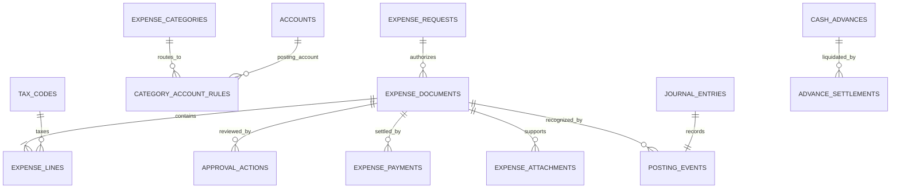
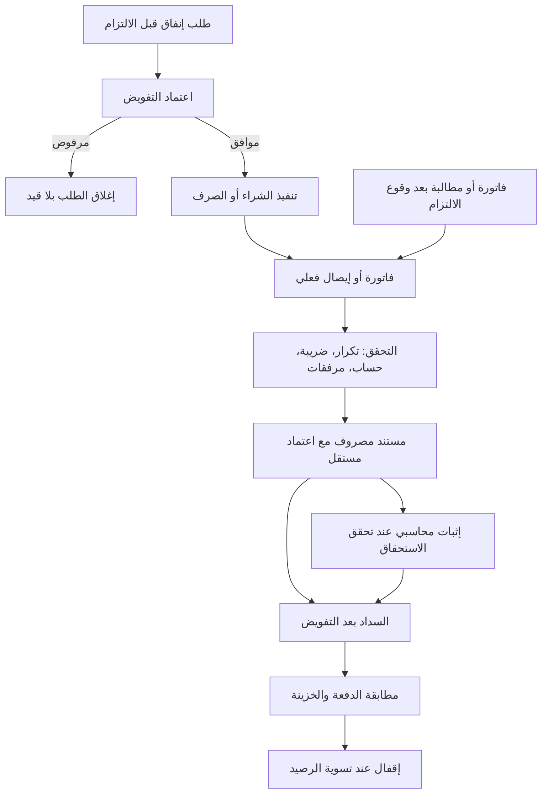

# خطة إعادة تصميم دورة المصروفات

راجعت التنفيذ الحالي من ملفات الشيفرة والترحيلات فقط، دون الاعتماد على التقارير أو التصاميم السابقة. هذه مرحلة تحليل وتصميم؛ **لم أعدّل الملفات أو قاعدة البيانات، ولم أشغّل اختبارات**.

## ما يكشفه التنفيذ الحالي

هناك أساس برمجي قائم: مستندات وبنود مصروفات، دفعات، سجل إجراءات واعتمادات، مرفقات، ودوال لإنشاء المصروف واعتماده وترحيله ودفعه وعكسه. لكن توجد فجوات تصميمية ينبغي حسمها قبل إعادة بناء الواجهات:

- **التوجيه المحاسبي لا يفشل عند غياب الربط:** التصنيف يمكن أن يكون بلا حساب، وإجراء الترحيل يستخدم الحساب `5911` كبديل، ويرحّل الضريبة إلى `1316`، والذمم إلى `2111` أو `2221` بحسب نوع المستفيد. هذه أرقام ثابتة داخل منطق الترحيل، وقد لا تطابق دليل حسابات المنشأة أو إعدادها الضريبي. ([تعريف التصنيفات](</C:/Users/mousa/Desktop/project/market-hup/supabase/migrations/09_expenses.sql:11>)، [إجراء الترحيل](</C:/Users/mousa/Desktop/project/market-hup/supabase/migrations/78_expense_posting_payment_integrity.sql:104>))
- **حالة واحدة تمثل مراحل مختلفة:** `expense_status` يجمع حالات المسودة والاعتماد والترحيل والسداد والإقفال. هذا يصعّب معرفة هل المستند معتمد إداريًا، مثبت محاسبيًا، أو مسدد. ودالة القرار الظاهرة تنقل المستند المرسل للاعتماد مباشرة إلى معتمد أو مرفوض، ولا يظهر معها جدول سياسة وخطوات اعتماد متعددة. ([الحالات](</C:/Users/mousa/Desktop/project/market-hup/supabase/migrations/01_core_enums_and_helpers.sql:43>)، [دالة الاعتماد](</C:/Users/mousa/Desktop/project/market-hup/supabase/migrations/09_expenses.sql:468>))
- **العهد تحتاج مسارًا محاسبيًا مستقلًا:** النوع `ADVANCE` موجود، لكن دالة الترحيل الحالية تسلك مسار بنود المصروف والذمم العام؛ لا يظهر فيها تسجيل إصدار العهدة كأصل/سلفة ثم تسويتها بالإيصالات. لذلك لا يكفي وجود النوع في القائمة لاعتبار دورة العهد مكتملة.
- **طبقتا بيانات ما زالتا موجودتين:** جدول `expenses` القديم موجود بجانب `expense_entries` و`expense_lines`. كما أن كشف النقدية يقرأ سجل المصروفات القديم والجديد، مع استبعاد السجلات التي رُحّلت عبر الجسر لتفادي العد المكرر. يجب الحفاظ على هذا التمييز خلال أي نقل أو تحويل للبيانات. ([جدول المصروفات القديم](</C:/Users/mousa/Desktop/project/market-hup/supabase/migrations/09_expenses.sql:167>)، [قراءة كشف النقدية](</C:/Users/mousa/Desktop/project/market-hup/src/lib/statements/adapters/cash.ts:266>)، [جسر الترحيل](</C:/Users/mousa/Desktop/project/market-hup/supabase/migrations/09_expenses.sql:1253>))
- **الدفع يملك حماية مفيدة ينبغي الحفاظ عليها:** يوجد مفتاح فريد لمنع تكرار الدفعة عند إعادة الطلب. المطلوب تعميم الحماية على إنشاء المستند والترحيل وقرارات الاعتماد، لا إزالة الحماية القائمة.

## القواعد المحاسبية التي سيبنى عليها التصميم

التصنيف الإداري والحساب المحاسبي شيئان مختلفان: التصنيف يشرح للمستخدم نوع الإنفاق، أما حساب الأستاذ فهو وجهة القيد. يُحلّ الحساب تلقائيًا إلى **حساب مصروف تحليلي قابل للترحيل** من دليل الحسابات؛ الحساب الأب للتجميع فقط، ومركز التكلفة والمشروع أبعاد تحليلية منفصلة لا بدائل عن حساب الأستاذ.

ويجب فصل **الطلب المسبق** عن **المصروف الذي وقع فعلًا**. اعتماد طلب شراء أو صرف قبل حدوث الالتزام لا ينشئ قيدًا. أما الفاتورة أو الالتزام الذي تحقق، فيُثبت محاسبيًا وفق أساس الاستحقاق، ولا ينتظر سداد النقد أو إغلاق الطلب. هذا يتفق مع أساس الاستحقاق في IAS 1. [IAS 1 – IFRS Foundation](https://www.ifrs.org/content/dam/ifrs/publications/pdf-standards/english/2022/issued/part-a/ias-1-presentation-of-financial-statements.pdf?bypass=on)

القيود المتوقعة:

- **فاتورة مورد آجلة:** مدين حساب المصروف أو الأصل المناسب، ومدين ضريبة المدخلات القابلة للاسترداد إن انطبقت، ودائن ذمم المورد.
- **السداد:** مدين ذمم المورد، ودائن الصندوق أو البنك.
- **مطالبة موظف:** عند ثبوت المصروف، مدين المصروف والضريبة المسموح بها، ودائن مستحقات الموظف؛ ثم تُسجل الدفعة مستقلّة.
- **إصدار عهدة أو تمويل صندوق نثريات:** مدين حساب عهد/نقدية بعهدة، ودائن الصندوق أو البنك. عند التسوية فقط يُثبت المصروف، وتُسجل المبالغ المرتجعة أو المستحقة للموظف.
- **ضريبة غير قابلة للاسترداد:** لا تُرحّل إلى حساب ضريبة مدخلات قابلة للاسترداد؛ تُحمّل على المصروف أو الأصل بحسب طبيعة النفقة. معدل الضريبة وقابليتها للاسترداد يعتمدان على الدولة والتسجيل الضريبي، فلا يصح تثبيت نسبة عامة في الكود.
- **تكلفة إنتاج مؤهلة:** عند انطباقها على المخزون تُحوّل إلى الإنتاج/المخزون وفق سياسة توزيع منتظمة؛ لا تُرسمل المصروفات الإدارية أو البيعية لمجرد ربطها بمركز تكلفة. IAS 2 يحدد تكاليف التحويل وما لا يدخل في المخزون. [IAS 2 – IFRS Foundation](https://www.ifrs.org/content/dam/ifrs/publications/pdf-standards/english/2022/issued/part-a/ias-2-inventories.pdf?bypass=on)

## الهيكل المقترح لقاعدة البيانات

هذا نموذج المجال المستهدف، وليس اقتراح حذف جداول قائمة مباشرة. حسابات الأستاذ والقيود الحالية تبقى المصدر الرسمي للدفاتر، ويكون النقل إليها عبر عمليات قاعدة بيانات ذرّية.



- **`expense_requests`**: طلب إنفاق مسبق، مبلغه التقديري، الغرض، مركز التكلفة، مقدم الطلب، وحالة التفويض. لا ينشئ قيد مصروف ولا حركة نقدية بحد ذاته.
- **`expense_documents`**: المستند الفعلي، ونوعه (فاتورة مورد، مطالبة موظف، مصروف مباشر، تسوية عهدة)، والمورد/الموظف، رقم فاتورة المورد، تاريخ الاستحقاق، العملة وسعر الصرف، ومصدره. ترتبط الفاتورة بالطلب الذي أجازها عند وجوده.
- **`expense_lines`**: وصف البند والكمية والمبلغ قبل الضريبة، ورمز الضريبة ولقطة النسبة والمبلغ، والتصنيف ومركز التكلفة والمشروع. عند الترحيل تحفظ هوية حساب الأستاذ المحلول على البند/قيد الترحيل حتى لا يغيّر تعديل التصنيف قيودًا تاريخية.
- **`expense_categories`**: اسم إداري واضح ورمز وحالة، بلا كتابة اسم الحساب أو رقمه يدويًا في النموذج.
- **`category_account_rules`**: ربط محدد المدة بين التصنيف وحساب مصروف تحليلي نشط وقابل للترحيل؛ يدعم الشركة/الفرع أو نوع العملية عند الحاجة. إذا كان الربط مفقودًا أو ملتبسًا أو يشير إلى حساب أب، يمنع الترحيل برسالة توضح التصحيح المطلوب؛ لا يوجد حساب بديل صامت.
- **`tax_codes`**: المعاملة الضريبية، النسبة، حساب الضريبة، الجزء القابل للاسترداد، وتاريخ صلاحية القاعدة بحسب الولاية الضريبية.
- **`approval_policies` و`approval_policy_steps` و`approval_actions`**: السياسات والخطوات والموافقات الفعلية. سجل الإجراءات غير قابل للتعديل، مع المعتمد والتاريخ والقرار والتعليل.
- **`expense_payments`**: دفعة واحدة أو أكثر لكل مستند، مع حساب الخزينة الفعلي ورقم المرجع ومفتاح idempotency فريد.
- **`cash_advances` و`advance_settlements`**: إصدار العهد وتسويتها والإيصالات والمبالغ المعادة أو المستحقة.
- **`posting_events`**: يربط كل حدث محاسبي (إثبات استحقاق، دفعة، إصدار عهدة، تسوية، عكس) بقيد اليومية، مع مفتاح فريد يمنع تكرار الحدث.
- **`expense_attachments`**: بيانات الملف والتجزئة ومصدر الرفع، مع التخزين الخاص وسياسات وصول.

قواعد منع التضارب: رقم فاتورة المورد فريد للمورد والكيان القانوني عندما يتوفر، ومفتاح فريد لكل طلب إنشاء/ترحيل/دفعة، وعدم تعديل أو حذف مستند مرحّل بل إنشاء قيد عكسي مرتبط به. الفهارس الفريدة الجزئية مناسبة لفرض التفرد على السجلات التي لديها رقم فاتورة فقط. [PostgreSQL – Partial Indexes](https://www.postgresql.org/docs/17/indexes-partial.html)

## تدفق الواجهات المقترح

### 1. لوحة المصروفات — `/expenses/dashboard`

```text
┌ المصروفات ─ الفترة ─ الفرع ─ مركز التكلفة ─ [طلب/تسجيل جديد] ┐
│ إجمالي المعترف به │ مستحقات غير مسددة │ متأخر │ بانتظار اعتمادي │
├─────────────────────────────┬──────────────────────────────┤
│ اتجاه المصروفات حسب الشهر   │ إجراءات مطلوبة ومبالغها      │
├─────────────────────────────┴──────────────────────────────┤
│ دفعات مستحقة قريبًا │ آخر القيود │ تنبيهات فواتير مكررة/ناقصة │
└─────────────────────────────────────────────────────────────┘
```

### 2. نموذج مستند جديد — `/expenses/new`

```text
نوع العملية: [طلب مسبق] [فاتورة مورد] [مطالبة موظف] [مصروف مباشر] [تسوية عهدة]
المستفيد والتواريخ والمرجع الخارجي
البنود: الوصف | التصنيف | الحساب المحلول للعرض | صافي | ضريبة | إجمالي
المرفقات والفاتورة | مركز التكلفة/المشروع | طريقة الدفع عند تسجيل دفعة فعلية
مراجعة القيد المتوقع: مدين ... / دائن ...
[حفظ مسودة] [إرسال للاعتماد]
```

تتغير الحقول بحسب النوع: لا تظهر بيانات المورد لمطالبة الموظف، ولا تظهر حقول سداد لطلب لم يُنفذ. لا يسمح النموذج بإدخال حساب الأستاذ يدويًا؛ تعرض معاينة الحساب الناتج من القاعدة المحاسبية.

### 3. صندوق الاعتمادات — `/expenses/approvals`

```text
┌ بانتظار مراجعتي: العدد، المبلغ ─ فلاتر حسب الفرع والمبلغ والعمر ┐
│ قائمة الطلبات │ معاينة المستند، المرفقات، التصنيف، الأثر المالي  │
│               │ [موافقة] [رفض مع سبب] [إرجاع لاستكمال البيانات] │
└─────────────────────────────────────────────────────────────────┘
```

تحدد السياسة المعتمد التالي بحسب المبلغ والكيان ومركز التكلفة ونوع المستند، وتمنع اعتماد المنشئ لنفسه إلا باستثناء مضبوط ومسجل. يمكن ضبط عدة مستويات وشروط اعتماد في أنظمة ERP؛ وهذا موثق أيضًا في تدفقات ERPNext الرسمية. [ERPNext Workflows](https://docs.frappe.io/erpnext/workflows)

### 4. الأرشيف والتقارير — `/expenses/archive`

```text
بحث متقدم: فترة | مورد/موظف | التصنيف/الحساب | المركز | الاعتماد | السداد
جدول: الرقم | التاريخ | المستفيد | الإجمالي | الاعتماد | الترحيل | المتبقي
تفاصيل المستند: سجل زمني + المرفقات + القيود + الدفعات + العكوس
[تصدير حسب الصلاحية]
```

## تدفق العمل



التمييز الأساسي هنا أن اعتماد الطلب يجيز الإنفاق، واعتماد الفاتورة يضبط الإجراء، والترحيل يثبت الحدث المحاسبي، والدفع يثبت حركة النقد. هذه أحداث مرتبطة لكنها ليست حالة واحدة؛ تسجيل الدفع نفسه ينبغي أن يكون وثيقة مالية منفصلة عن قيد إعادة التصنيف أو التسوية. [ERPNext Payment Entry](https://docs.frappe.io/erpnext/payment-entry)

## خطة التنفيذ والقبول

1. **جرد تقني ومحاسبي للقراءة فقط:** تتبع كل مسارات إنشاء المصروف وقراءته وتقاريره وربطه بالدفاتر، بما فيها جدول `expenses` القديم وجسر نقله، وفحص صلاحيات كل إجراء.
2. **اعتماد مصفوفة التوجيه:** حساب المصروف حسب نوع البند، حسابات الموردين والموظفين والعهد، قواعد الضرائب، العملة، والاعتماد حسب المبلغ. تحديد الدولة والتسجيل الضريبي وحدود الصلاحيات مطلوب قبل تثبيت هذه القيم.
3. **تثبيت قواعد البيانات والإجراءات:** الفصل بين حالات الاعتماد والإثبات والسداد؛ منع الحسابات غير الصالحة؛ عمليات ترحيل وسداد ذرّية مع قفل المستند ومفاتيح idempotency. حماية الجداول المكشوفة بـ RLS، وعدم منح المتصفح كتابة مباشرة لدفتر الأستاذ. توصي وثائق Supabase بتطبيق RLS على الجداول المكشوفة وضبط صلاحيات الدوال بعناية. [Supabase RLS](https://supabase.com/docs/guides/database/postgres/row-level-security)
4. **إنشاء الصفحات الأربع** وربطها بنفس بيانات المستندات ودوال الخادم، مع سجل زمني موحد وأذونات بحسب الدور.
5. **نقل البيانات دون حذف عشوائي:** تقرير تكرارات للفاتورة والمصروف القديم، حفظ معرّفات المصدر، نقل دفعات موثوقة فقط، ثم مقارنة المجاميع بين سجل النقدية والدفتر العام قبل تعطيل أي كتابة قديمة.
6. **معايير القبول:** فاتورة مورد غير مسددة ثم مدفوعة جزئيًا وكليًا؛ مصروف نقدي فوري؛ مطالبة موظف؛ إصدار وتسوية عهدة مع مبلغ مرتجع؛ ضريبة قابلة وغير قابلة للاسترداد؛ تصنيف بلا حساب؛ حساب أب غير قابل للترحيل؛ فاتورة مورد مكررة؛ موافقة متزامنة؛ تكرار إرسال الطلب؛ عكس دفعة وقيد. يجب أن تتوازن القيود، وألا تتكرر، وأن يمكن تتبع كل مبلغ من المستند إلى حساب الأستاذ.

هذه الخطة تبني تدفقًا جديدًا من واقع قواعد الاستحقاق والدفاتر الحالية، وتحافظ على الجداول والقيود القائمة إلى أن تثبت مطابقة البيانات ويُعتمد التحويل.